# Zella Voice: complete system architecture

**Status:** the architecture as built (repo `main` plus production read on 9 Nov 2026) and the changes recommended (§17).
**Audience:** engineers, reviewers, and the owners making go-live decisions.
**Diagrams:** written in Mermaid. They render on GitHub and in most Markdown viewers.

Where this file and a dated report in `docs/` disagree, check production. Reports are snapshots; this file describes the design.

## Contents

1. [What the business is](#1-what-the-business-is)
2. [System context](#2-system-context)
3. [Architectural style: the database is the application](#3-architectural-style-the-database-is-the-application)
4. [Multi-tenancy, identity and access](#4-multi-tenancy-identity-and-access)
5. [Data architecture](#5-data-architecture)
6. [Backend components](#6-backend-components)
7. [Voice architecture](#7-voice-architecture)
8. [Messaging architecture](#8-messaging-architecture)
9. [Automation architecture: the complete catalogue](#9-automation-architecture-the-complete-catalogue)
10. [Knowledge and AI quality](#10-knowledge-and-ai-quality)
11. [Integrations](#11-integrations)
12. [Frontend and UI/UX architecture](#12-frontend-and-uiux-architecture)
13. [Security architecture](#13-security-architecture)
14. [Deployment, environments and operations](#14-deployment-environments-and-operations)
15. [Testing strategy](#15-testing-strategy)
16. [Production state (9 Nov 2026)](#16-production-state-9-nov-2026)
17. [Architect's recommendations](#17-architects-recommendations)
18. [Glossary and repo map](#18-glossary-and-repo-map)

---

## 1. What the business is

Zella Voice is a multi-tenant SaaS **AI receptionist for small businesses** in 28 industries (salons, dental, restaurants,
HVAC, legal, childcare, hotels, e-commerce …). Each business gets:

1. **An AI phone receptionist** that answers 24/7. It answers from the business's own knowledge, books, moves and
   cancels appointments, takes messages, screens spam, transfers urgent calls and looks up orders.
2. **A business CRM** (`app.zellavoice.com`): Today, calls, callbacks, leads, inbox, calendar, industry records,
   money, reports, team, settings and the receptionist editor.
3. **Automations** that act on the business's behalf within strict rules: reminders, confirmations, follow-ups,
   waitlist offers, review requests, missed-call texts, digests and staff alerts.

Zella's team runs the platform from the **admin console** (`admin.zellavoice.com`).

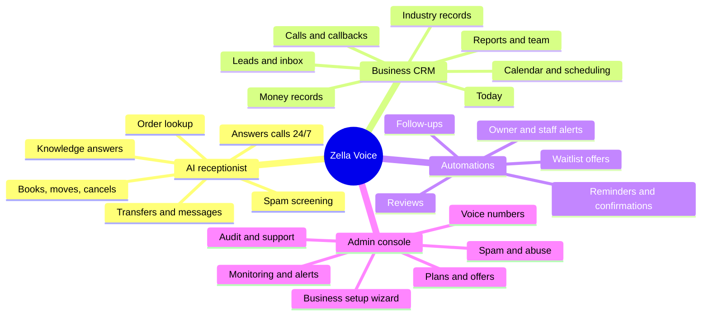

### Product principles that shape the architecture

| Principle | Architectural consequence |
|---|---|
| The AI never makes things up | Only `ready` knowledge is used. Facts come from tools that read the database, and the model never computes availability. |
| Nothing goes out without consent | Consent, opt-out, calling hours and industry policy are checked **in the database** when a message is prepared. |
| Safe by default | Each outbound channel has a live switch, off by default. Off means a recorded **dry run**. |
| One codebase, every industry | Industries are **data** (configurations, presets, capabilities, policies), not code. |
| Say what happened | Failures stay visible (dead letters, "Sending failed", platform alerts) and are never swallowed. |

---

## 2. System context

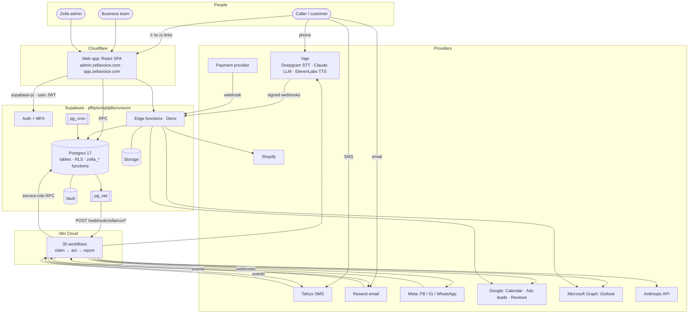

---

## 3. Architectural style: the database is the application

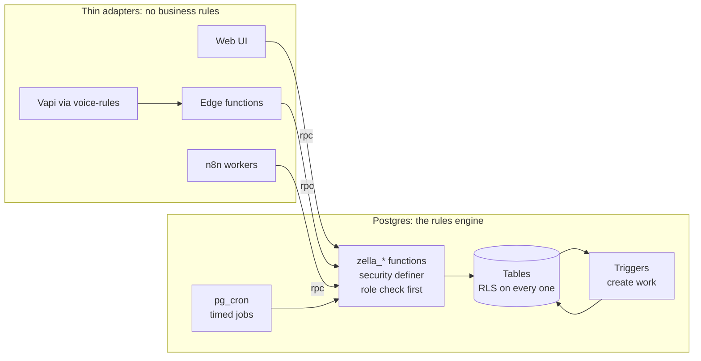

- **All business logic is PL/pgSQL** (`public.zella_*`, about 660 functions), called over PostgREST RPC.
- **n8n holds no rules.** It *claims* work, calls a provider, and *reports* the outcome.
- **Edge functions are adapters** for callers that cannot use PostgREST directly (Vapi, OAuth, webhooks, service-key operations).

**Why this design:** one enforcement point for every entry (browser, AI, SMS reply, webhook, cron). Transactions
give exactly-once behaviour. There is no app-server fleet to run. **The cost:** SQL-heavy code and deploys done as
migrations. These are handled by the test suites and migration discipline in §14 and §15.

---

## 4. Multi-tenancy, identity and access

### 4.1 Tenancy

Shared database and schema, isolated by row. Every tenant-owned row has `business_id`, and the trigger
`zz_tenant_links` on about 30 tables refuses a row whose linked rows belong to another business.

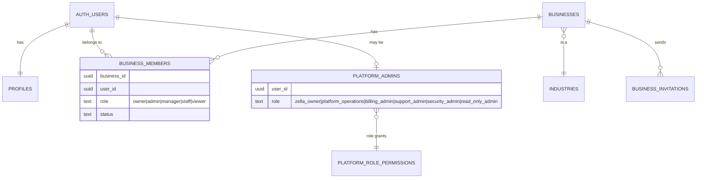

### 4.2 Two role planes

| Plane | Roles (high → low) | Checked by |
|---|---|---|
| Business | `owner`, `admin`, `manager`, `staff`, `viewer` | `zella_has_role(business, roles[])`, `zella_is_member`, RLS |
| Platform | `zella_owner`, then `platform_operations`, `billing_admin`, `support_admin`, `security_admin`, `read_only_admin` | `zella_admin_role()`, `zella_admin_can(permission)` |

Platform permissions: `businesses.view|manage`, `billing.view|manage`, `plans.manage`, `security.view|manage`,
`audit.view`, `support.manage`, `telephony.manage`, `ai.configure`, `comms.manage`, `integrations.manage`, `analytics.view`.

**Access to a CRM feature requires all three checks** (`docs/NAVIGATION.md`):

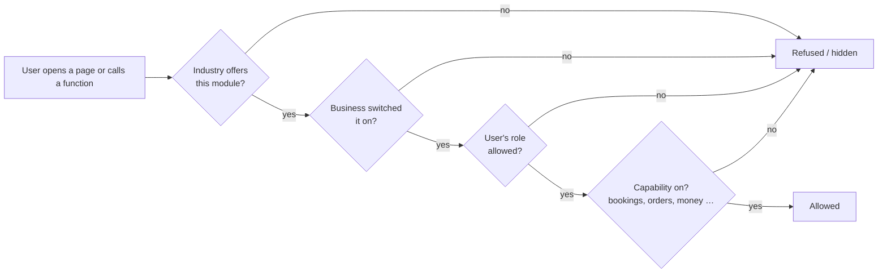

### 4.3 Request contexts

| Context | `auth.uid()` | JWT role | `zella_has_role` |
|---|---|---|---|
| Signed-in browser | set | `authenticated` | checks membership and role |
| Anonymous browser | null | `anon` | **always false** |
| Server (n8n, edge, cron, SQL editor) | null | `service_role` / none | trusted |

### 4.4 Sign-in and invitation flow

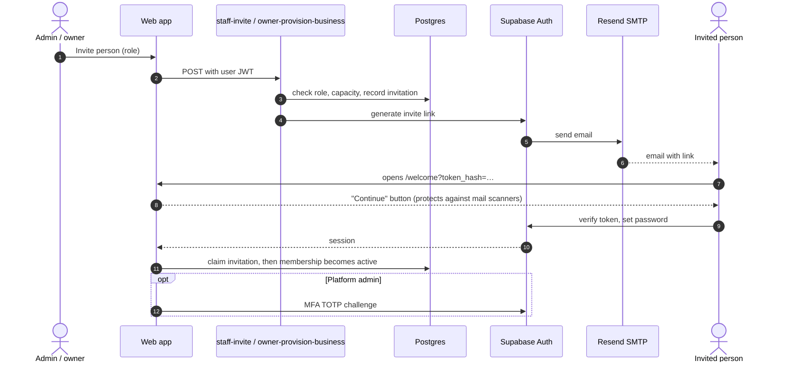

---

## 5. Data architecture

### 5.1 Core entity model

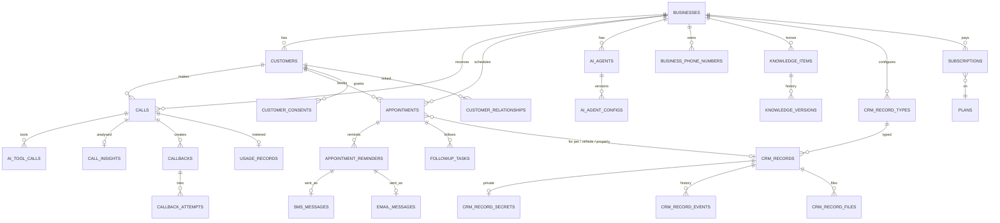

### 5.2 Table groups (about 175 tables)

| Domain | Key tables |
|---|---|
| Tenancy and access | `businesses`, `business_members`, `business_invitations`, `profiles`, `platform_admins`, `platform_role_permissions`, `staff_members` |
| Industry configuration | `industries`, `industry_configurations`, `industry_modules`, `business_modules`, `business_capabilities`, `industry_crm_presets`, `industry_automation_presets`, `industry_automation_defaults`, `industry_message_policy`, `record_workflow_presets` |
| Customers and leads | `customers`, `customer_relationships`, `customer_consents`, `contact_consents`, `lead_rules`, `lead_questions`, `lead_submissions`, `website_forms`, `google_lead_keys`, `google_lead_events`, `meta_*`, `duplicate_reviews` |
| Calls and voice | `calls` (read through `calls_view`), `call_messages`, `call_insights`, `ai_agents`, `ai_agent_configs`, `agent_config_versions`, `business_voice`, `business_phone_numbers`, `ai_tool_calls`, `vapi_request_receipts`, `ai_eval_cases`, `ai_response_samples`, `ai_answer_reports` |
| Scheduling | `appointments`, `business_hours`, `business_closures`, `blocked_times`, `resources`, `resource_needs`, `waitlist_entries`, `appointment_reminders`, `appointment_reschedule_links`, `waitlist_offer_links`, `calendar_connections`, `calendar_sync_queue`, `recurring_plans`, `recurring_visits`, `restaurant_tables`, `table_combinations`, `table_blocks`, `table_states`, `table_events` |
| Industry records | `crm_record_types`, `crm_records`, `crm_record_events`, `crm_record_secrets`, `crm_record_files`, `record_approvals`, `record_milestones`, `record_inspections`, `record_exceptions`, `record_credits`, `job_dispatch` |
| Work queues | `callbacks`, `callback_attempts`, `followup_tasks`, `crm_tasks`, `staff_notifications`, `message_drafts`, `staff_handovers`, `customer_requests`, `time_off_requests`, `on_call_*` |
| Messaging | `sms_messages`, `email_messages`, `email_events`, `message_templates`, `conversations`, `conversation_messages`, `conversation_notes`, `email_unsubscribe_tokens`, `assistant_deliveries` |
| Knowledge | `knowledge_items`, `knowledge_versions`, `knowledge_gaps`, `website_sources`, `website_pages` |
| Automation engine | `automations`, `automation_runs`, `automation_events`, `workflow_executions`, `automation_dead_letters`, `industry_automation_runs`, `automation_channel_reviews`, `n8n_dispatch_state` |
| Money and billing | `plans`, `subscriptions`, `payments`, `billing_events`, `usage_records`, `usage_thresholds`, `usage_threshold_events`, `voice_pricing`, `customer_charges`, `customer_charge_payments`, `offers`, `offer_*` |
| Trust and safety | `spam_settings`, `spam_list_entries`, `spam_incidents`, `spam_incident_events`, `rate_limits`, `sensitive_approvals`, `business_verification_documents`, `data_rights_requests`, `legal_documents`, `legal_acceptances` |
| Reviews and growth | `review_sources`, `reviews`, `cross_sell_rules`, `zella_milestones`, `social_flows` |
| Platform operations | `platform_settings`, `platform_alerts`, `platform_incidents`, `provider_health`, `audit_logs`, `support_tickets`, `config_migration_snapshots`, `business_report_schedules`, `business_report_runs` |

### 5.3 Configuration layering

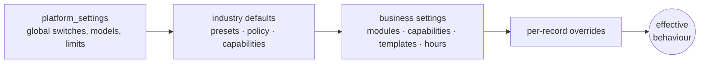

### 5.4 Data-integrity patterns

| Pattern | Where |
|---|---|
| Idempotency keys | `ai_tool_calls` (Vapi `toolCallId`), `vapi_request_receipts`, `usage_records.idempotency_key`, unique `calls.external_call_id`, one message per reminder, provider event ids |
| Claim / complete queues | `FOR UPDATE SKIP LOCKED`, an attempt counter, and a visibility timeout. Workers never retry on their own. |
| Per-business booking lock | `zella_booking_lock` (advisory transaction lock) before every availability check |
| Append-only ledgers | `usage_records` (usage / adjustment), `audit_logs`, `crm_record_events`, `offer_events` |
| Version-guarded migrations | A patch checks that the live function body matches the expected version before replacing it |

### 5.5 Sensitive data

| Data | Protection |
|---|---|
| Transcripts and recordings | Only through `calls_view`: owners, admins and managers; staff only if the owner opts in; never in health, legal, financial, insurance, vet or childcare. `zella_lock_call_columns()` revokes the raw columns. |
| Access codes, member IDs, children's details | `crm_record_secrets`: managers and assigned staff only |
| Provider tokens | Vault and `integration_secrets`. n8n provider keys live on n8n credentials. |
| Card data | Not stored, by design |
| Files | Private `record-files` bucket. Each upload stays `checking` until it has been inspected. |

---

## 6. Backend components

### 6.1 Function conventions

- Named `public.zella_<verb>_<noun>`, always `security definer set search_path = public`.
- The first statement is the authorization check (`zella_has_role`, `zella_admin_can`, `zella_require_capability`,
  or a server-only grant).
- Errors are stable codes (`not_allowed`, `capability_off`, `slot_taken` …) that the UI maps to friendly copy.
- Important writes add a row to `audit_logs`.

### 6.2 Edge functions

| Function | Caller | Purpose | Auth gate |
|---|---|---|---|
| `voice-rules` | Vapi | assistant-request, 15 tools, transfer, status, end-of-call | HMAC or Bearer verified in the DB (`zella_vapi_authenticate`: raw bytes, 5-minute timestamp, replay table) |
| `owner-provision-business` | Admin console | business creation, setup wizard, owner invite, settings sync | platform role |
| `staff-invite` | CRM team | invite, re-invite, revoke | business role |
| `reschedule-appointment` | `/r/…`, `/w/…` | reschedule, cancel, accept or decline a waitlist offer | 64-hex link token |
| `website-lead` | business websites | lead intake | form key and rate limit |
| `google-lead` | Google Ads | lead intake | Google key |
| `billing-webhook` | payment provider | subscription and payment events | signature |
| `calendar-connect` | OAuth redirect | connect Google or Outlook | signed 10-minute state |
| `store-connect` | CRM | connect Shopify | business role, `*.myshopify.com` only |
| `record-files` | CRM | upload checks and inspection | member check in the DB |
| `continue-plan` | public page | resume plan or checkout | link token |

All deploy with `verify_jwt = false` and authenticate as their first step. `_shared/vapi-brain-tools.js` and
`_shared/vapi-call-events.js` are the **same parsing code** that n8n uses.

---

## 7. Voice architecture

### 7.1 Inbound call sequence

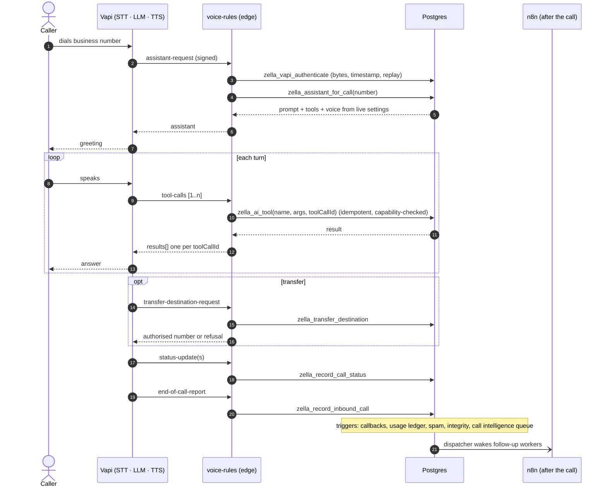

### 7.2 The receptionist's tools

| Tool | Does | Guard |
|---|---|---|
| `search_knowledge` | answers from `ready` knowledge | "don't know" if there is no match |
| `check_open_hours` | hours, closures, holidays | business time zone |
| `lookup_caller` / `update_caller` | identify the caller, save preferences | caller number match |
| `check_availability` | real free times | capability `bookings`, staff, resources, buffers |
| `book_appointment` | book | exact `start` from check_availability, read-back, booking lock |
| `find_my_appointments` / `reschedule_appointment` / `cancel_appointment` | manage own bookings | caller identity |
| `take_message` | message for staff | becomes a notification |
| `report_emergency` | urgent escalation | escalation rules, on-call |
| `transfer_to_human` | live transfer | authorised number only |
| `request_follow_up` | callback request | becomes a callback |
| `report_unanswered_question` | knowledge gap | feeds the knowledge loop |
| `lookup_order` | order status | capability `orders`, Shopify connected |

### 7.3 Voice design rules

- **No sync step:** the assistant is built per call from live settings.
- **Tools give facts; the prompt forbids guessing.** Industry safety lines are added to the prompt.
- **The tool list follows capabilities** (no booking tools where bookings are off). The DB refuses anyway.
- **Exactly once:** identical in-flight tool calls wait for each other, and a redelivery returns the first result.
- **Latency budget:** 4 s per DB call and 12 s per request, under Vapi's 20 s timeout. A timeout gives a safe failure.
- **Fallback path:** n8n Brain Tools (`/webhook/zella/vapi-brain`) runs the same code with the same idempotency key.

### 7.4 Booking concurrency

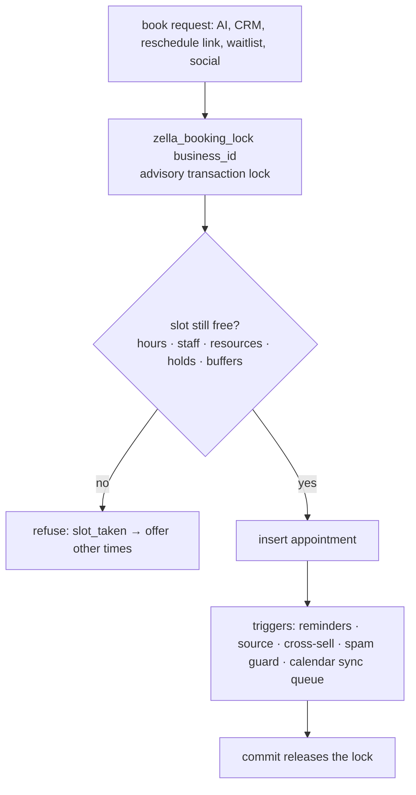

### 7.5 Minute metering

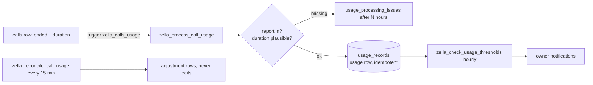

---

## 8. Messaging architecture

### 8.1 The outbound pipeline (every channel)

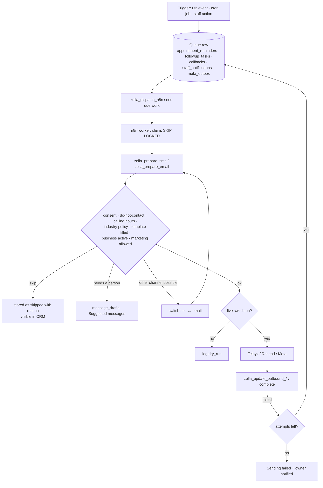

### 8.2 Queue item lifecycle

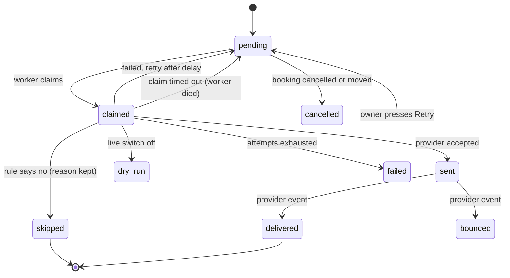

### 8.3 Inbound

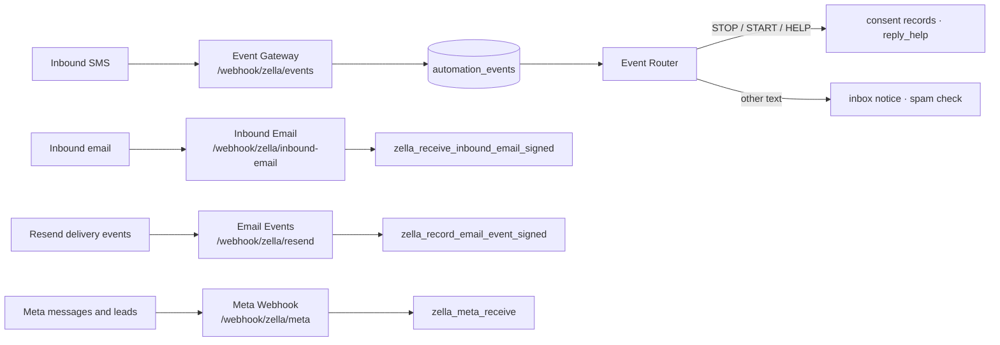

### 8.4 Customer self-service links (no sign-in)

| Link | Page | Backend |
|---|---|---|
| `/r/<64 hex>` | reschedule or cancel | `reschedule-appointment` |
| `/w/<64 hex>` | accept or decline a waitlist offer | `reschedule-appointment` |
| `/u/<32 hex>` | unsubscribe | `zella_unsubscribe_lookup` / `zella_unsubscribe_email` |
| `/status` | platform status | `zella_public_status` |

---

## 9. Automation architecture: the complete catalogue

Automations come from **five sources**. All of them end in the same queues and the same worker contract.

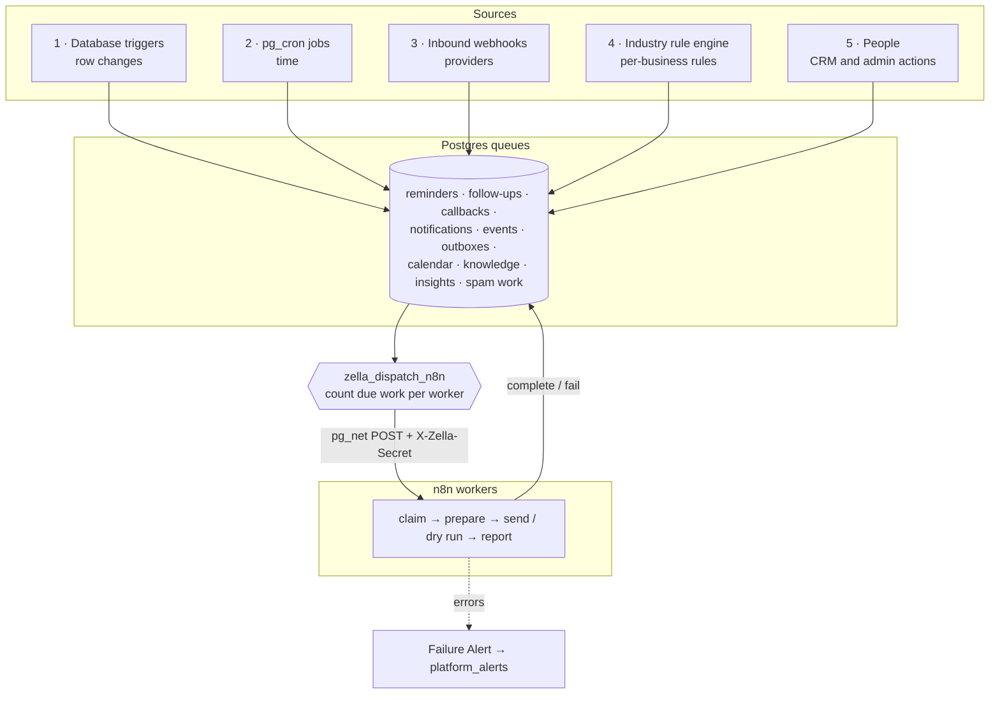

### 9.1 The dispatcher

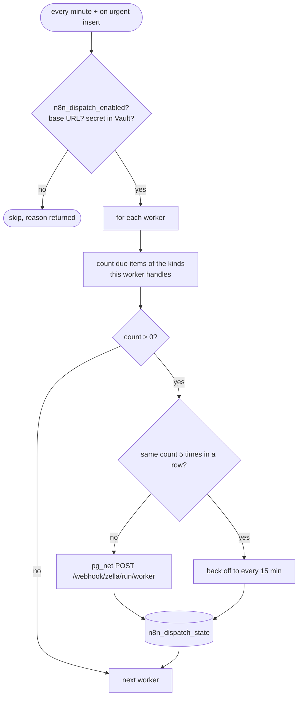

### 9.2 Source 1: database triggers (work created the moment data changes)

| Table | Trigger | Automation it starts |
|---|---|---|
| `calls` | `zella_calls_callbacks_trg` | missed or unfinished call → **callback** (auto-call or staff) |
| `calls` | `zella_calls_usage` | **minute ledger** entry |
| `calls` | `zella_spam_call` | **spam scoring** of the caller |
| `calls` | `zella_call_integrity` | one row per provider call; status order |
| `appointments` | `zella_appointment_new`, `zella_appointment_after_trg` | **confirmation and reminders** queued; calendar sync queued; waitlist offer on cancel; pending follow-ups withdrawn on cancel or move |
| `appointments` | `zella_no_show_followup` | **no-show follow-up** |
| `appointments` | `zella_cross_sell_booked`, `zella_cross_sell_completed` | **cross-sell** offers (opt-in only) |
| `appointments` | `zella_spam_booking_guard` / `_record` | **booking abuse** limits |
| `customers` | `zella_welcome_new_customer` | **welcome message** |
| `customers` | `zella_auto_assign_lead_trg` | **lead assignment** by rules |
| `customers` | `zella_customer_change` | `customer.*` event |
| `callbacks` | `zella_auto_assign_callback_trg` | **callback assignment** |
| `crm_records` | `zella_industry_status` | **industry status actions** (status update messages, tasks) |
| `sms_messages`, `email_messages` | `zella_spam_sms`, `zella_spam_email` | **spam scoring** |
| `followup_tasks` | `zella_spam_reply_guard` | no auto-reply to spam |
| `staff_notifications` | `zella_mark_staff_sms_trg` | **staff text** queued when the person chose text |
| `knowledge_items` | `zella_knowledge_*` | version log; back to `processing` on edit |
| `reviews` | `zella_review_*_insert` | **review reply draft** queued |
| `sensitive_approvals` | `zella_approval_decided_trg` | carry out the approved action |
| `subscriptions`, `payments` | `zella_subscription_*`, `zella_offer_*` | **plan state**, offer redemption |
| `business_invitations`, `business_phone_numbers` | capacity triggers | plan limits |
| `businesses`, `business_members`, `ai_agents`, `automations`, `platform_settings` | `zella_audit_privileged_trg` | **audit log** |
| about 30 tenant tables | `zz_tenant_links` | refuse cross-business links |

### 9.3 Source 2: pg_cron jobs (time-based)

**Production cron entries (read 9 Nov 2026):**

| Job | Schedule (UTC) | Runs | Active in prod |
|---|---|---|---|
| `zella_dispatch` | every minute | `zella_dispatch_n8n()` | **off** |
| `zella_jobs_every5` | `*/5` | group `every5` | **off** |
| `zella_jobs_every15` | `*/15` | group `every15` | **off** |
| `zella_jobs_hourly` | `0 *` | group `hourly` | **off** |
| `zella_jobs_daily` | `0 4 * * *` | group `daily` | **off** |
| `zella_jobs_weekly` | `0 8 * * 1` | group `weekly` | **off** |
| `zella_spam_hourly` | `17 *` | `zella_spam_hourly()` | **off** |
| `zella_cron_cleanup` | `30 3 * * *` | prune `cron.job_run_details` (3 days) | **off** |
| `zella_billing_reconcile` | `*/15` | `zella_reconcile_billing_events()` | on |
| `zella_usage_thresholds` | `23 *` | `zella_check_usage_thresholds()` | on |

**Every job in the groups** (each runs through `zella_run_scheduled_job`, which checks its allow-list; a failure raises one grouped alert):

| Group | Job | What it does |
|---|---|---|
| every 5 min | `zella_flag_overdue_leads` | leads not contacted in time → alert the assignee |
| | `zella_expire_holds` | release held slots |
| | `zella_expire_waitlist_offers` | unanswered offer → next person |
| | `zella_detect_transfer_failures` | transfers that didn't connect → callback |
| | `zella_flag_overdue_callbacks` | warning after 10/30/60 min, urgent after 3 h |
| | `zella_sweep_stuck_calls` | outbound call with no report after 45 min → failed attempt |
| | `zella_check_engine_health` | automation engine self-check |
| | `zella_rebalance_assignments` | rebalance leads and callbacks across staff |
| | `zella_check_unassigned_work` | unassigned work → owner |
| | `zella_check_escalation_acks` | unacknowledged escalations → next person |
| | `zella_remind_upcoming_callbacks` | reminder before a scheduled callback |
| | `zella_sweep_open_calls` | close calls left open |
| | `zella_offers_tick` | start, end and limit platform offers |
| every 15 min | `zella_queue_quote_followups` | quote follow-up tasks |
| | `zella_recover_orphaned_work` | release stuck claims |
| | `zella_check_response_times` | response-time KPIs |
| | `zella_reconcile_call_usage` | minute ledger adjustments |
| | `zella_check_uptime` | uptime signal |
| | `zella_on_call_reminders` | on-call shift reminders |
| hourly | `zella_post_daily_summaries` | owner daily summary at the business's local 8 am |
| | `zella_schedule_calendar_pulls` | queue calendar pulls |
| | `zella_check_customer_requests` | customer requests waiting |
| | `zella_post_callback_digests` | callback digest |
| | `zella_post_team_summaries` | team summary |
| | `zella_recover_failed_texts` | retry or move failed texts |
| | `zella_check_overdue_tasks` | overdue CRM tasks |
| | `zella_detect_repeated_questions` | repeated unanswered questions → knowledge gap |
| | `zella_flag_unrecorded_appointments` | past visits without an outcome |
| | `zella_recover_provisioning` | finish a half-done business setup |
| | `zella_sweep_approvals` | expire or remind approvals |
| | `zella_run_industry_timers` | **industry rule engine** (§9.5) |
| | `zella_verify_calls` | check call records against Vapi |
| | `zella_recover_knowledge` | retry stuck knowledge updates |
| | `zella_check_milestones` | customer milestones |
| | `zella_team_scorecard_nudge` | scorecard reminders |
| daily 04:00 | `zella_queue_lead_reactivation` | reactivation (marketing, opt-in only, up to 200) |
| | `zella_check_setup_incomplete` | nudge unfinished setups |
| | `zella_check_trials` | trial ending |
| | `zella_apply_payment_policy` | past due → restrict per policy |
| | `zella_queue_customer_touches` | visit feedback, six-month check-in, review request |
| | `zella_check_kpis` | KPI alerts |
| | `zella_check_renewals` | renewals due |
| | `zella_check_connections` | integration health |
| | `zella_sample_ai_responses` | AI quality samples |
| | `zella_reconcile` | data reconciliation |
| | `zella_retention_scan` | retention due |
| | `zella_detect_knowledge_conflicts` | conflicting answers |
| | `zella_run_tenant_check` | cross-tenant integrity self-test |
| | `zella_notify_message_failures` | failed-message summary |
| | `zella_check_data_rights_due` | privacy request deadlines |
| | `zella_scan_duplicates` | duplicate customers → review |
| | `zella_remind_reconnects` | reconnect expired integrations |
| | `zella_apply_scheduled_cancellations` | subscription cancellations at period end |
| | `zella_run_permission_check` | grants and policy self-test |
| weekly, Mon 08:00 | `zella_post_weekly_reviews` | owner weekly review |
| | `zella_remind_integrations` | integrations not set up |
| | `zella_send_gap_reports` | knowledge gap report |

### 9.4 Source 3: the n8n workflows (all 30)

**Workers started by the dispatcher** (`POST /webhook/zella/run/<name>`, `X-Zella-Secret`):

| Workflow | Path | Claims (DB) | Provider | Reports (DB) | Gate |
|---|---|---|---|---|---|
| SMS Sender | `run/sms-sender` | `zella_claim_reminders(sms)` → `zella_prepare_sms` | Telnyx | `zella_log_outbound_sms`, `zella_update_outbound_sms` | `sms_live` |
| Follow-up Texts | `run/followup-texts` | `zella_claim_followup_texts` → `zella_prepare_sms` | Telnyx | same | `sms_live` |
| Email Sender | `run/email-sender` | `zella_claim_reminders(email)` → `zella_prepare_email` | Resend | `zella_log_outbound_email`, `zella_update_outbound_email` | `email_live` |
| Follow-up Emails | `run/followup-emails` | `zella_claim_followup_emails` → `zella_prepare_email` | Resend | same | `email_live` |
| Owner Emails | `run/owner-emails` | `zella_claim_owner_emails` | Resend | same | `email_live` |
| Staff Texts | `run/staff-sms` | `zella_claim_staff_sms` | Telnyx | `zella_update_outbound_sms` | `sms_live` |
| Admin Alerts | `run/admin-alerts` | `zella_claim_admin_alert_email` | Resend | after-send step | `email_live` |
| Outbound Calls | `run/outbound-calls` | `zella_claim_callback_calls`, `zella_claim_followup_calls` | Vapi | via Call Results | `calls_live` + assistant and number set |
| Event Router | `run/event-router` | `zella_claim_events` (×20) | — | `zella_start_execution`, `zella_finish_execution`, `zella_complete_event` | — |
| Calendar Sync | `run/calendar-sync` | `zella_claim_calendar_sync`, `zella_claim_calendar_pulls` | Google, Microsoft Graph | `zella_finish_calendar_sync`, `zella_replace_calendar_busy`, `zella_calendar_mark_error` | `calendar_sync_live` |
| Knowledge | `run/knowledge-sync` | `zella_claim_knowledge_updates`, `zella_claim_gap_drafts` | Anthropic (drafts) | `zella_complete_knowledge_update`, `zella_set_gap_suggestion` | `knowledge_ai_live` for drafts |
| Call Intelligence | `run/call-intel` | `zella_claim_call_insights` | Anthropic | insight saved | `call_intel_live`, monthly limit |
| Call Reconciliation | `run/call-reconcile` | `zella_calls_to_reconcile` | Vapi | `zella_reconcile_call` | — |
| Connection Tests | `run/connection-tests` | `zella_claim_provider_checks` | Telnyx, Resend, Vapi | `zella_record_provider_check` | `provider_checks_live` |
| Website Crawler | `run/website-crawl` | `zella_website_claim` | business website | `zella_website_record_discovery`, `zella_website_record_page` | `website_crawl_live` |
| Review Replies | `run/review-replies` | `zella_review_claim_fetch`, `_claim_ai`, `_claim_posts` | Google Business Profile, Anthropic | `zella_review_ingest`, `zella_review_save_ai_draft`, `zella_review_post_result` | owner approves each reply |
| Spam Response | `run/spam-response` | `zella_spam_claim_work` | Anthropic (optional second opinion) | `zella_spam_finish_work`, `zella_spam_save_report` | policy re-checked in the DB |
| Meta Sender | `run/meta-sender` | `zella_meta_claim_outbox` | Meta Graph | `zella_meta_record_send` | Meta connection + approved templates |
| Meta Leads | `run/meta-leads` | `zella_meta_claim_leads` | Meta Graph | `zella_meta_capture_lead`, `zella_meta_fail_event` | Meta connection |
| Meta Health | `run/meta-health` | `zella_meta_claim_checks` | Meta Graph | `zella_meta_record_check`, `zella_meta_record_templates` | — |

**Webhooks called by outside systems:**

| Workflow | Path | Caller | DB entry | Role today |
|---|---|---|---|---|
| Event Gateway | `zella/events` | Telnyx, internal | `zella_ingest_event` | store each event once, reply fast |
| Email Events | `zella/resend` | Resend | `zella_record_email_event_signed` | delivery, bounce, complaint |
| Inbound Email | `zella/inbound-email` | Resend inbound | `zella_receive_inbound_email_signed` | customer replies |
| Meta Webhook | `zella/meta` (GET verify, POST) | Meta | `zella_meta_verify_token`, `zella_meta_receive` | messages and leads |
| Call Results | `zella/vapi` | Vapi | `zella_record_inbound_call`, `zella_record_call_result`, `zella_record_call_status` | **fallback**: `voice-rules` is primary |
| Receptionist Brain Tools | `zella/vapi-brain` | Vapi | `zella_ai_tool` | **fallback** for tools |
| Voice Rules | `zella/vapi-voice` | Vapi | `zella_business_for_number` | **fallback** |
| Assistant Tools | `zella/vapi-tools` | Vapi | `zella_business_for_number` | **fallback** |
| Appointment Booking | `zella/vapi-booking` | Vapi | `zella_ai_tool` | **fallback** |

**Platform:**

| Workflow | Trigger | Does |
|---|---|---|
| Failure Alert | n8n error trigger (set as the error workflow on all 29 others) | `zella_platform_alert` |

### 9.5 Source 4: the industry rule engine

Per-business rules (`automations`, seeded from `industry_automation_presets` / `industry_automation_defaults`, edited
in Setup and "Write your own rule") are evaluated hourly by `zella_run_industry_timers` and immediately by the
`zella_industry_status` trigger:

| Trigger type | Fires when | Typical action |
|---|---|---|
| `appointment_followup` | N days after a completed visit | feedback, check-in, review request |
| `record_due_reminder` | a record's due date is N days away | "service due", renewal, inspection |
| `record_status_action` | a record enters a status | status-update message, staff task |
| `record_stale` | a record hasn't moved in N days | task for the owner or assignee |
| `seasonal_reminder` | a date in the year | seasonal service reminder |
| `service_due` | service interval since the last visit | rebooking prompt |

Each rule has a **notify** target (owner, assignee, team) and a **channel** ("tell the owner by" text, email or in-app).
Customer-facing actions still go through the message policy, so sensitive industries become drafts.

### 9.6 Key automation flows

**Missed call → callback**

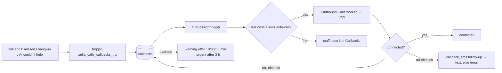

**Appointment lifecycle**

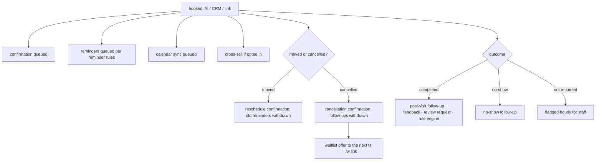

**Waitlist offer**

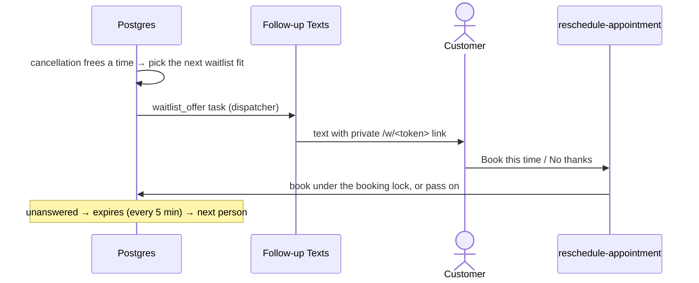

**Knowledge readiness**

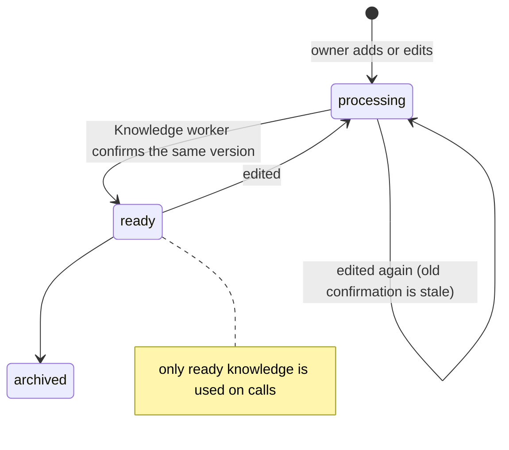

**Spam**

```mermaid
flowchart LR
  in[call / text / email / booking] --> sc[trigger: score signals<br/>lists · repetition · links · phrases · withheld ID]
  sc --> inc[(spam_incidents<br/>one per sender, channel and day)]
  inc --> lvl{score}
  lvl -- low --> log[recorded]
  lvl -- medium --> rev[Spam Response: AI second opinion optional]
  lvl -- "high + 2 signals" --> tmp[temporary 24 h restriction, reversible]
  rev & tmp --> fin[zella_spam_finish_work re-checks policy]
  fin --> ui[CRM Spam page + weekly summary]
```

**Calendar sync**

```mermaid
flowchart LR
  ap[appointment change] --> q[(calendar_sync_queue)] --> cs[Calendar Sync worker]
  cs --> g[Google / Outlook: create · update · delete event]
  hr[hourly zella_schedule_calendar_pulls] --> cs
  cs --> busy[pull busy times → zella_replace_calendar_busy]
  busy --> av[availability excludes external busy]
  cs -. token error .-> err[zella_calendar_mark_error → reconnect reminder]
```

**Reviews**

```mermaid
flowchart LR
  f[fetch new Google reviews] --> ing[zella_review_ingest] --> ai[AI drafts a reply]
  ai --> own[owner edits and approves in CRM]
  own --> post[post to Google] --> res[zella_review_post_result]
```

---

## 10. Knowledge and AI quality

```mermaid
flowchart LR
  src1[Owner writes answers] --> ki[(knowledge_items)]
  src2[Website crawler] --> sug[suggested items] --> ki
  calls[Calls] --> gap[(knowledge_gaps)]
  gap --> draft[AI draft, knowledge_ai_live] --> own[owner approves] --> ki
  ki --> kw[Knowledge worker → ready]
  kw --> brain[search_knowledge on calls]
  brain --> samp[ai_response_samples · ai_answer_reports]
  evals[(ai_eval_cases)] --> run[zella_brain_run_evals]
  calls --> intel[Call Intelligence → call_insights]
```

---

## 11. Integrations

| Integration | Direction | Built | Gate / blocker |
|---|---|---|---|
| Vapi (voice) | both | yes | real assistants need the server headers; phone numbers to assign |
| Telnyx SMS | both | yes | A2P 10DLC registration; `sms_live` |
| Resend email | both | yes (domain verified) | `email_live`; signing secret |
| Google Calendar | both | yes | Google OAuth client and consent screen |
| Outlook Calendar | both | yes | Microsoft app registration |
| Meta lead ads / WhatsApp | both | yes | Meta app review, template approval |
| Google Ads lead forms | in | yes | approval |
| Website forms | in | yes | — |
| Shopify | out (lookup) | yes | per-store connect |
| Google reviews | both | yes | Google OAuth; owner approval per reply |
| Anthropic | out | yes | API key and budget |
| Payments (Stripe-style) | in | webhook only | choose a provider |
| Gmail / Outlook mailbox | — | **choice stored, nothing uses it** | build it or remove it from the wizard |

---

## 12. Frontend and UI/UX architecture

### 12.1 Structure

```mermaid
flowchart TD
  main[main.jsx<br/>styles · appearance · ErrorBoundary] --> app[App.jsx: choose surface by host and path]
  app -->|"/welcome, token links"| welcome[Welcome / set password]
  app -->|"/r/hex · /w/hex · /u/hex"| pub[Reschedule · WaitlistOffer · Unsubscribe]
  app -->|"/status"| status[StatusPage]
  app -->|"/continue-plan"| cp[ContinuePlan]
  app -->|"/app/*"| crm[BusinessApp: CRM]
  app -->|"/ on admin host"| admin[AdminApp → OwnerDashboard]
  crm --> nav[navigation/: navConfig + zella_workspace_navigation]
  crm --> pages[Today · Calls · Callbacks · Leads · Inbox · Calendar ·<br/>Records · Money · Reports · Team · Settings …]
  admin --> apages[Businesses · Wizard · Plans · Offers · Voice numbers ·<br/>Monitoring · Spam · Audit · Support · Settings]
  crm & admin --> sb[supabase.js · rpc / RLS selects]
```

- **Stack:** React 19, Vite 8, plain JSX, no state or router library (`router.js` is about 80 lines), `oxlint`.
- **Routing:** History API with **leave guards** (unsaved forms are protected on navigation, Back and tab close).
- **Data:** `supabase.rpc('zella_*')` and RLS selects. Loading, empty and error are always distinct states.
- **Navigation is data-driven:** the sidebar shows what passes the checks in §4.2, and the DB refuses the rest anyway.

### 12.2 Design system

| Layer | File |
|---|---|
| Tokens (the only place for colour, type, spacing, radii, shadows) | `styles/tokens.css` (`--zella-*`) |
| Base | `index.css` |
| Components | `styles/components.css`, `BusinessUI.jsx`, `formFields.jsx` |
| Themes | `zella-theme.css` (warm ivory and mocha, default), `glass.css` (dark) |
| Motion | `motion.css`, `motion.js` (off with reduced motion) |

### 12.3 UX rules

- **Accessibility, WCAG 2.1 AA:** `useDialogFocus` on every dialog (focus in, Tab trapped, Escape, focus returned,
  only the topmost dialog handles keys), a visible focus ring, labels, and axe-core in the sweeps.
- **Responsive:** 1280 px and 390 px are tested, with no sideways scrolling.
- **Copy:** sentence case, US spelling, honest status language (`ZELLA_PRODUCT_VOICE.md`, `ZELLA_STATUS_LANGUAGE_GUIDE.md`).
- **Role-aware UI:** viewers see read-only views without amounts, and staff see only what their role allows.

---

## 13. Security architecture

### 13.1 Defence in depth

```mermaid
flowchart TB
  L1[Edge: Cloudflare TLS · CORS allow-list · body limits] --> L2[Identity: Supabase Auth · MFA for admins · invite-only]
  L2 --> L3[API: publishable key only in browser · service key only server-side]
  L3 --> L4[Functions: security definer · role check first · EXECUTE revoked from public]
  L4 --> L5[Data: RLS on every table · tenant-link triggers · private columns behind views · Vault]
  L5 --> L6[Webhooks: HMAC/Bearer + timestamp + replay · Resend and Meta signatures · X-Zella-Secret · signed OAuth state]
  L6 --> L7[Abuse: rate limits · spam scoring · temporary restrictions]
  L7 --> L8[Audit and self-tests: audit_logs · daily tenant and permission checks]
```

### 13.2 Threat model (summary)

| Threat | Control |
|---|---|
| One business reads another's data | RLS, `zz_tenant_links`, role checks in every function, daily `zella_run_tenant_check`, the security test suite |
| Forged Vapi request books or reads data | HMAC/Bearer verified in the DB over the raw bytes, 5-minute window, replay table |
| Prompt injection makes the AI do something | Tools are capability- and role-checked server-side; transfer only to authorised numbers; the AI cannot see secrets |
| Stolen staff session | MFA (admins), short sessions, viewer read-only, sensitive approvals |
| SMS/email abuse or toll fraud | consent checks, calling hours, rate limits, spam scoring, live switches |
| Service key leak | only in edge secrets and the n8n credential; rotate; nothing in the repo (`.gitignore`) |
| Mail scanner uses up a one-time link | the Continue step on `/welcome` |

### 13.3 Supabase advisor findings (9 Nov 2026)

| Finding | Assessment / action |
|---|---|
| `calls_view` is `SECURITY DEFINER` (ERROR) | It is the gate that hides transcripts. Confirm it filters by membership and role, or use `security_invoker` plus column grants. |
| 6 functions callable by `anon` | Intended public endpoints (status, platform info, unsubscribe ×2, MFA check, pre-request). Keep them small and rate-limited. |
| 355 definer functions callable by `authenticated` | Expected with this design. Every one must start with a role check, which the test suites enforce. |
| Leaked-password protection off | Turn it on. |
| `backup_20261104_*` tables, legacy functions `smart-action` and `zella-admin-check-v2` | Remove them or move them out of `public`. |

---

## 14. Deployment, environments and operations

### 14.1 Deployment topology

```mermaid
flowchart LR
  dev[Developer] -->|PR → main| gh[(GitHub repo)]
  gh -->|build web/ → dist| cf[Cloudflare Pages<br/>admin. · app.zellavoice.com]
  gh -->|supabase functions deploy| ef[Edge functions]
  gh -->|approved SQL, in order| db[(Supabase Postgres)]
  gh -->|n8n/src → build.mjs → import| n8n[n8n Cloud]
  dns[GoDaddy DNS] --> cf
  dns --> rs[Resend: send · rsend records]
```

### 14.2 Environments

| Environment | What it is |
|---|---|
| Production | Supabase `pffqxlumqhjdbzvvoszm` (us-west-1, Postgres 17), n8n Cloud, Cloudflare Pages |
| Isolated test DB | `sql/baseline/` (a schema-only snapshot of prod) restored locally by `restore.sh`, plus pending migrations; guarded so it can never target prod |
| Local stand-in backend | `tests/browser/local-backend.mjs` for browser sweeps, with outside network blocked |
| Local edge runtime | `tests/runtime/` |

### 14.3 Change process

```mermaid
flowchart LR
  w[write sql/zella_x.sql<br/>idempotent · version-guarded] --> rb[write rollback]
  rb --> t[test on isolated DB<br/>feature · security · matrix · deploy rehearsal]
  t --> m[deployment manifest]
  m --> ap{owner approves}
  ap --> bk[backup] --> apply[apply in order<br/>dispatcher last]
  apply --> base[refresh sql/baseline]
```

n8n: edit `n8n/src/*.js` → `node n8n/src/build.mjs` → `node n8n/test.mjs` → import → re-attach the hand-set
credentials → set the error workflow. **Never hand-edit the workflow JSON.**

### 14.4 Observability

| Signal | Where |
|---|---|
| Platform alerts (grouped, deduped) | `platform_alerts` → Admin Alerts email, and the admin bell |
| Job failures | `scheduler_failed` alert |
| n8n failures | Failure Alert → platform alert |
| Automation health | `workflow_executions`, `automation_dead_letters`, `n8n_dispatch_state` |
| Provider health | `provider_health`, Connection Tests, Meta Health |
| Voice latency | `Server-Timing` and one JSON log line per `voice-rules` request |
| Public status | `/status` |

### 14.5 Live switches (all off by default; each is also a kill switch)

`sms_live` · `email_live` · `calls_live` · `knowledge_ai_live` · `calendar_sync_live` · `provider_checks_live` ·
`website_crawl_live` · `call_intel_live` · `n8n_dispatch_enabled`

---

## 15. Testing strategy

| Level | Suite | Proves |
|---|---|---|
| Unit | `web/src/*.test.mjs`, `n8n/test.mjs`, edge `*_test.ts` | routing, wizard, templates, tool parsing, signatures, OAuth state |
| Database | `tests/security`, `tests/<feature>/` | RLS and role matrix, privacy, cross-tenant refusal, idempotency, rollback |
| Concurrency | `tests/voice-reliability` | parallel bookings, retries, duplicate call rows |
| Industry matrix | `tests/workflows/industry_matrix.mjs` | 1,383 checks across 28 industries |
| End to end | `tests/workflows/salon_launch.mjs`, `tests/e2e` | a full business journey |
| Runtime | `tests/runtime` | edge functions in the real edge runtime |
| Browser | `tests/browser/*.cjs` (Playwright) | every page × role × laptop, phone and dark theme; axe-core; dialogs |
| Deploy rehearsal | `tests/deploy/run_all.sh`, `tests/staging/run.sh` | full pending sequence and full rollback |

**Gap:** there is no CI. Nothing runs automatically on a pull request.

---

## 16. Production state (9 Nov 2026)

| Area | State |
|---|---|
| Data | 4 test businesses (salon, 2 restaurants, dental), 5 calls, 2 customers, 0 subscriptions |
| Edge functions | 13 deployed (11 in the repo + 2 legacy) |
| Cron | 10 jobs registered; **only `zella_billing_reconcile` and `zella_usage_thresholds` active**. Dispatcher and all job groups are off. |
| n8n | 30 workflows, **all unpublished** |
| Live switches | all off |
| Hosting | Cloudflare Pages setup pending |
| Provider accounts | Resend verified; Telnyx 10DLC, Google/Microsoft OAuth and Meta review pending |

**Go-live order:** hosting → Auth URLs and secrets → Vault secrets → publish Failure Alert, then the other workflows
→ attach provider credentials → turn on the job groups and the dispatcher → one live switch at a time, starting with
one business and one number.

---

## 17. Architect's recommendations

### P0: before the first paying customer

1. **CI on every PR:** web lint and build, edge `deno test`, `n8n/test.mjs`, and the security suite in a Postgres 17
   service container. Block merges on red.
2. **Make migrations queryable:** a `zella_schema_migrations(name, checksum, applied_at, applied_by)` table, or
   Supabase CLI migrations.
3. **Close the advisor items** (§13.3).
4. **PITR backups** and an external uptime ping on `/status` and `voice-rules`.
5. **Launch narrow:** one or two industries (salon first) on real numbers, turning live switches on one at a time.
6. **One source of truth:** this file plus a short `docs/STATUS.md`. Archive the dated reports.

### P1: first months

7. Voice SLOs: p95 tool call under 1.5 s with an error-rate alert, and a log drain for `voice-rules`.
8. Retire the five n8n voice fallback workflows after 30 clean days on `voice-rules`.
9. Generated DB types and gradual TypeScript. Split `CreateBusinessWizard.jsx` (2.3k lines) by step.
10. Code-split by surface (admin, CRM, public) with `React.lazy`.
11. Decide the 10DLC model (platform brand vs per business) and per-business sender numbers.
12. Connect billing to plans and the minute ledger, and enforce quotas in `zella_assistant_for_call`.

### P2: scale

13. n8n capacity: upgrade the plan, or move the hot senders to edge functions. The claim/complete contract makes this a drop-in swap.
14. Monthly partitions plus retention for `audit_logs`, `ai_tool_calls`, `usage_records`, `automation_events`, `sms_messages`.
15. A read replica for reports once KPI queries compete with voice-path writes.
16. Data residency: an India launch (`zellaai.in`) needs a separate regional project.
17. Build or remove the Gmail and Outlook mailbox option.

---

## 18. Glossary and repo map

| Term | Meaning |
|---|---|
| Business | a tenant (one paying customer of Zella) |
| Member | a user's role in a business |
| Platform admin | Zella staff with a platform role |
| Capability | a switch for a kind of operation (bookings, check-ins, waitlist, dispatch, classes, orders, money, access codes) |
| Module | a CRM area enabled per industry and per business |
| Record type | a configurable industry object (pet, vehicle, matter, policy, job …) |
| Live switch | a setting that lets a channel act in the real world; off = dry run |
| Claim / complete | the queue protocol between the DB and workers |
| Dispatcher | `zella_dispatch_n8n`: wakes n8n only when work is due |
| Ready knowledge | knowledge the receptionist may use |
| Dead letter | a permanently failed or unhandled event, kept visible |

| Need | Path |
|---|---|
| Production schema snapshot | `sql/baseline/` |
| A feature's SQL / its rollback | `sql/zella_<feature>.sql` / `sql/rollback/` |
| Scheduler and dispatcher | `sql/zella_dispatcher.sql` |
| Role checks | `sql/zella_role_check_hardening.sql`, `sql/zella_settings_system.sql`, `sql/zella_viewer_read_only.sql` |
| Voice endpoint / shared Vapi code | `web/supabase/functions/voice-rules/` / `web/supabase/functions/_shared/` |
| n8n source / built workflows | `n8n/src/` / `n8n/workflows/` |
| App entry and routing | `web/src/main.jsx`, `web/src/App.jsx`, `web/src/router.js` |
| Navigation / design system | `web/src/navigation/` / `web/src/styles/tokens.css` |
| Go-live | `docs/GO_LIVE.md`, `n8n/GO-LIVE.md` |
| Deeper design notes | `docs/VOICE_RELIABILITY.md`, `docs/MESSAGING_POLICY_2026-11-05.md`, `docs/SPAM_PROTECTION.md`, `docs/MINUTE_USAGE_DESIGN.md`, `docs/NAVIGATION.md`, `docs/DESIGN_SYSTEM.md` |
