# Zella Voice: complete target architecture

**What this document is:** the complete required design of the Zella Voice SaaS platform, written by the principal
architect from first principles. It states what Zella Voice must be, not what exists.
It is the blueprint every change to the web app, database, workflows and voice system is measured against.

**How to use it:**
- Every requirement has an ID (`REQ-…`). Changes, pull requests and tests cite the IDs they implement.
- `ZELLA_VOICE_RULES.md` holds the binding rules this design obeys (`TEN-…`, `SEC-…`, …).
- Values that are business, legal or product choices are **never invented here**. They appear as **[DECISION D-n]** and
  are listed in §23. Until a decision is made, the setting exists but has no default, and the feature stays off.

**Brand:** the product and company are always written in full: **Zella Voice**.

**Decisions applied:** the owner's product decisions of 9 Nov 2026 are written into every section below and listed in
§23 (decided vs. still open). **Launch market: United States only**; the design stays multi-country ready.

---

## Contents

| Part | Sections |
|---|---|
| A. Foundations | [1 Product](#1-product) · [2 Actors and roles](#2-actors-and-roles) · [3 Principles](#3-principles) · [4 System context and containers](#4-system-context-and-containers) · [5 Responsibility boundaries](#5-responsibility-boundaries) |
| B. Core platform | [6 Multi-tenant isolation](#6-multi-tenant-isolation-architecture) · [7 Domain model](#7-domain-model) · [8 Automation engine](#8-automation-engine) · [9 Communication core](#9-communication-core) |
| C. Journeys | [10 SaaS lifecycle](#10-saas-lifecycle) · [11 Inbound calls and the AI receptionist](#11-inbound-calls-and-the-ai-receptionist) · [12 Missed calls](#12-missed-calls) · [13 Leads and outgoing lead calls](#13-leads-and-outgoing-lead-calls) · [14 SMS and email](#14-sms-and-email) · [15 Appointments, check-in and waitlist](#15-appointments-check-in-and-waitlist) · [16 Knowledge](#16-knowledge) · [17 Billing, plans and usage](#17-billing-plans-and-usage) |
| D. Applications | [18 Web application](#18-web-application) (public pages, CRM, admin, Create Business) |
| E. Operations | [19 Integrations](#19-integrations) · [20 Security and privacy](#20-security-and-privacy) · [21 Reliability, observability, delivery](#21-reliability-observability-delivery) · [22 Industries](#22-industries) · [23 Decisions](#23-decisions) · [24 Safe build sequence](#24-safe-build-sequence) |

---

# Part A: Foundations

## 1. Product

Zella Voice answers the phone for small businesses so no customer is missed. It is three products on one platform:

| Product | Who uses it | What it does |
|---|---|---|
| **AI receptionist** | callers, customers | Answers every call; answers questions from the business's approved knowledge; books, moves and cancels appointments; takes messages; transfers to a person; calls leads and missed callers back when the business allows it |
| **Business CRM** | business owners and teams | One place for customers, leads, calls, messages, appointments, follow-ups, industry records, reports and settings |
| **Platform admin** | Zella Voice staff | Creating and supporting businesses, numbers, plans, monitoring, security, abuse and audit |

A fourth, internal product supports the business itself:

| Product | Who uses it | What it does |
|---|---|---|
| **Zella Voice growth** | Zella Voice sales and marketing | Public website, Zella Voice's own sales leads, demos and signups. **Fully separate from every business's data.** |

### 1.1 Promises that drive every requirement

| ID | To the business | To their customers |
|---|---|---|
| P1 | Every call is answered | You reach someone who helps |
| P2 | Only true things are said about your business | Correct answers, or an honest "I'll have them call you" |
| P3 | Your data is yours alone | Your details stay private |
| P4 | No spam, no wrong or badly timed messages | You hear from the business only when it is useful and wanted |
| P5 | You stay in control | You can always stop messages and reach a person |
| P6 | It works, and you hear first when it doesn't | Your booking is real |

### 1.2 Glossary

| Term | Meaning |
|---|---|
| Business | a tenant: one customer of Zella Voice |
| Member | a person's membership in a business, with a role |
| Customer | a person a business serves (caller, client, patient, guest). A **lead** is a customer not yet converted |
| Interaction | any call, message, email, booking or note on a customer's timeline |
| Work item | a durable row that represents something to do later (reminder, follow-up, callback, attempt) |
| Live switch | a setting that lets a channel act in the real world; off = dry run |
| Capability | a kind of operation a business offers (bookings, check-in, waitlist, orders, money, dispatch, classes, tables) |
| Module | an area of the CRM, enabled per industry and per business |
| Record type | a configurable industry object (pet, vehicle, matter, policy, job …) |

---

## 2. Actors and roles

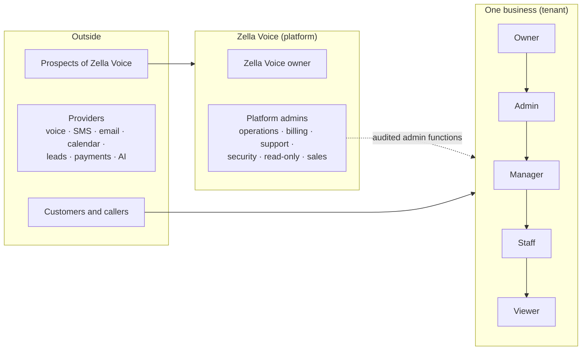

**REQ-ROLE-01: business roles** (ordered; each includes the ones below it, except where stated):

| Role | Can | Cannot |
|---|---|---|
| Owner | everything in the business, including billing, ownership transfer, deletion, data export | — |
| Admin | settings, team (not owners or other admins unless the owner allows), automations, integrations, receptionist | billing, ownership, deletion |
| Manager | daily operations, money records, approvals, transcripts (unless the industry forbids), reports | settings, team, integrations |
| Staff | assigned and team work: calls, callbacks, bookings, messages, records | money settings, other staff's private data, transcripts unless the owner allows |
| Viewer | read only; no amounts; no transcripts | any write |

**REQ-ROLE-02: platform roles** use named permissions, never one all-powerful role in daily use:
- `businesses.view` / `businesses.manage`
- `telephony.manage`
- `comms.manage`
- `ai.configure`
- `integrations.manage`
- `billing.view` / `billing.manage`
- `plans.manage`
- `support.manage`
- `security.view` / `security.manage`
- `audit.view`
- `analytics.view`
- `growth.manage` (Zella Voice's own sales pipeline)

The Zella Voice owner has all permissions and is the only one who manages platform admins.

---

## 3. Principles

| ID | Principle | Consequence |
|---|---|---|
| PRN-1 | **The database is the rules engine** | Permissions, tenant isolation, eligibility, consent, timing, retries and policies are enforced in Postgres functions and row security. Apps and workers ask; they never decide. |
| PRN-2 | **Adapters are thin** | Edge functions authenticate, validate, call one rule and translate the answer. Workers claim, call one provider and report. |
| PRN-3 | **Every external action is at-least-once, made safe** | Idempotency keys, dedupe, an `unknown` outcome state, reconciliation before retry. Exactly-once is never claimed for provider actions. |
| PRN-4 | **Events create durable work** | An event writes a work item with a due time; schedules only wake workers and run reconciliation and health checks. |
| PRN-5 | **Configuration over code** | Industries, capabilities, policies, templates and terminology are data. No per-industry code branches. |
| PRN-6 | **Off by default, dry run when off** | Every channel and AI feature has a live switch; off records exactly what would have happened. |
| PRN-7 | **Honest state everywhere** | Separate statuses for lead, attempt, conversation, task and appointment. "Delivered" only with proof. Nothing silently dropped. |
| PRN-8 | **The AI is constrained, not trusted** | Facts only from tools and approved knowledge; actions only through server-checked tools; uncertainty leads to a message, callback or person. |
| PRN-9 | **Privacy by default** | Collect the minimum; classify; mask in logs; retention per class; sensitive industries stricter. |
| PRN-10 | **Every change is reversible** | Migrations with rollbacks; feature switches; kill switches per channel and per business. |

---

## 4. System context and containers

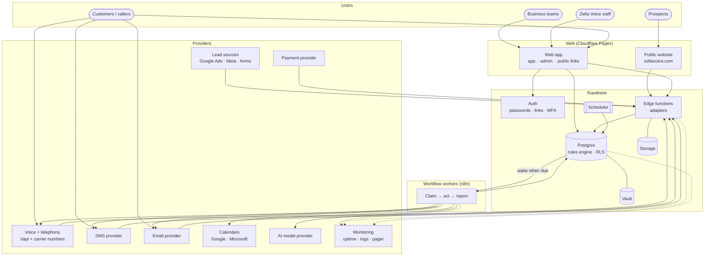

**Containers:**

| Container | Technology | Responsibility |
|---|---|---|
| Public website | static site + form endpoint | marketing, demo requests, signup entry |
| Web app | React (single bundle, three surfaces; code-split by surface) | CRM, admin, customer self-service pages |
| Auth | Supabase Auth | identity, sessions, MFA, invitations, recovery |
| Rules engine | Postgres functions + RLS | all business rules, queues, audit |
| Edge functions | Deno | provider webhooks, voice endpoint, OAuth, provisioning, signed links |
| Scheduler | pg_cron | wake workers, reconciliation, health, timers |
| Workers | n8n (replaceable by edge workers) | provider calls for queued work |
| Storage | Supabase Storage | files, brand assets, recordings (if stored) |
| Vault | Supabase Vault | provider secrets, signing keys |
| Monitoring | external uptime check, log drain, pager | alerting outside the platform it watches |

---

## 5. Responsibility boundaries

| Concern | Owner layer | Never in |
|---|---|---|
| Who may do what | Postgres (role checks + RLS) | UI, workers |
| Which business a request belongs to | derived in the adapter from session, verified number, signed token or signature, then checked in Postgres | request body, AI arguments |
| Whether a message or call may happen now | Postgres (contact policy engine, §9.3) | workers, UI |
| When work is due, retries, back-off | Postgres work items | workers |
| Talking to providers | workers and edge adapters | Postgres (except waking workers) |
| Mapping provider results to outcomes | one shared adapter module per provider, used by every caller | duplicated per workflow |
| Display, wording, honest states | web app | business rules |
| Booking authority | Zella Voice database | external calendars (mirror and busy-time source only) |
| Payments and card data | payment provider | Zella Voice (never stores cards) |
| Alerting | external monitoring | only inside the system being watched |

---

# Part B: Core platform

## 6. Multi-tenant isolation architecture

**One Zella Voice platform. Many independent businesses. Shared infrastructure. Strict database-enforced isolation.**

Zella Voice is a shared, multi-tenant SaaS platform. Every business gets an independent workspace with its own:
- configuration;
- communication environment;
- AI receptionist;
- operational data boundary.

Business A, Business B and Business C share the Zella Voice application and infrastructure, and operate as three
independent businesses.

### 6.1 Non-negotiable principles

| ID | Principle |
|---|---|
| ISO-01 | One shared Zella Voice application codebase and platform |
| ISO-02 | One shared Supabase Postgres infrastructure |
| ISO-03 | Tenant isolation **enforced by the database**: row security, ownership checks, constraints |
| ISO-04 | Independent business configuration and operations |
| ISO-05 | No cross-business data access |
| ISO-06 | No cross-business booking conflicts (conflicts are scoped to one business and one resource) |
| ISO-07 | No shared AI context or communication history |
| ISO-08 | Every tenant-owned record belongs to exactly one verified business |
| ISO-09 | Platform administration is separate from business administration |
| ISO-10 | Privileged access and sensitive operations are audited |

### 6.2 High-level tenant architecture

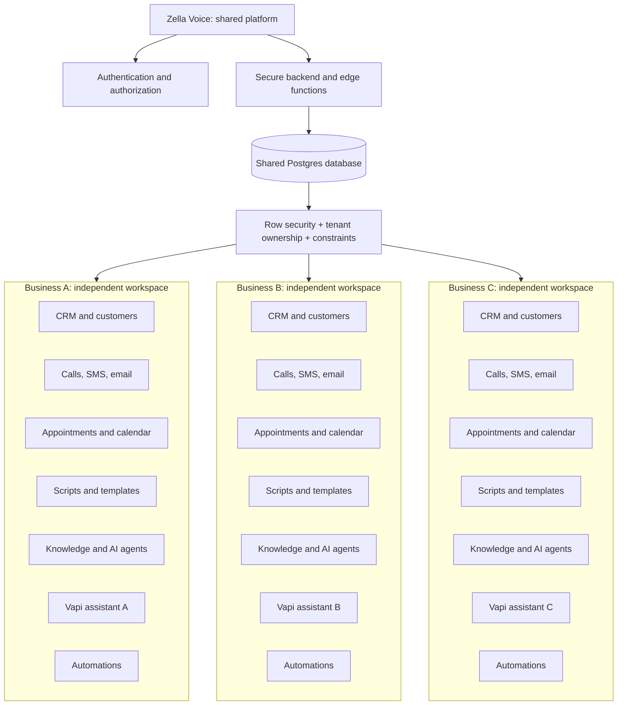

Each workspace uses the same Zella Voice features; its data and configuration belong to that business alone.

### 6.3 Who may act: identity and authorization

Every access is checked against three things, **in the database**:
1. the authenticated identity;
2. an **active** membership in the business that owns the data;
3. the role's permissions.

| Context | How the business is established | How the actor is established |
|---|---|---|
| Web app user | from the row being touched (never from a business ID the browser sends) | Supabase session + `business_members` (active) + role |
| Inbound call | verified **called number** or **Vapi assistant / phone-number ID** → business mapping | caller number = weak customer identity (REQ-ID-01) |
| Provider webhook (SMS, email, leads, payments) | verified provider identifier (number, inbound address, lead-form key, connection) → business mapping | signature over raw bytes + timestamp + replay protection |
| Customer link | signed token bound to one business and one record | token |
| Background worker | business ID carried in a **signed work envelope** (§6.9), re-verified by the database | service credential, server-only functions |
| Platform staff | — | platform permission + MFA + audited admin function |

- **REQ-ID-01** Changing or cancelling a booking, or hearing appointment details by phone, needs more than caller ID
  [D-18].
- **REQ-ISO-01** Removing a member, suspending a business or changing a role takes effect on the **next request**:
  sessions are re-checked against membership on every call, and open work items re-check business status at claim
  time.

### 6.4 Database-level isolation

**Ownership model.** Every table is exactly one of:

| Scope | Rule | Examples |
|---|---|---|
| **Tenant-owned** | `business_id NOT NULL`, references `businesses` | customers, appointments, calls, conversations, conversation messages, SMS, email, AI agents and configs, knowledge, automations and runs, integrations, notifications, support tickets, usage records |
| **Platform-owned** | no `business_id`; readable by members only where needed; writable only by platform functions | industries, presets, plans, platform settings |
| **Mixed** (platform default + business override) | explicit `scope` column (`platform`, `industry`, `business`) with a check constraint: `scope = 'business'` ⇔ `business_id IS NOT NULL` | message templates, spam rules, automation presets |

**Database security requirements:**

| ID | Requirement | How |
|---|---|---|
| REQ-DB-ISO-01 | Row security enabled **and verified** on every table | CI test: fail if any table lacks RLS or a tenant table lacks a membership policy |
| REQ-DB-ISO-02 | Server-side tenant authorization in every function | the first statement checks membership and role against the **row's** business |
| REQ-DB-ISO-03 | **Composite foreign keys** for tenant relationships | e.g. `appointments (business_id, customer_id) → customers (business_id, id)`; every tenant table has `unique (business_id, id)` so children can reference it |
| REQ-DB-ISO-04 | **Tenant-scoped unique constraints** | e.g. `unique (business_id, phone_e164)` for customers; `unique (business_id, vin)`; never global uniqueness on business data |
| REQ-DB-ISO-05 | Child tables carry their own `business_id` | conversation messages, agent configs, report runs, reminder logs: denormalised, kept consistent by composite FKs |
| REQ-DB-ISO-06 | Tenant-aware **storage** policies | object paths start with the business **UUID**; policies check membership against that UUID; files are served through short-lived server-signed URLs |
| REQ-DB-ISO-07 | Tenant-aware **Realtime** | if Realtime is used, only through RLS-filtered `postgres_changes`, or private channels named per business with membership-checked authorization; never public broadcast of tenant data |
| REQ-DB-ISO-08 | Service-role operations are secured | service credential only server-side; server functions take the business from the verified envelope and re-check record ownership; no "act on any ID" functions |
| REQ-DB-ISO-09 | Privileged operations audited | audit row: actor, business, action, before and after |
| REQ-DB-ISO-10 | Records referencing another business's resources are **rejected** | composite FKs (preferred), with a trigger guard as a backstop |
| REQ-DB-ISO-11 | Frontend filters are never a security boundary | every list and RPC returns only what RLS and functions allow |

### 6.5 CRM independence

| CRM feature | Business A | Business B |
|---|---|---|
| Customer records, notes, tags, status | independent | independent |
| Lead pipeline and stages | independent | independent |
| Appointments | independent | independent |
| Staff and assignments | independent | independent |
| Tasks | independent | independent |
| Custom fields and record types | independent | independent |
| Reports | independent | independent |
| Communication history | independent | independent |

- **REQ-CRM-ISO-01** The same person can be a customer of Business A and Business B as **two separate records**.
  Updating A's record (for example the phone number) never changes B's.
- **REQ-CRM-ISO-02** A custom field or record type created by A never appears in B. Industry defaults are copied
  into a business as its own rows (or read as platform templates); business changes never write back to the template.
- **REQ-CRM-ISO-03** Duplicate detection, merging and search run **inside one business only**.

### 6.6 Communication isolation: calls, SMS, email

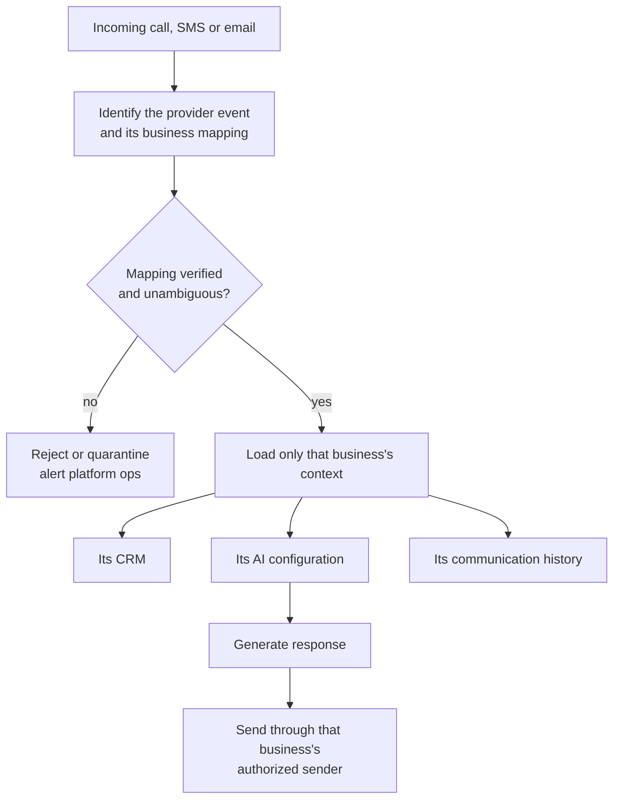

Every business has independent:
- call history, recordings and transcripts;
- SMS and email conversations;
- email signatures;
- call scripts and message templates;
- AI-generated responses;
- callbacks and missed-call records;
- spam classifications and allow/block lists;
- communication preferences;
- consent and opt-out records.

| ID | Requirement |
|---|---|
| REQ-COM-ISO-01 | A provider event that maps to no business, or to more than one, is **quarantined** (`quarantined_events`) and alerted. It is never guessed. |
| REQ-COM-ISO-02 | Outbound messages are sent only from the sender identities (numbers, email domains or addresses) registered to that business. Each send re-checks that the customer, destination and sender belong to the same business. |
| REQ-COM-ISO-03 | Opt-outs and consent are recorded **per business**: a STOP to Business A does not opt the person out of Business B. Platform-level legal blocks are a separate, explicit list. |
| REQ-COM-ISO-04 | Changing A's missed-call template never changes B's; templates resolve platform → industry → **A's own override**. |
| REQ-COM-ISO-05 | Platform-wide spam intelligence may use counts across businesses (e.g. "seen at 3 businesses") but never exposes another business's data or customer identity. |

### 6.7 Vapi and AI receptionist isolation

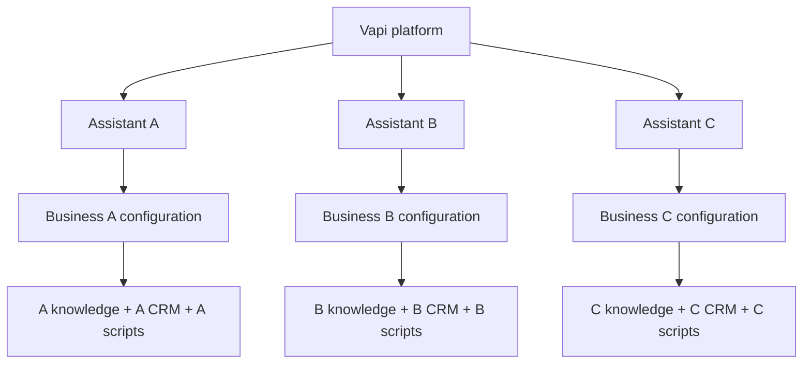

Each assistant loads only its own business's:
- name and identity;
- instructions;
- hours and time zone;
- knowledge;
- services and prices;
- staff and transfer settings;
- availability;
- customer context;
- authorized tools.

**Critical rule (REQ-VOX-ISO-01):** the AI model never decides its own tenant.
- The business is resolved from a **verified** Vapi assistant ID, phone-number ID or provider-event mapping.
- That business is bound to the call on the server.
- **Every tool call is authorized against that bound business**; tool arguments can never name or switch a business.
- A caller saying "switch to Business B" changes nothing.

| ID | Requirement |
|---|---|
| REQ-VOX-ISO-02 | Inbound **and** outbound assistants are per business (or built per call from that business's settings); no shared assistant carries business data. |
| REQ-VOX-ISO-03 | Tool results contain only the bound business's data; customer lookups match only inside it. |
| REQ-VOX-ISO-04 | Transfer numbers are resolved server-side from the bound business; the model never sees them. |
| REQ-VOX-ISO-05 | Webhook replays and duplicates are idempotent per business and provider call ID. |

### 6.8 Appointment isolation and double-booking protection

**Rule A: different businesses never conflict.** Business A, B and C may each book 10:00 AM. There is no global
appointment uniqueness anywhere in Zella Voice.

**Rule B: the same business cannot double-book the same exclusive resource.**

| Business | Resource | Time | Result |
|---|---|---|---|
| A | Provider 1 | 10:00 | allowed |
| A | Provider 1 | 10:00 (overlapping) | **conflict** |
| A | Provider 2 | 10:00 | allowed |
| B | Provider 1 of B | 10:00 | allowed |

The booking check considers:
- `business_id`;
- the resource (provider, staff member, room, chair, table, technician, vehicle);
- start and end, including buffers;
- appointment status (only active statuses block);
- the business time zone;
- configured capacity (a class or a resource with capacity > 1).

| ID | Requirement |
|---|---|
| REQ-APT-ISO-01 | Each appointment reserves one or more resources through a reservation table: `appointment_resources (business_id, appointment_id, resource_id, period tstzrange, status)`. |
| REQ-APT-ISO-02 | Database-level guarantee: an **exclusion constraint** on reservations, `EXCLUDE USING gist (business_id WITH =, resource_id WITH =, period WITH &&) WHERE (status is active)` (needs `btree_gist`). Capacity resources use a counted check inside the booking transaction under a per-resource advisory lock. |
| REQ-APT-ISO-03 | Bookings run in one transaction: lock → re-check availability (hours, holidays, external busy times) → insert reservation → insert appointment. An exclusion violation returns `slot_taken` with alternatives. |
| REQ-APT-ISO-04 | Idempotent booking: the same request key returns the same appointment. |
| REQ-APT-ISO-05 | Support: independent calendars per business; multiple staff and resources; configurable durations and buffers; business working hours; time-zone-aware scheduling; cancellation and rescheduling that release and re-reserve atomically. |
| REQ-APT-ISO-06 | A staff override of a resource conflict is **not allowed by default**. If ever enabled, it is a separate business setting with a reason and an audit record [D-35]. |

### 6.9 Automation and n8n isolation

n8n never runs an automation without a verified tenant context. Every execution carries a **work envelope**:

| Field | Purpose |
|---|---|
| `business_id` | verified owner |
| `automation_id` | which rule |
| `event_id` | triggering event |
| `work_item_id` | the claimed item |
| `subject_id` | customer or record, when relevant |
| `idempotency_key` | duplicate protection |
| `business_timezone` | timing |
| `claim_token` | proves the worker holds this claim |

- **REQ-AUT-ISO-01** Before any action, the database re-verifies that the business, automation, customer,
  destination (phone, email, transfer number) and sender all belong together. Any mismatch → refuse, dead-letter,
  alert.
- **REQ-AUT-ISO-02** Workers never choose destinations; the database `prepare` step returns them from the verified
  records.
- **REQ-AUT-ISO-03** Retries re-use the same envelope and are re-verified; a retry can never run another business's
  work.
- **REQ-AUT-ISO-04** Supabase stays the authority for rules and data; n8n only orchestrates.

These must never happen:
- Business A's reminder using Business B's customer phone number;
- A's missed-call callback using B's transfer number;
- A's knowledge automation updating B's knowledge.

### 6.10 Storage, recordings and sensitive information

```text
<business_uuid>/recordings/…
<business_uuid>/documents/…
<business_uuid>/knowledge/…
```

- Paths start with the business **UUID**, never a name or slug.
- Paths alone are not security: storage policies check membership against the path's business UUID, and downloads
  use short-lived **server-signed URLs** issued after an authorization check.
- Brand assets that must be public (logos) live in a public bucket containing nothing sensitive.
- Recordings, transcripts, documents and knowledge files are always private.

### 6.11 Configuration scopes

| Configuration | Scope |
|---|---|
| Default Zella Voice behaviour | platform |
| Industry terminology and default templates | industry |
| Greeting, AI voice and personality | business |
| Call scripts, SMS and email templates | business (with protected compliance content, REQ-MSG-06) |
| Business hours, appointment rules | business |
| Staff transfer settings | business |
| Knowledge answers | business |
| Automation rules | business |

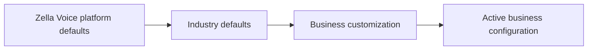

A business customizes permitted defaults without ever changing another business's settings or the shared template.

### 6.12 Cross-tenant security tests (required before production)

Three isolated test businesses (A, B, C), each with an owner, admin, manager, staff and viewer:

| Test | Expected |
|---|---|
| A reads B's customer | rejected |
| A edits B's appointment | rejected |
| A accesses B's call recording or transcript | rejected |
| A retrieves B's knowledge | rejected |
| A changes B's SMS template | rejected |
| A triggers B's automation | rejected |
| A subscribes to B's Realtime data | rejected |
| A's assistant or tool call targets B (including "switch to B") | rejected |
| A links its appointment to B's customer or resource | rejected |
| A books the same time as B | **allowed** |
| A double-books the same exclusive resource (including concurrently) | rejected (one succeeds) |
| A and B edit their own templates | both allowed, independent |
| A and B run separate reminders at the same time | both allowed, correct destinations |
| Duplicate webhooks | one effect |
| Forged tenant ID in a webhook or request body | rejected |
| Removed staff member's next request | rejected |
| Suspended business: queued work | skipped with reason |
| Viewer or staff attempts a forbidden write | rejected |
| Malicious browser requests (direct RPC/REST) | rejected by RLS and functions |

### 6.13 Acceptance and status

This section is the required design. Tenant isolation is **accepted only when** the automated tests in §6.12 prove
two things: cross-business access is rejected, and legitimate independent operations still work.

| Acceptance criterion | Proven by |
|---|---|
| Row security on every table, with a membership policy on every tenant table | CI schema test |
| Every security-definer function checks membership and role first (or is on the reviewed public list) | CI static test |
| Every tenant relationship uses a composite foreign key with `business_id` | CI schema test |
| Every uniqueness rule on business data includes `business_id` | CI schema test |
| `business_id NOT NULL` on every tenant table; explicit scope on mixed tables | CI schema test |
| Storage paths keyed by business UUID; policies check membership; signed URLs only | storage policy tests |
| Realtime (if used) only through RLS or membership-checked private channels | Realtime tests |
| Booking conflicts scoped to business + resource; exclusion constraint holds under concurrency | concurrency test |
| Business bound from verified provider mapping; tools authorized against it; "switch business" has no effect | voice runtime tests |
| Unmapped or ambiguous provider events quarantined | webhook tests |
| Opt-outs and consent per business | messaging tests |
| Worker envelope re-verified before every action; retries keep the same business | worker tests |
| Privileged operations audited | audit tests |
| §6.12 three-business suite passes in CI and staging | CI + staging |

### 6.14 Future features

Every new feature must follow this architecture. That includes new CRM modules, AI agents, Vapi tools, SMS and email
workflows, appointment features, integrations, industry modules, automations, reports and dashboards.

**A feature is not complete until** all of these are in place: its tenant ownership, its authorization, its data
relationships (composite FKs), and its cross-business tests.

---

## 7. Domain model

### 7.1 Bounded contexts

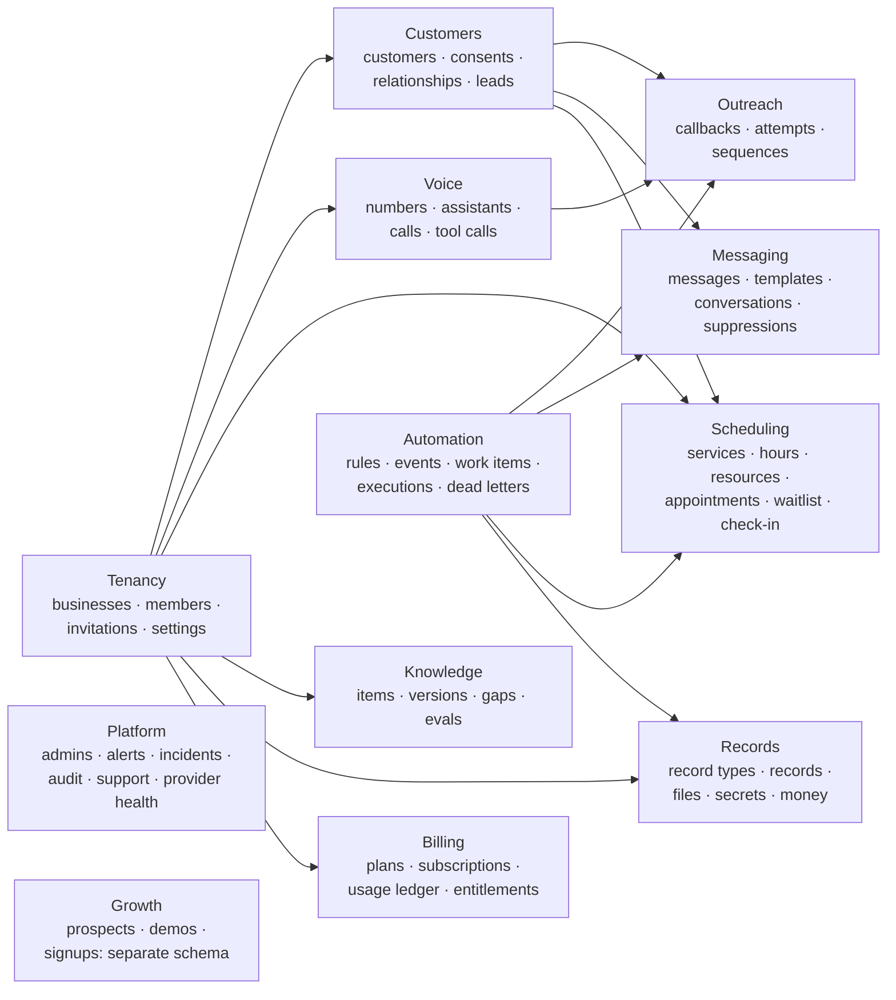

### 7.2 Core entities (target)

| Entity | Key fields | Notes |
|---|---|---|
| `businesses` | id, name, industry, time_zone, status (draft, setup, testing, live, paused, suspended, cancelling, cancelled), locale, plan | tenant root |
| `business_members` | business_id, user_id, role, status | REQ-ROLE-01 |
| `customers` | business_id, names, phones[], emails[], lifecycle (lead, customer, inactive), source, owner (assignee) | one person per business; dedupe by normalised phone and email |
| `contact_consents` | business_id, customer_id or address, channel, purpose (service, marketing), status, evidence (how, when, text shown), source | append-only history |
| `suppressions` | business_id, address, channel, reason (opt_out, invalid, bounced, complaint, legal) | checked before every contact |
| `phone_numbers` | business_id, e164, provider, purpose (inbound, outbound, both), caller-ID verified | per business |
| `assistants` | business_id, kind (inbound, outbound), version, config hash, status | built from settings per call |
| `calls` | business_id, direction, from, to, provider_call_id (unique), status, end_reason, classification (§12.1), duration, handled_by (ai, staff), transfer_status, recording/transcript refs, correlation_id | one row per provider call |
| `call_tool_calls` | call_id, tool, idempotency_key (unique), args keys, result, verified | AI actions |
| `callbacks` (outreach tasks) | business_id, customer_id, reason (missed_call, new_lead, needs_person, transfer_failed, requested), handler (ai, staff), status, attempts, sequence_id, next_due_at, assignee, outcome | REQ-OUT-* |
| `call_attempts` | callback_id, attempt_no, scheduled_at, started_at, from_number, provider_call_id, provider_status, attempt_outcome, conversation_outcome, duration, handler, summary, policy_decision, failure_reason, next_action, next_due_at, correlation_id | REQ-OUT-20 |
| `messages` | business_id, customer_id, channel (sms, email), direction, purpose, template_id, body, status (§9.5), provider_id, delivery evidence, dedupe_key (unique), correlation_id | texts and emails |
| `message_jobs` | the work item behind each automated message | REQ-MSG-* |
| `conversations` | business_id, customer_id, channel, state | CRM inbox |
| `appointments` | business_id, customer_id, service, staff, resources, start/end, status, source, booking_state, linked record, attendance timestamps | REQ-APT-* |
| `waitlist_entries`, `waitlist_offers` | entry preferences; offer slot, token, expires_at, state | REQ-WL-* |
| `knowledge_items`, `knowledge_versions`, `knowledge_gaps` | status (draft, ready, archived) | REQ-KNW-* |
| `automation_rules` | business_id, trigger, conditions, actions, channel, audience, enabled | owner-visible |
| `events` (outbox) | business_id, type, payload, idempotency_key, status | REQ-AUT-01 |
| `work_items` | queue, business_id, due_at, status, attempts, claim, last_error, idempotency_key | REQ-AUT-02 |
| `usage_ledger` | business_id, source event, quantity, unit, kind (usage, adjustment), period | append-only |
| `plans`, `subscriptions`, `entitlements` | limits per plan (owner-defined) | REQ-BIL-* |
| `audit_logs` | actor, business, action, before/after, at | append-only |

---

## 8. Automation engine

### 8.1 Three kinds of automated work

| Kind | Example | Mechanism |
|---|---|---|
| **Event-triggered** | missed call → callback; booking → confirmation | database trigger or webhook writes an **event** and **work items** in the same transaction |
| **Durable future job** | reminder 24 h before; retry at next calling window | a work item with `due_at` |
| **Reconciliation / health** | calls without reports; stuck claims; provider health; tenant self-checks | scheduled jobs |

- **REQ-AUT-01 Outbox.** Every business event is written once to `events`, with an idempotency key, in the same
  transaction as the change that caused it.
- **REQ-AUT-02 Work items.** A work item has: queue, business, due time, status, attempt count, claim token,
  claim expiry, last error, idempotency key, correlation ID and cancellation reason.
- **REQ-AUT-03 Claim protocol.** Workers claim with `FOR UPDATE SKIP LOCKED`, take a batch limit, and must report
  within the claim timeout or the item returns. Workers never retry by themselves.
- **REQ-AUT-04 Retry policy** is per queue in the database: growing delay, max attempts, then a dead letter and an
  alert.
- **REQ-AUT-05 Unknown outcome.** If a provider call's result is lost, the item enters `unknown`. It is **reconciled
  with the provider before any retry**.
- **REQ-AUT-06 Re-check before acting.** Eligibility (business status, consent, suppression, contact hours (REQ-MSG-07),
  stop conditions, entitlements) is evaluated **at claim time**, not when the item was created.
- **REQ-AUT-07 Cancellation.** Work items are cancelled by the events that make them irrelevant: a booking moved or
  cancelled, a reply received, an opt-out, a rule disabled, the business paused. Every cancellation stores its reason.
- **REQ-AUT-08 Visibility.** Every work item and its outcome is visible to the business (on the customer timeline
  and the relevant page) and to platform operations.

### 8.2 Work item lifecycle

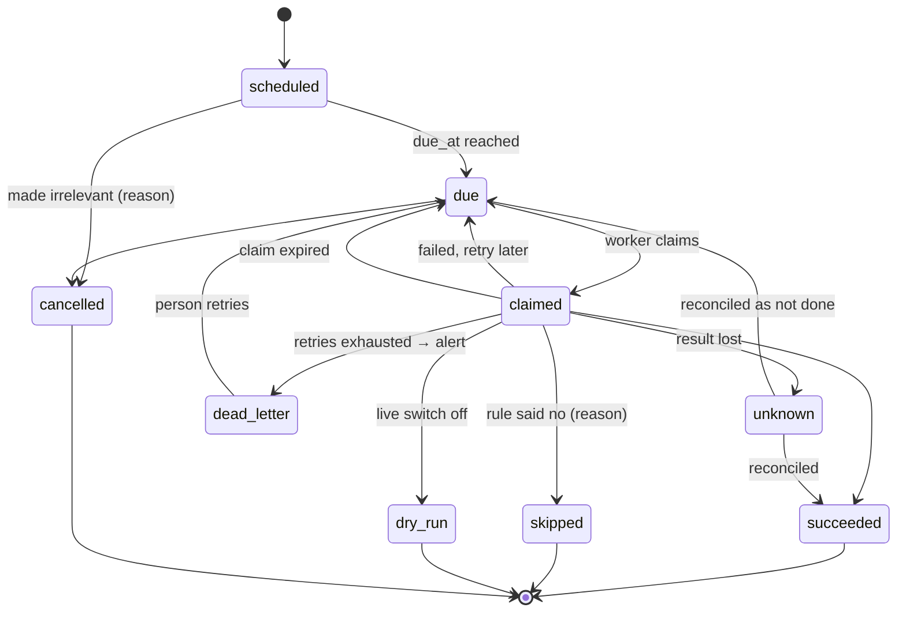

### 8.3 Waking workers (dispatcher)

- **REQ-AUT-10** Workers are woken when work is due (on insert of due work, and once a minute as a safety net). The
  database calls the worker webhook only if that queue has due work.
- **REQ-AUT-11 Back-off without starving new work.**
  - A queue is "stuck" only when its **oldest due item has not changed** across N wake-ups **[D-22]**.
  - A stuck queue is woken less often, but any **newly due item** wakes the worker immediately.
  - The stuck item is also alerted and, after its retries, dead-lettered.
- **REQ-AUT-12** A master switch stops all worker wake-ups; each queue has its own switch.

### 8.4 Automation catalogue (target)

| # | Automation | Kind | Trigger | Main checks at claim | Action | Stop / cancel | Visible in |
|---|---|---|---|---|---|---|---|
| A1 | Inbound call handling | event | call arrives | number → business; business live | AI receptionist | — | Calls |
| A2 | Missed-call callback | event → work | call classified missed (§12) | consent, suppression, calling hours, already handled? | AI or staff callback sequence | reply, booked, opt-out, staff closed | Callbacks |
| A3 | Missed-call text | event → work | missed call | SMS consent; sent immediately (a reply to the caller's own action); one per missed-call follow-up | text | reply, callback reached | Callbacks, timeline |
| A4 | Lead intake | event | lead source webhook / form / staff | source auth, dedupe | create or update lead, assign | — | Leads |
| A5 | Lead call sequence | work | new eligible lead | §13.5 stop conditions, consent, calling hours | outgoing call attempts | §13.5 | Leads, Callbacks |
| A6 | Lead follow-up message | work | attempt outcome rules | consent per channel and purpose | SMS / email | reply, resolved | timeline |
| A7 | Booking confirmation | event → work | appointment booked | consent | message | cancelled | appointment |
| A8 | Reminders | work | appointment start minus offsets | still booked, consent, reminder window 07:00–21:00 (REQ-MSG-07) | message | moved, cancelled | appointment |
| A9 | Reschedule / cancellation confirmation | event → work | appointment changed | consent | message | — | appointment |
| A10 | Check-in reminder (**later phase**, with self check-in) | work | before start | still booked | message with check-in link | checked in, cancelled | appointment |
| A11 | No-show follow-up | event → work | marked no-show | policy | message or call | rebooked | timeline |
| A12 | Post-visit follow-up / feedback | work | marked completed | industry policy, one check-in per visit | message or draft | — | timeline |
| A13 | Review request | work | completed + review link | classification [D-16] | message | — | timeline |
| A14 | Waitlist offer | event → work | slot freed | next eligible entry | offer with link | accepted, expired, slot gone | Waitlist |
| A15 | Callback reminder (staff) | work | callback due soon | still open | staff notification | done | Callbacks |
| A16 | Overdue alerts | schedule | callbacks or leads past due | still open | escalate to assignee, then owner | done | Callbacks, Leads |
| A17 | Staff notifications | event → work | anything needing a person | member preferences | email / SMS / in-app | read | Notifications |
| A18 | Daily summary, weekly review, scheduled reports | schedule | business local time | has content | email | — | Reports |
| A19 | Knowledge readiness | event → work | item saved | — | validate → ready | edited again | Knowledge |
| A20 | Knowledge gap handling | event | unanswered question | — | gap + optional AI draft for approval | answered | Knowledge |
| A21 | Calendar sync | event → work + schedule | booking change; periodic busy pull | connection healthy | push event / pull busy | disconnect | Integrations |
| A22 | Provider health | schedule | — | — | test each provider | — | Admin |
| A23 | Call reconciliation | schedule | call without final report | — | fetch provider record | reconciled | Calls (admin) |
| A24 | Usage metering | event | call finalised | — | ledger entry | — | Billing |
| A25 | Thresholds and entitlements | schedule + at use | usage | plan | warn / limit humanely | — | Billing |
| A26 | Payment policy | event + schedule | payment failed | grace policy | warn → read-only → suspend | paid | Billing |
| A27 | Spam scoring and response | event | call/text/email/booking | — | score, restrict temporarily, notify | allow-listed | Spam |
| A28 | Industry rules | event + schedule | record status, due dates, stale records, seasonal, service due | policy | task / message / draft | — | Automations |
| A29 | Retention and deletion | schedule | data past retention | legal hold | delete or anonymise | — | Admin, audit |
| A30 | Data-rights requests | event + schedule | request created | identity verified | export / delete within deadline | done | Admin |
| A31 | Setup / trial / renewal nudges | schedule | — | — | owner notices | done | — |
| A32 | Self-checks | schedule | — | — | tenant isolation and permission tests on live metadata | — | Admin alerts |
| A33 | Growth: prospect follow-up | event → work | Zella Voice website lead | prospect consent | sales task / email | converted, opted out | Growth (platform only) |

---

## 9. Communication core

### 9.1 Channels

| Channel | Inbound | Outbound | Provider | Status evidence available |
|---|---|---|---|---|
| Voice | calls to the business number | callbacks, lead calls | Vapi + carrier numbers | ringing, answered, end reason, duration; voicemail detection only if the provider reports it |
| SMS | replies, STOP/HELP | service and marketing texts | SMS provider (Telnyx planned) | accepted, sent, delivered/failed (delivery receipts required: REQ-MSG-12) |
| Email | replies | service and marketing emails | Resend | accepted, delivered, bounced, complained |
| Web links | reschedule, waitlist, check-in, unsubscribe, continue plan | — | web app | clicked, used |
| Staff notifications | — | in-app, email, SMS | same | read (in-app) |
| Human transfer | — | warm or cold transfer to authorised numbers | voice provider | connected, failed, no one available |

### 9.2 Every outbound contact passes the same path

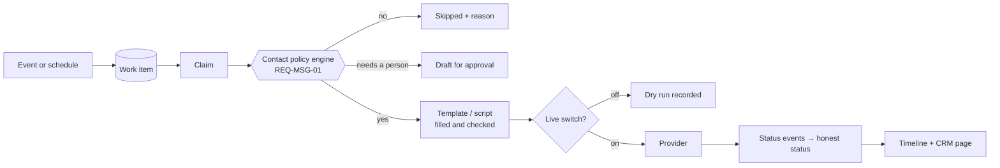

### 9.3 Contact policy engine

**REQ-MSG-01:** one database function decides, for (business, customer or address, channel, purpose, kind),
whether contact may happen **now**. It returns allow, deny (with reason), defer-until (with time) or draft-required.
It checks, in order:

1. Business status (live, not paused or suspended) and the channel's live switch.
2. Suppression list (opt-out, invalid, bounced, complaint, legal).
3. Consent for the channel **and purpose** (service vs marketing), with evidence.
4. Industry policy (sensitive industries: drafts, no relationship-revealing previews).
5. **Frequency (REQ-MSG-08), two layers:**
   - **Plan limits (commercial):** the business's plan sets the quantities, such as call attempts per sequence,
     callbacks, minutes and messages (REQ-BIL-08).
   - **Platform contact ceiling (protective):** the most any single customer can be contacted, set by the Zella Voice
     owner and never raised by a plan [D-38]. It covers attempts per sequence, unprompted messages per day and
     check-ins per visit.
   - The effective limit is the **lower** of the two.
   - **Until plans exist**, these defaults apply:
     - at most 2 call attempts per sequence, each followed by at most one message;
     - one unprompted message per customer per day per business;
     - one after-visit check-in per visit.
   - Replies to the customer are never capped.
6. Stop conditions of the sequence (reply received, resolved, booked, closed).
7. **Contact hours (REQ-MSG-07)**, in the **recipient's local time zone when known** (from their address, area code or a
   stated preference), otherwise the business's time zone:

   | Contact | Allowed window | Outside the window |
   |---|---|---|
   | Calls (callbacks, lead calls) | the business's opening hours; businesses open 24/7 use 08:00–21:00 unless they set a narrower permitted window | wait for the next opening |
   | Replies, and messages caused by the customer's own action (answers to their texts, missed-call text, booking confirmation) | immediately, any time | — |
   | Follow-up text or email after a call attempt | the same window as calls | sent at the next opening |
   | Appointment reminders | 07:00–21:00 | moved **earlier** (for example to 20:00 the evening before), never past the appointment |
   | Other service messages (reschedule/cancellation follow-ups, post-visit, feedback, waitlist offers) | 09:00–19:00 (waitlist offers: immediately if the freed slot is within 24 h, otherwise 09:00–19:00) | next window |
   | Marketing (reactivation, promotions, cross-sell) | 09:00–19:00 | next window |

   The calling window must also satisfy US calling-time rules (federal and state) for the called person's local time;
   counsel confirms which call types they cover [D-04]. Emergency inbound availability **never** grants permission for
   outbound calls.
8. Entitlements: **not enforced at this stage** (no plans yet, REQ-BIL-01). The check point exists so plans can be
   added later without redesign.
9. Template completeness (no unfilled placeholders).

**REQ-MSG-02 Opt-outs are immediate and cross-channel by purpose:**
- A STOP reply suppresses SMS for that business.
- "Don't call me" suppresses calls.
- An email unsubscribe suppresses marketing email.
- "Do not contact" suppresses everything.

Opt-outs apply to every pending work item at its next claim and cancel open sequences for that channel.

### 9.4 Templates and scripts

- **REQ-MSG-03** Templates are versioned per business, with industry defaults. Placeholders are typed; a missing
  value blocks the message.
- **REQ-MSG-04** Every message identifies the business and says how to stop (SMS) or unsubscribe (marketing email).
- **REQ-MSG-05** Outbound call scripts are approved guidance per business and purpose, not free-form prompts. The
  AI follows the business's script.
- **REQ-MSG-06 Protected template content.**
  - Businesses can edit tone, wording, greetings, appointment details and other permitted content of every
    confirmation, reminder and follow-up (text and email).
  - Protected fields cannot be removed: business identity and disclosure, STOP/opt-out instructions, unsubscribe
    links, and provider and carrier compliance fields.
  - Templates are validated on save **and** before every send; a template missing mandatory language cannot be
    saved or sent.

### 9.5 Honest status model

| Status | Meaning | Proof required |
|---|---|---|
| Scheduled | waiting for its time | — |
| Queued | due, waiting for a worker | — |
| Attempting | claimed, being sent or dialled | claim |
| Provider accepted | provider took the request | provider ID |
| Ringing | call ringing | provider event |
| Answered | the call was picked up (by a person **or** a machine) | provider event |
| No answer / Busy | not picked up | provider end reason |
| Voicemail / machine | provider classified it as a machine | provider classification. Never inferred |
| Delivered | handset or mailbox confirmed | provider delivery event |
| Failed | provider refused or failed | provider error |
| Unknown | result lost; being reconciled | — |
| Cancelled | no longer needed (reason) | — |
| Skipped | a rule said no (reason) | — |
| Not sent (test mode) | live switch off | — |

- **REQ-MSG-10** These labels are defined once and used everywhere: the CRM, the admin, exports and the AI's own
  summaries.
- **REQ-MSG-11** "Answered" never means "contacted". "Contacted" is a **conversation outcome** (§13.6).
- **REQ-MSG-12** SMS delivery receipts and email events update message status. Without a receipt, the UI shows
  "Sent", never "Delivered".

---

# Part C: Journeys

## 10. SaaS lifecycle

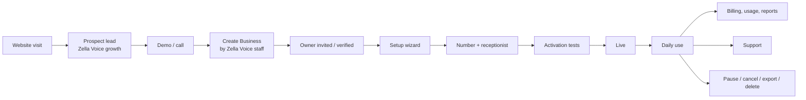

| Area | Requirement |
|---|---|
| **10.1 Public website** | REQ-LC-01: marketing pages, pricing (owner-defined), demo request and signup entry. Forms post to an edge endpoint with rate limiting and bot protection, creating a **prospect** in the growth schema. |
| **10.2 Zella Voice sales leads** | REQ-LC-02: prospects, demos, stages, owner and follow-up tasks in the growth schema; visible only with `growth.manage`; prospect emails follow the same consent rules. Never stored in a tenant. |
| **10.3 Business onboarding** | REQ-LC-03: **for now, every business is created by the Zella Voice team** in the platform admin (Create Business, §18.6). The owner is then invited, signs in and finishes setup. **Self-service signup is a later phase:** account → workspace → industry wizard → business details, time zone, hours → receptionist → phone and integrations, built on the same server functions. Every business gets an isolated workspace; **no demo data is ever loaded into production**. Duplicates are prevented by normalised name, phone and domain checks. |
| **10.4 Authentication and recovery** | REQ-LC-04: email + password, email links that need a click on our page, recovery by email, MFA (TOTP) required for platform staff and owner-enforceable for members, session revocation on role change, leaked-password protection on. |
| **10.5 Business creation** | REQ-LC-05: creates the tenant, owner membership (pending until accepted), industry defaults, capabilities, policies, templates, default automations (off until reviewed), and an audit record. Idempotent by a creation key. |
| **10.6 Invitations** | REQ-LC-06: bound to email, role-limited (admins invite at most staff/manager; only owners invite admins), expiring, revocable, resendable; accepted only from a session proven to own the email. |
| **10.7 Setup** | REQ-LC-07: wizard (§18.5) with save-and-resume, honest checklist, server-side readiness. |
| **10.8 Industry configuration** | REQ-LC-08: industry sets terminology, capabilities, modules, record types, message policy, safety lines and default automations. The owner can adjust within allowed bounds. |
| **10.9 AI receptionist setup** | REQ-LC-09: greeting, voice (approved list), languages (plan), call handling rules, transfer numbers and hours, escalation rules, emergency script, after-hours behaviour. |
| **10.10 Phone numbers** | REQ-LC-10: **initially, businesses forward their existing number to their Zella Voice number**, after Zella Voice verifies ownership and forwarding with a test call. Buying new numbers through the telephony provider comes in a later phase. Live calling is never switched on until the provider configuration and test calls are verified. Numbers are assigned per business, with purpose inbound/outbound. Outbound caller ID must be a number the business owns or Zella Voice provides **for that business**, never shared across businesses. Routing: called number → business, enforced in the database. |
| **10.11 Knowledge** | REQ-LC-11: §16. Activation requires a minimum knowledge set [D-24]. |
| **10.12 Services, hours, prices, booking rules** | REQ-LC-12: services (duration, price **entered by the business**, buffers, resources, staff), opening hours, holidays, closures, notice and horizon, approval-required bookings. |
| **10.13 Provider connections** | REQ-LC-13: calendar (Google, Microsoft), lead sources, store (Shopify), reviews. OAuth with signed state; health checks; reconnect prompts. |
| **10.14 Testing and activation** | REQ-LC-14: an activation checklist the server computes. Each item must pass before the business goes live: hours, at least one service or "no bookings", knowledge minimum, number routed, test inbound call answered and recorded, test message (dry run), transfer number verified, owner sign-off. Results are stored in `activation_tests`. |
| **10.15–10.18 CRM, admin, billing, reports** | §18, §17, REQ-RPT below |
| **10.19 Support and incidents** | REQ-LC-19: in-app support requests, tickets linked to the business, audited support access, incident status page, notification of affected businesses. |
| **10.20 Pause, cancel, export, retention, offboarding** | REQ-LC-20: owner can pause (receptionist takes messages only [D-25]), schedule cancellation (signed "continue my plan" link), export everything (CSV/JSON + files), and data is deleted on the retention schedule after cancellation. All steps audited. |

**REQ-RPT-01 Reports:**
- Daily summary at 08:00 business time: calls, missed, leads, bookings, overdue callbacks.
- Weekly review.
- Scheduled report emails.
- On-screen analytics.

All are computed in the business time zone, DST-safe, and visible only to permitted roles.

---

## 11. Inbound calls and the AI receptionist

### 11.1 Call flow

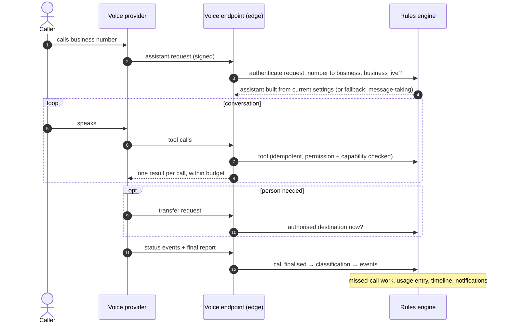

| ID | Requirement |
|---|---|
| REQ-VOX-01 | The assistant is assembled **per call** from current settings; every delivery is recorded (`served`, `not_ready`, `unknown_number`). |
| REQ-VOX-02 | If the business is not ready or the database is unreachable, a **standby assistant** answers, takes a message and promises a callback; the message is stored once recovered. |
| REQ-VOX-03 | Tools: check hours; search knowledge; look up / update caller; check availability; book / find / reschedule / cancel appointment; take message; request follow-up; report emergency; transfer to a person; report unanswered question; look up order (if Orders on). Each is idempotent per tool-call ID, permission- and capability-checked, answered within budget (DB step p95 < 800 ms; whole request well under the provider timeout). |
| REQ-VOX-04 | Facts only from tools and `ready` knowledge; read back before committing; never advise on medical/legal/financial matters; emergencies → emergency services first; identify as an assistant if asked. |
| REQ-VOX-05 | Booking changes over the phone require REQ-ID-01. |
| REQ-VOX-06 | Transfers only to numbers each business authorises: the owner by default, or the people or roles the business chooses, with hours (on-call rota). The transfer number is never shown to the AI model; the backend performs the transfer. If the recipient doesn't answer, the AI: (1) detects the failed transfer; (2) returns to the caller; (3) says the person is unavailable right now; (4) offers to take a message or arrange a callback; (5) creates **one** urgent callback task; (6) notifies the right staff member. It never says a transfer succeeded when it did not. |
| REQ-VOX-07 | Unanswered questions are always logged, with or without caller contact. |
| REQ-VOX-08 | Every call is finalised exactly once from the final report: duration, end reason, classification, summary, transcript and recording references (per privacy settings). Calls without a final report are reconciled with the provider within 15 minutes [D-26]. |
| REQ-VOX-09 | Call recording is **off** until recording consent and caller disclosures are legally reviewed [D-27]. When enabled, it follows the business's notice and consent settings. Retention: recordings 30 days, transcripts 90 days (§20). |
| REQ-VOX-10 | AI changes (prompt, tools, model, voice) pass the per-industry evaluation set before release. |

---

## 12. Missed calls

### 12.1 Final classification (exactly one per inbound call)

| Classification | Definition | Default next step |
|---|---|---|
| `answered_ai_resolved` | AI handled it; no person needed | none |
| `answered_ai_unresolved` | AI answered; caller needs a person or follow-up | callback (`needs_person`) |
| `answered_human` | transfer connected; a person talked | none (close any open callback) |
| `transfer_failed` | caller asked for a person; transfer failed or no one available | urgent callback |
| `abandoned_before_answer` | caller hung up before the assistant answered | missed-call journey |
| `not_answered` | rang without being answered (provider or capacity issue) | missed-call journey |
| `failed` | provider or system error | missed-call journey **if** the caller number is known and the caller is eligible (REQ-MC-11) + platform alert |
| `spam` | spam rules matched | none (logged) |
| `unknown` | final report missing | reconcile (REQ-VOX-08), then classify |

"Missed" = `abandoned_before_answer`, `not_answered`, and `failed` with a known number.

### 12.2 Missed-call journey

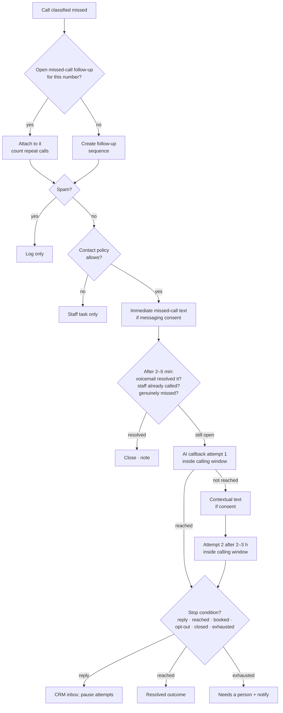

| ID | Requirement |
|---|---|
| REQ-MC-01 | Repeat calls from the same number within the open follow-up are grouped, not duplicated; each call still appears on the timeline. |
| REQ-MC-02 | At most one immediate missed-call text per missed-call follow-up (REQ-MC-10). |
| REQ-MC-03 | A reply from the customer pauses pending attempts and puts the conversation in the inbox. |
| REQ-MC-04 | If staff called the customer (logged call or manual attempt), the automated sequence stops unless staff choose to continue. |
| REQ-MC-05 | Opt-out at any point cancels the remaining sequence for that channel. |
| REQ-MC-06 | Failed SMS or call attempts follow their own retry rules; when exhausted → "Needs a person" with the full attempt history. |
| REQ-MC-07 | Business controls on each follow-up: pause, resume, retry now, assign, close with outcome. |
| REQ-MC-08 | Safe testing: test mode records every decision as a dry run; a test number list can be enabled for real end-to-end tests. |
| REQ-MC-09 | Settings per business, with these **defaults**: AI callback on; first attempt about 2–5 minutes after the missed call; at most **2** attempts, about 2–3 hours apart (inside the calling window); a contextual text between attempts if messaging consent exists. Businesses can turn the AI callback off (staff task instead). |
| REQ-MC-10 | **Immediate missed-call text** (default on, where messaging consent and preferences allow): "Hi, this is {{business_name}}. Sorry we missed your call. We can help you shortly. How can we assist?" (editable, REQ-MSG-06). Once per missed-call follow-up. |
| REQ-MC-11 | **Before the first callback**, the system verifies: the call was genuinely missed; any voicemail the caller left hasn't already resolved the request; no staff member has already returned the call; the caller is eligible (consent, suppression, spam). |
| REQ-MC-12 | **Withheld or anonymous number:** no automated callback and no attempt to identify the caller. Staff get a notification or task: "Anonymous caller missed at {time}". |
| REQ-MC-13 | **Spam before every callback:** high-risk spam is blocked or handled by the spam policy. Medium-risk or uncertain calls get **no automatic callback** and go to a staff review queue. A spam classification can never start outbound contact. |
| REQ-MC-14 | When both attempts fail: callback status "needs a person", a staff task, and the full attempt history on the timeline. |

---

## 13. Leads and outgoing lead calls

### 13.1 Two separate lead worlds

| | Zella Voice prospects (growth) | Business leads (tenant) |
|---|---|---|
| Storage | platform growth schema | tenant `customers` (lifecycle = lead) |
| Access | `growth.manage` platform staff | business members by role |
| Calls | by Zella Voice sales staff (or AI if decided) from Zella Voice numbers | from the business's own outbound number |
| Rules | same contact policy engine, platform as "business" | business's policy |

### 13.2 Lead intake

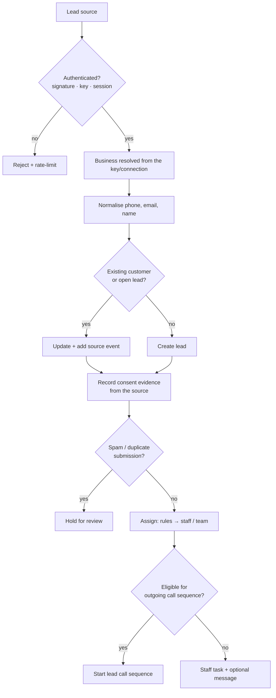

Sources:
- REQ-LEAD-01: Google Ads lead forms (per-business key).
- REQ-LEAD-02: website forms (form key, bot check).
- REQ-LEAD-03: incoming calls (caller saved as a lead).
- REQ-LEAD-04: inbound SMS and email from unknown senders.
- REQ-LEAD-05: Meta lead ads (signed webhook, then a fetch).
- REQ-LEAD-06: manual entry and CSV import (staff; import requires a stated consent basis).
- REQ-LEAD-07: other connected sources through the same intake function.

### 13.3 Outgoing call configuration (per business)

| Setting | Values | Default |
|---|---|---|
| Lead calls enabled | on/off | off |
| Handler | AI / staff / AI then staff | **AI** (if the lead asks for a person: transfer to the owner or the people the business chooses, REQ-VOX-06) |
| Eligible sources | Google Ads forms, website forms, Meta lead forms, manually added leads, approved CRM/API integrations | all of them, but a source never authorises a call by itself: every lead passes consent, eligibility, duplicate and opt-out checks first |
| Caller number | one of the business's outbound numbers | required to enable |
| Calling hours and days | the business's opening hours (24/7 businesses: 08:00–21:00 unless configured narrower), checked in the **lead's local time zone when known**, else the business's | business hours (REQ-MSG-07) |
| First-call delay | time after the lead arrives | **about 1 minute**; if closed, queued for the next opening |
| Max attempts, spacing | numbers | **set by the business's plan** within the platform ceiling (REQ-BIL-08); until plans exist **2 attempts per follow-up sequence**, about **2–3 hours** apart |
| Voicemail behaviour | none / leave approved message | **leave a short, professional voicemail** where consent and calling rules permit; never sensitive information |
| Follow-up message after an unsuccessful attempt | SMS / email | **one contextual message** after each unsuccessful attempt (text and/or email, by consent); none if the customer already replied or the lead is closed |
| After the sequence is exhausted | — | lead status **Unreachable** + staff task for manual follow-up; never deleted; staff can reopen |
| Assignment and escalation | team / person; when to hand to staff | business |
| Consent basis required | per source; evidence stored with the lead | required for automated (AI-voice) calls and texts. US rules for artificial-voice calls and texts need counsel review [D-04] |
| Script / guidance | approved per purpose | business (template) |
| Industry restrictions | from industry policy | industry |
| Kill switch | per business and platform-wide | on hand |

### 13.4 Lead call sequence

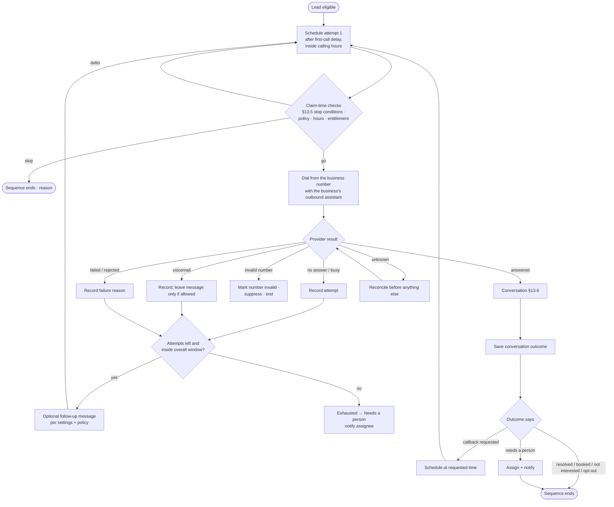

### 13.5 Stop conditions

They are rechecked **immediately before every call, SMS or email** (REQ-OUT-10):

| Condition | Effect |
|---|---|
| Opt-out, "don't call", do-not-contact, suppression | end; suppress channel |
| Not interested | end; lead status lost (reason) |
| Resolved by AI or staff | end |
| Appointment booked (if the sequence is set to stop on booking) | end |
| Customer replied by text or email | pause; inbox; staff decides |
| Staff paused or closed the lead | pause / end |
| Invalid number | end; mark number invalid |
| Business disabled the sequence, or paused the business | pause all attempts at next claim |
| Outside calling hours or past the overall window | defer / end |
| Attempts exhausted | end → Needs a person |
| Consent missing or withdrawn | end |
| Duplicate or spam confirmed | end |
| Entitlement exhausted | defer; notify owner |

### 13.6 When the lead answers

| Step | Requirement |
|---|---|
| 1 | Provider reports answered (REQ-OUT-11). Machine detection is used **only** if the provider classifies it and its accuracy is acceptable; otherwise the assistant listens before speaking. On voicemail, leave the short approved message (D-10). |
| 2 | Introduce: the business name, that this is an assistant, why it is calling (reply to their enquiry), per the approved script. |
| 3 | Ask permission to continue; on "no" → record `declined_now` and offer a better time or stop. |
| 4 | Handle the request with the **same tools as inbound**: answer from knowledge, offer times, book (after confirmed success only), take a message, transfer, schedule a callback, record "not interested", record opt-out. |
| 5 | Save the **conversation outcome** (REQ-OUT-12): `booked`, `resolved`, `callback_requested`, `message_taken`, `transferred`, `not_interested`, `opted_out`, `wrong_person`, `language_barrier`, `no_conversation` (answered but nothing meaningful), `hung_up_early`. |
| 6 | Update the lead status and the timeline; cancel future attempts per §13.5; notify staff if a person is needed; start permitted follow-up. |

**"Contacted" (REQ-OUT-13)** is set only for the conversation outcomes the business counts as contact [D-17]. Never
for `no_conversation` or `hung_up_early`.

**REQ-OUT-14 Picked up and hung up** counts as an **unsuccessful attempt**, not contact:
- the attempt is recorded with outcome `hung_up_early`, with notes on the callback in the CRM;
- one contextual follow-up message is sent if messaging consent exists and the lead hasn't replied or closed;
- the next attempt follows the normal spacing.

### 13.7 When the lead does not answer

| Attempt outcome | Recorded | Retry? | Message after? | Notes |
|---|---|---|---|---|
| `no_answer` | yes | if attempts left | per settings | — |
| `busy` | yes | yes, at least the spacing later | per settings | — |
| `voicemail` | yes (provider classified) | yes | yes: leave a short professional voicemail (no sensitive details), then one contextual text or email if consent | — |
| `invalid_number` | yes | no | no | suppress number |
| `rejected` (carrier/provider) | yes | limited | no | alert if repeated (possible spam labelling) |
| `provider_failure` | yes | yes, **not counted** toward the 2 customer attempts (our failure, not theirs) | no | alert |
| `timeout` | yes | after reconciliation | no | — |
| `unknown` | yes | **only after reconciliation** | no | prevents duplicate calls |

**When the sequence is exhausted** (2 attempts plus their follow-up messages):
- the lead status becomes **Unreachable**;
- a staff task is created for manual follow-up;
- the assignee is notified, with the full attempt history;
- automated contact stops.

The lead is never deleted, and staff can reopen it, which starts a new sequence only if they choose.

**Sequence summary (defaults):**

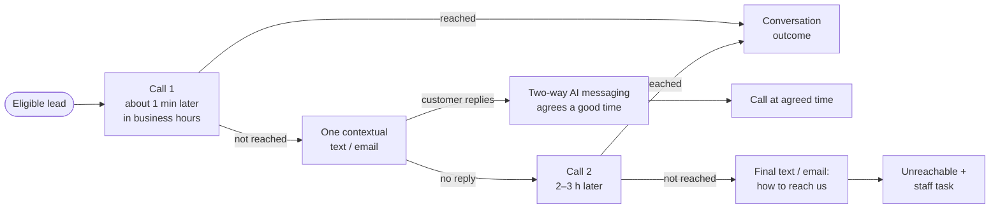

### 13.8 Attempt history (REQ-OUT-20)

Every attempt stores:
- business, lead/customer, sequence and callback IDs;
- attempt ID and number;
- scheduled and actual start, in UTC plus the business time zone;
- calling number and provider call ID;
- final provider status;
- **attempt outcome** and **conversation outcome**;
- duration, and handler (AI assistant version or staff member);
- summary and transcript reference (if permitted);
- failure reason;
- the policy decision (which checks passed);
- next action and next due time;
- correlation ID and audit entries.

**Five statuses, never merged (REQ-OUT-21):**

| Status | Values (target) |
|---|---|
| Lead status | new, working, contacted, qualified, booked, converted, not_interested, unreachable, lost |
| Attempt status | scheduled, attempting, ringing, answered, no_answer, busy, voicemail, invalid_number, rejected, failed, unknown, cancelled, skipped |
| Conversation outcome | §13.6 list |
| Callback / task status | open, scheduled, in_progress, paused, waiting_reply, needs_person, resolved, closed, cancelled |
| Appointment status | §15 |

---

## 14. SMS and email

### 14.1 Message catalogue (target)

| Message | Trigger | Purpose | Channels | Timing | Cancel when | Reply handling |
|---|---|---|---|---|---|---|
| Missed-call text | missed call | service | SMS | immediately | caller reached | inbox; pause attempts; AI may reply (§14.3) |
| Lead follow-up | sequence rule | service (first contact to an enquiry) [D-04] | SMS, email | after attempt N | resolved, reply | inbox |
| Booking confirmation | booked | service | SMS/email (customer preference) | immediately | cancelled | inbox; "C" not required |
| Reminder(s) | before start | service | same | REQ-MSG-30 schedule; 07:00–21:00, moved earlier | moved, cancelled, checked in | inbox |
| Reschedule / cancellation confirmation | changed | service | same | immediately | — | inbox |
| Check-in reminder / link (**later phase**) | before start | service | SMS | with self check-in | checked in | — |
| Waitlist offer | slot freed | service | SMS (+ email if chosen) | immediately | expired, slot gone | link |
| No-show follow-up | no-show | service | per policy | per policy | rebooked | inbox |
| Post-visit / feedback | completed | service | per industry | per industry | — | inbox |
| Review request | completed + link | [D-16] | per policy | per policy | — | — |
| Reactivation, cross-sell, promotions | schedule / rule | **marketing** | SMS/email with opt-in | 09:00–19:00 | opt-out | inbox |
| Callback reminder | staff, before due | internal | in-app, email, SMS | before due | done | — |
| Staff notification | needs a person, escalation, new lead | internal | per member preference | immediately | read | — |
| Business reports | schedule | internal | email | 08:00 local / weekly | — | — |
| Integration disconnected | health | internal | email + in-app | immediately, then daily | reconnected | — |
| Billing notifications | payment events | internal | email | immediately | paid | — |
| Knowledge notices | gaps, conflicts | internal | email + in-app | weekly | resolved | — |
| Invitation, password, sign-in | auth | transactional | email | immediately | — | — |

**REQ-MSG-30 Reminder schedule** (business time zone), computed from the notice between booking and appointment:

| Booked | Reminders |
|---|---|
| more than 48 h ahead | 24 h and 2 h before |
| 1–48 h ahead (not same day) | one, 2 h before if that is still in the future; otherwise 1 h before |
| same day (at least 1 h ahead) | one, 1 h before |
| less than 1 h ahead | confirmation only, no reminder |

Rules for reminders:
- Reminders are sent only between **07:00 and 21:00** in the customer's local time (business time if unknown). A
  reminder that would fall outside that window moves **earlier**, never later. If no earlier time remains after the
  booking was made, that reminder is dropped and the confirmation stands.
- Rescheduling cancels pending reminders and recalculates from the new time.
- Cancelling cancels them.
- Never a duplicate: one dedupe key per appointment, version and offset.
- Reminders are informational and need no reply, but replies are understood (REQ-MSG-40).
- **Confirmations** go by text **and** email (each where consent and address exist).
- Every booking also appears in the business's CRM calendar at once.

Every message goes through §9.2–9.5 with a dedupe key (`kind:entity:version`). Each send is visible on the customer
timeline (customer messages) or in notifications (internal messages), with an admin view across businesses.

### 14.2 Inbound replies

- **REQ-MSG-20** SMS replies: STOP and its variants opt out, START opts in, HELP sends help. Any other reply goes to
  the CRM inbox and pauses related sequences.
- **REQ-MSG-21** Email replies arrive through the inbound email domain into the inbox, signed and rate-limited.
- **REQ-MSG-22** Staff reply from the inbox; replies are service messages and go immediately.

### 14.3 Two-way AI messaging (text and email)

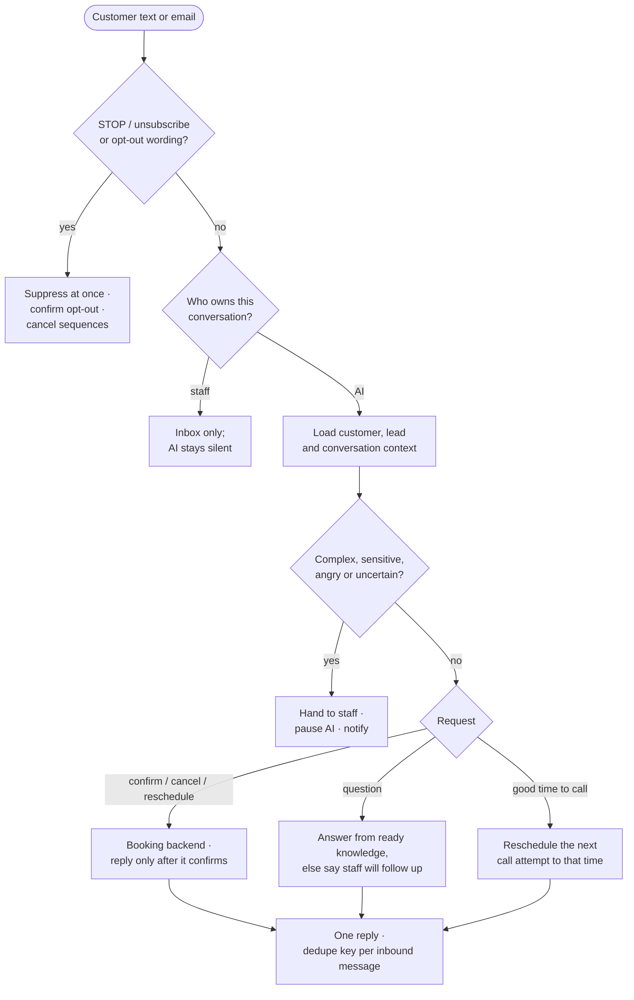

| ID | Requirement |
|---|---|
| REQ-MSG-40 | The AI may reply automatically by text and email to inbound replies, where the customer has consented and the business's rules allow it. It uses the existing conversation and the lead or appointment context. |
| REQ-MSG-41 | STOP and other opt-out wording are honoured **immediately**, before any AI processing. |
| REQ-MSG-42 | Exactly one reply per inbound message (dedupe key = inbound message ID); no reply loops (max AI replies per conversation per hour [D-32]). |
| REQ-MSG-43 | Booking changes go through the authorised booking backend; the AI describes a change as done only after the backend confirms it. |
| REQ-MSG-44 | Complex, sensitive or uncertain conversations, and every message in regulated industries, are escalated to staff. |
| REQ-MSG-45 | Staff can take over any conversation. AI replies then stay paused until a staff member explicitly hands control back. The current owner (AI or staff) is shown in the inbox. |
| REQ-MSG-46 | If the customer gives a good time to call, the next call attempt is moved to that time, inside the calling window. |
| REQ-MSG-47 | AI messaging usage and cost are metered per business (REQ-BIL-07). |

---

## 15. Appointments, check-in and waitlist

### 15.1 Lifecycle

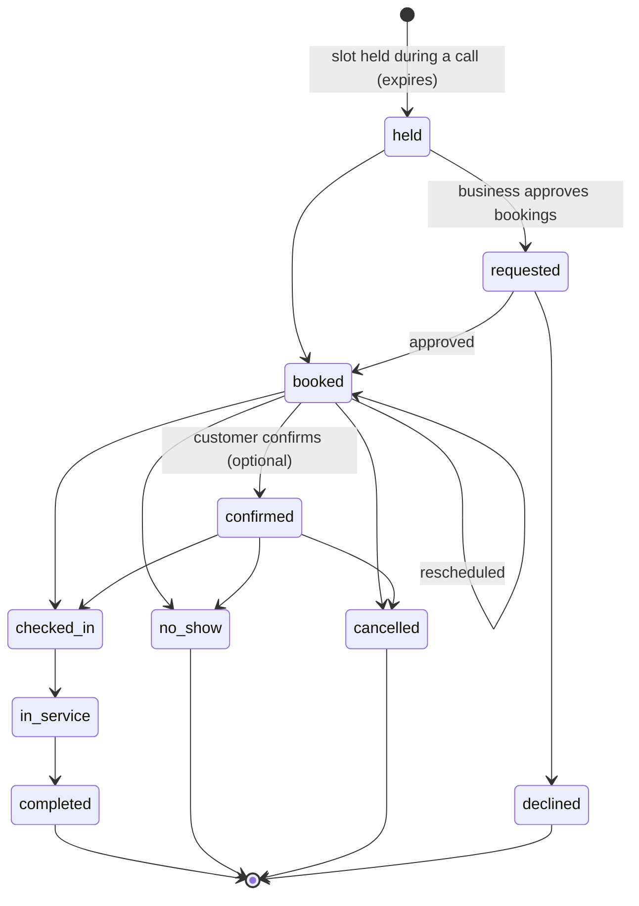

| ID | Requirement |
|---|---|
| REQ-APT-01 | Zella Voice's database is the **booking authority**. External calendars are mirrors plus busy-time sources. |
| REQ-APT-02 | Availability = hours − closures − holidays − existing bookings − holds − buffers − staff/resource conflicts − **external busy times**. External busy times must be fresh (push notifications, or a pull no older than N minutes before offering a slot [D-28]). |
| REQ-APT-03 | Booking takes a per-business lock, re-checks availability inside the lock, and writes once (idempotent per request). |
| REQ-APT-04 | Uncertain result (timeout): the next request with the same key returns the first result; the AI says only what the system confirms. |
| REQ-APT-05 | External conflict after booking (calendar shows a clash): flag for staff; never silently move a customer. |
| REQ-APT-06 | Confirmation and reminders are created on booking and cancelled or replaced on change. |
| REQ-APT-07 | All times in the business time zone; customer-facing times in the customer's zone if known. |
| REQ-APT-08 | Customer self-service: signed links to view, reschedule or cancel (policy windows apply). |

### 15.2 Check-in

| ID | Requirement |
|---|---|
| REQ-CHK-01 | Staff check-in: arrived → checked in → in service → completed, each logged with who and when. Undo is possible within a window. |
| REQ-CHK-02 | **Initial version: staff-managed check-in only.** The design keeps room for customer self check-in later (a signed link in the reminder, a reply "HERE", or a QR code at the location), switched on per business through a business-level permission. |
| REQ-CHK-03 | Late arrival and no-show rules: after N minutes [D-36], prompt staff to mark no-show. Nothing is assumed automatically. |
| REQ-CHK-04 | Check-in cancels pending reminders for that appointment. |

### 15.3 Waitlist

| ID | Requirement |
|---|---|
| REQ-WL-01 | Customers join by phone (AI), by link, or through staff, with preferences (service, staff, days, times, earliest/latest). |
| REQ-WL-02 | When a slot frees up, the matching entries are ranked [D-29: first-come, priority, or best fit]. |
| REQ-WL-03 | Offers go **one at a time** by default, with an expiry [D-29]. Optional "first to accept" broadcast mode, protected by the booking lock: later accepters are told politely that it is taken. |
| REQ-WL-04 | Acceptance books under the lock after re-checking availability (including external busy times). |
| REQ-WL-05 | When the slot disappears (booked by staff, external busy), open offers are withdrawn at once. |
| REQ-WL-06 | Offers are service messages; they respect suppression and contact hours (REQ-MSG-07: immediately if the slot is within 24 h, otherwise 09:00–19:00). |
| REQ-WL-07 | The CRM shows entries, offers sent, expiries and acceptances. |

---

## 16. Knowledge

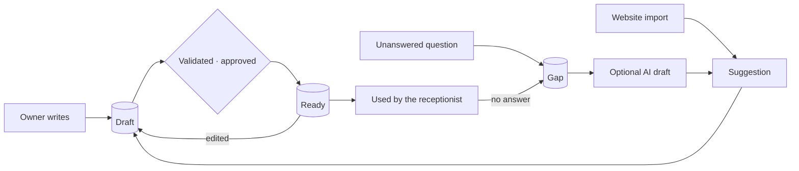

| ID | Requirement |
|---|---|
| REQ-KNW-01 | Only `ready` items are used. Readiness is set **in the database** when the owner approves an item; it does not depend on an external worker being on. |
| REQ-KNW-02 | Every edit creates a version; an approval applies only to the version approved. |
| REQ-KNW-03 | Gaps are logged for every unanswered question, counted, and shown weekly. |
| REQ-KNW-04 | When the receptionist can't answer, the AI writes the best suggested answer (Anthropic API), from the business's own information only. The owner (or an authorised user) reviews, edits and publishes it. Drafts are never used until approved. |
| REQ-KNW-07 | AI drafting usage and estimated cost are tracked per business. Each business has a configurable internal monthly budget, with alerts at configurable thresholds (default 75% and 90%). Platform admins can see usage and cost. Retries are capped to prevent runaway loops. Reaching the budget pauses **optional drafting only**: it never disables the core receptionist. |
| REQ-KNW-05 | Conflicting items are detected and shown. |
| REQ-KNW-06 | Per-industry evaluation cases run before any AI change and weekly. |

---

## 17. Billing, plans and usage

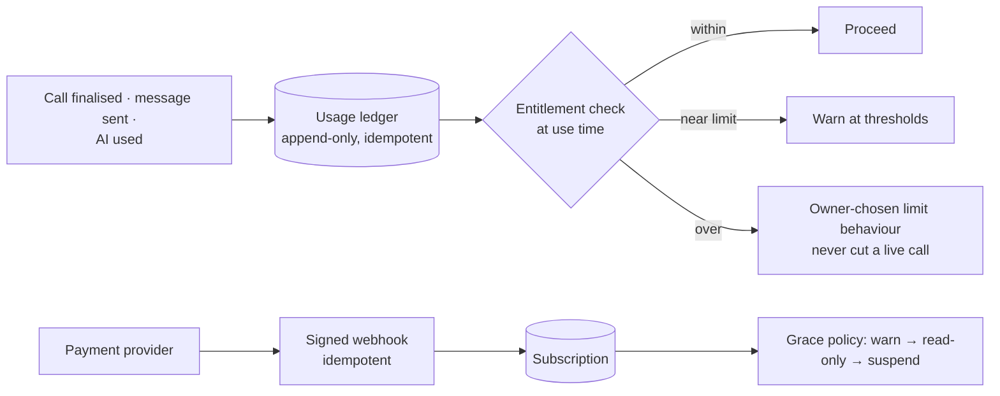

| ID | Requirement |
|---|---|
| REQ-BIL-01 | Subscription plans, prices and minute allowances are **defined later by the Zella Voice owner** (D-34). Until then no plans exist and no plan-based limits apply. The billing architecture (ledger, payment webhook, entitlement check points) is designed so plans and a payment provider can be added without redesign. |
| REQ-BIL-02 | Usage is metered from an append-only ledger (one entry per finalised call; adjustments, never edits). Our failures are never billable. |
| REQ-BIL-03 | Entitlement **check points** sit at use time: assistant assembly, outbound claims, messaging claims, AI features. They enforce limits only once plans exist; the core receptionist is never cut mid-call. |
| REQ-BIL-04 | Payment provider handles cards and invoices; Zella Voice stores no card data. Webhooks are signed and idempotent. |
| REQ-BIL-05 | Billing page for owners: plan, usage, invoices, payment method (provider portal), cancellation. |
| REQ-BIL-06 | Grace policy on failed payment; no data deleted within the grace and export window. |
| REQ-BIL-08 | **Plan-defined limits.** When the owner creates plans, each plan sets the business's quantities: AI voice minutes, inbound and outbound calls, callbacks, call attempts per follow-up sequence, messages (SMS and email), AI messaging and AI drafting. They are enforced at the entitlement check points (REQ-BIL-03). Plans choose values **within** the platform contact ceiling (REQ-MSG-08); they never raise it. Until plans exist, the defaults in REQ-MSG-08 and §13.3 apply. |
| REQ-BIL-07 | **AI usage and cost tracking (now):** voice minutes, AI drafting, AI messaging and call intelligence are metered per business, with estimated cost, internal budgets, threshold alerts and a platform admin view. Budgets for optional features never stop the core receptionist. |

---

# Part D: Applications

## 18. Web application

### 18.1 Surfaces and routing

| Surface | Host / path | Users | Auth |
|---|---|---|---|
| Public website | `zellavoice.com` | prospects | none |
| Business CRM | `app.zellavoice.com/app/*` | business members | session + business membership |
| Platform admin | `admin.zellavoice.com/*` | platform staff | session + platform permission + MFA |
| Customer pages | `/r/<token>` reschedule, `/w/<token>` waitlist, `/c/<token>` check-in (later phase), `/u/<token>` unsubscribe, `/continue-plan`, `/status` | customers, public | signed token / none |
| Auth pages | `/welcome` (email link landing with Continue), sign-in, reset | everyone | — |

- **REQ-WEB-01** Each surface is code-split; customer pages never load CRM or admin code.
- **REQ-WEB-02** URL-based routing with leave guards for unsaved changes.
- **REQ-WEB-03** All data through RPCs or RLS-protected reads; no direct writes to tables that only the server may
  change.
- **REQ-WEB-04** Every page has distinct loading, empty, error, stale, unauthorized and success states.
- **REQ-WEB-05** Accessibility at WCAG 2.2 AA; 360 px and 1280 px layouts; performance budget per the rulebook (UX-22).
- **REQ-WEB-06** Design tokens only; one component library; industry terminology everywhere.

### 18.2 Page specification format

Each page below lists: **job** (what the user needs to do), **data** (sources), **actions**, **roles**, **states**
(beyond the standard ones), **connected automations**, **provider dependencies**.

### 18.3 Business CRM pages

| ID | Page | Job | Data | Actions | Roles | Notes / connected automations |
|---|---|---|---|---|---|---|
| REQ-CRM-01 | **Today** | What needs me now | needs-a-person calls, due callbacks, leads waiting, today's bookings, check-ins, failed sends, alerts | open, call, assign, mark | all (viewer read) | A2, A5, A15, A16 |
| REQ-CRM-02 | **Calls** | Review every call | calls with classification (§12.1), handler, outcome, transfer, duration, summary; transcript if permitted | set outcome, call back, create callback, open customer | all; transcripts manager+ (industry rules) | A1, A23 |
| REQ-CRM-03 | **Outgoing calls** | See every attempt | attempts with attempt + conversation outcome, next action | retry now, pause, stop, listen/summary | staff+ | A5, A2 |
| REQ-CRM-04 | **Callbacks** (missed calls, lead calls, needs a person) | Work the follow-up queue | callback/sequence status, attempts, due time, assignee | call now (staff), schedule, assign, pause, resume, close with outcome | staff+ | A2, A5, A15, A16 |
| REQ-CRM-05 | **Leads** | Convert enquiries | leads by status, source, owner, age; speed-to-lead | add, import, assign, start/stop sequence, convert, mark lost | staff+ | A4, A5, A6 |
| REQ-CRM-06 | **Inbox** | Reply to customers | conversations (SMS, email), unread, assigned | reply, assign, close, mark spam | staff+ | MSG-20–22 |
| REQ-CRM-07 | **Customers** | Know each person | profile, contact details, consent and suppressions, **unified timeline** (§18.4), records, appointments | edit, merge duplicates, export (owner), delete (owner) | staff+ (viewer read) | — |
| REQ-CRM-08 | **Calendar** | Manage bookings | appointments, holds, blocks, external busy times | book, move, cancel, block time | staff+ | A7–A9 |
| REQ-CRM-09 | **Check-ins** | Run arrivals | today's appointments with arrival state | arrived, checked in, in service, completed, no-show, undo | staff+ | CHK-* |
| REQ-CRM-10 | **Waitlist** | Fill gaps | entries, offers, expiries | add, remove, offer manually | staff+ | A14 |
| REQ-CRM-11 | **Industry records** | Industry objects | records by type, status, due dates, files, private fields (managers/assigned staff) | create, update status, attach files | staff+ | A28 |
| REQ-CRM-12 | **Money** (if capability on) | Invoices and payments recorded (no cards) | charges, payments | raise (staff), record payment/refund (manager+) | staff+ | — |
| REQ-CRM-13 | **Tasks & follow-through** | Internal work | tasks, approvals, milestones, problems | complete, assign | staff+ | A28 |
| REQ-CRM-14 | **Suggested messages** | Approve drafts | drafts with reason | send, edit, discard | staff+ | A12, sensitive industries |
| REQ-CRM-15 | **Sending failed** | Fix failures | failed messages and calls with reason | retry (queued), fix contact, dismiss | owner/admin retry | §8.2 |
| REQ-CRM-16 | **Reports** | Understand performance | answered rate, missed, speed-to-lead, bookings, sources, AI resolution, costs vs plan | schedule reports | owner/admin/manager | A18 |
| REQ-CRM-17 | **AI receptionist** | Configure the voice | greeting, voice, languages, rules, transfers, hours, escalation, test call | edit, publish version, test | owner/admin | REQ-VOX-* |
| REQ-CRM-18 | **Knowledge** | Teach the receptionist | items (draft/ready), gaps, suggestions, conflicts | add, approve, archive | owner/admin/manager | A19, A20 |
| REQ-CRM-19 | **Automations** | Control what happens automatically | every automation (A2–A28 that apply), its switch, settings and last outcomes | toggle, edit settings, pause all | owner/admin | — |
| REQ-CRM-20 | **Outreach settings** | Lead calls and missed-call follow-up | §13.3 and REQ-MC-09 settings | edit (owner/admin) | owner/admin | — |
| REQ-CRM-21 | **Lead sources** | Connect sources | forms, Google keys, Meta pages, imports | create keys, connect, test | owner/admin | A4 |
| REQ-CRM-22 | **Integrations** | Calendars, store, reviews | connection health | connect, reconnect, disconnect | owner/admin | A21 |
| REQ-CRM-23 | **Team** | People and access | members, invites, roles, on-call, notification preferences | invite, change role, remove | owner/admin | — |
| REQ-CRM-24 | **Settings** | Business profile, hours, services, policies, templates, appearance | — | edit | owner/admin | — |
| REQ-CRM-25 | **Billing** | Plan and usage | plan, usage vs limits, invoices | change plan, payment portal, cancel | owner | §17 |
| REQ-CRM-26 | **Support** | Get help | tickets | open, reply | owner/admin | — |
| REQ-CRM-27 | **Spam protection** | Handle abuse | incidents, allow/block lists | confirm, allow, block | owner/admin | A27 |
| REQ-CRM-28 | **Security log, data rights** | Oversight | sign-ins, privileged changes, requests | export, respond | owner | A30 |

### 18.4 Unified customer timeline (REQ-CRM-30)

One chronological list per customer, scoped to one business. It shows:
- incoming calls (classification and summary);
- outgoing attempts (attempt and conversation outcome);
- missed calls;
- SMS and email in both directions (honest status);
- replies;
- callback requests and their status;
- appointments and their changes;
- check-ins;
- staff actions and notes;
- consent changes and opt-outs;
- automation outcomes, including **skipped with reason**;
- record events.

Each item links to its source, and the timeline is filterable by type.

### 18.5 Platform admin pages

| ID | Page | Job | Permission |
|---|---|---|---|
| REQ-ADM-01 | Overview | platform health and growth KPIs | any |
| REQ-ADM-02 | Businesses (search, filters by status, detail) | find and support a business; pause/suspend; view readiness, numbers, usage, alerts | `businesses.view/manage` |
| REQ-ADM-03 | **Create Business** | §18.6 | `businesses.manage` |
| REQ-ADM-04 | Users & platform roles | manage platform staff | Zella Voice owner |
| REQ-ADM-05 | Plans & offers | define plans and promotions | `plans.manage` |
| REQ-ADM-06 | Billing | subscriptions, failed payments, credits | `billing.*` |
| REQ-ADM-07 | Voice & numbers | buy/assign/release numbers, caller-ID status, assistants | `telephony.manage` |
| REQ-ADM-08 | Providers & integrations health | provider status, credentials present (not values), test results | `integrations.manage` |
| REQ-ADM-09 | Automation queues | queue depth, oldest due, stuck queues, dispatcher state, dead letters, retry | ops |
| REQ-ADM-10 | Outgoing call attempts (cross-business) | spot carrier rejections and anomalies | ops |
| REQ-ADM-11 | Failed messages | cross-business failures | `comms.manage` |
| REQ-ADM-12 | Spam & abuse | incidents, global rules | `security.*` |
| REQ-ADM-13 | Support | tickets, audited access to a business | `support.manage` |
| REQ-ADM-14 | Audit logs | every privileged action | `audit.view` |
| REQ-ADM-15 | Monitoring & incidents | alerts, status page incidents | ops |
| REQ-ADM-16 | Platform settings & kill switches | live switches per channel, per business override, maintenance mode | Zella Voice owner |
| REQ-ADM-17 | Industry configuration | presets, policies, safety lines, defaults | `ai.configure` |
| REQ-ADM-18 | Growth (prospects, demos) | Zella Voice sales pipeline | `growth.manage` |

**REQ-ADM-20 Access states:** loading, authorized, unauthorized (signed out, MFA needed, no permission) and failed
(couldn't check; grants nothing). A refusal always applies; a failed background refresh keeps the current view.

### 18.6 Create Business (REQ-ADM-03)

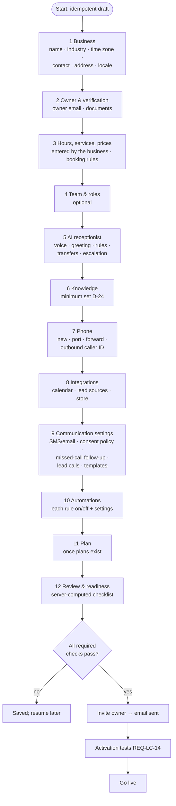

| Concern | Requirement |
|---|---|
| Save, resume, duplicates | Every step is saved server-side; the draft resumes at the first incomplete step. A creation key prevents a second business on a double submit. A duplicate name, phone or domain shows a warning. |
| Validation | Server-side per step; nothing is written to live tables until the step's checks pass. |
| Failure and rollback | Each step is atomic. A failed invite leaves the business inactive and retryable. Abandoned drafts expire [D-30]. |
| Audit | Every step and every change is audited. |
| Provider readiness | Numbers, calendar and lead sources are each checked, with a clear "not set up yet" state. |
| Test call and message readiness | Part of the activation tests before go-live. |

---

# Part E: Operations

## 19. Integrations

**REQ-INT-01 Provider adapter contract:** one adapter per provider with:
- a switch, with dry-run behaviour when off;
- credentials in Vault or the worker credential store, never in code or logs;
- timeouts;
- one shared module that maps provider results to Zella Voice outcomes;
- signature verification for inbound events;
- a health check;
- an exit plan.

| Provider type | Choice | Notes |
|---|---|---|
| Voice orchestration | Vapi | inbound assistant per call; outbound assistant per business; server tools |
| Phone numbers / carrier | **forwarding of existing numbers first** (D-07), then numbers bought through Vapi or Telnyx in a later phase | caller-ID registration per business; spam-label monitoring |
| SMS | Telnyx (planned) | A2P 10DLC or local equivalent before live; delivery receipts required |
| Email | Resend | verified domain; inbound domain; events |
| Calendars | Google, Microsoft | OAuth, push notifications preferred |
| Lead sources | Google Ads lead forms, Meta lead ads, website forms | per-business keys / connections |
| Store | Shopify | order lookup only |
| Reviews | Google Business Profile | owner-approved replies |
| AI model | Anthropic (through Vapi for voice; direct for drafts and insights) | caps per business; never trains on customer data |
| Payments | chosen later by the owner (D-34) | hosted checkout and portal; signed webhooks |
| Monitoring | external uptime, log drain, pager [D-31] | outside the platform |

---

## 20. Security and privacy

| Area | Requirement |
|---|---|
| Isolation | §6 (ISO, REQ-DB-ISO, REQ-COM-ISO, REQ-VOX-ISO, REQ-APT-ISO, REQ-AUT-ISO); cross-tenant tests §6.12 for every table, view, function and endpoint |
| Row security | on every table; tables meant for the server only have no client policies and no grants |
| Storage | private buckets; per-business paths; content inspection before files are usable |
| Realtime (if used) | subscriptions are filtered by RLS only; no broadcast of tenant data |
| Definer functions | pinned search path; role check first; an automated test fails on any definer function without a role check that is not on the public allow-list |
| Service contexts | a null user is trusted only for the server role; anonymous API requests never pass a role check |
| Service credentials | edge secrets and the worker credential store only; worker accounts protected by MFA, with a minimal number of people; consider scoped database roles for workers |
| Webhooks | signatures over raw bytes, timestamp windows, replay tables |
| Caller identity | REQ-ID-01 |
| Contact policy | REQ-MSG-01 before every contact |
| Link tokens | 256-bit random, hashed at rest, single purpose, expiry, revoked when the underlying item changes, never logged |
| AI | prompt-injection treated as hostile input; tools re-check permissions; no secrets or other customers' data in prompts; eval cases include injection attempts |
| Sensitive industries | transcripts never to staff; private fields separate; previews never reveal the relationship; drafts for follow-ups |
| Recordings and transcripts | **Call recording is off** until recording-consent rules, caller disclosures and business settings have been reviewed [D-27]. Access logged; tenant-isolated; deletion requests supported. |
| Retention (REQ-PRV-01) | Defaults, configurable per platform and per industry; **legal review before launch** (some regulated industries may need longer periods for certain records): **call recordings 30 days**, **transcripts 90 days**, **message bodies 2 years**, **audit and security logs 7 years** (unless the applicable legal policy requires otherwise), **a cancelled business's data deleted 30 days after cancellation**, after a final export offer. Deletion is a scheduled job that reaches tables, files and provider copies where possible, with legal hold respected. |
| Audit | append-only; privileged actions; support access |
| Retention and deletion | scheduled deletion per data class; legal hold; deletion reaches files and provider copies where possible |
| Backups | point-in-time recovery; quarterly restore drill; a restore never re-sends messages (dedupe keys and a "restored" flag on work items) |
| Support access | ticket-linked, time-limited, visible to the business, audited |
| Rate limiting | every public entry point |
| Spam false positives | only explicit lists block; automatic restriction needs several signals and is temporary and reversible |
| Export and offboarding | owner export; deletion schedule |
| Professional review | legal review is needed for calling and texting rules per country, recording consent, sensitive industries, data residency and retention. No compliance is claimed by this document. |

---

## 21. Reliability, observability, delivery

| Topic | Requirement |
|---|---|
| Service levels | voice path 99.9% monthly; tool DB step p95 < 800 ms; messages sent within 5 min of due 99% of the time; web 99.5% (rulebook REL-1) |
| Recovery | RPO ≤ 5 min, RTO ≤ 1 h voice, ≤ 4 h other |
| Degradation | DB down → standby assistant takes messages; workers down → queues hold work; provider down → kill switch + clear status |
| Idempotency and outbox | §8 |
| Correlation | one correlation ID from the first event (call, lead) through every work item, attempt, message and timeline entry |
| Metrics | answered rate, abandon rate, time to answer, AI resolution rate, tool latency/errors, booking success, speed-to-lead, attempts per lead, messages by status, queue depth and oldest due, dead letters, cost per call, per business and platform-wide |
| Alerts | grouped, actionable, routed to an external pager for Sev1 (calls not answered, data exposure, wrong messages at scale) |
| Environments | local isolated DB; hosted **staging** (Supabase + workers + test numbers); production. Each has its own credentials. |
| CI | every pull request runs lint, build, unit tests, function checks, worker tests, database security suite and the migration apply/rollback rehearsal |
| Migrations | one file per change, idempotent, version-guarded, with rollback; a migration ledger table written by each migration |
| Deploys | owner-approved, one at a time; verify the deployed version equals the reviewed source; smoke test after |
| Kill switches | per channel, per business, per automation, platform-wide |

**Test plan (acceptance):**
- two-business isolation;
- inbound call on a real test number;
- outbound: answered / no answer / busy / voicemail / invalid / failure / unknown;
- attempt limits and windows;
- opt-out mid-sequence;
- reply before the next attempt;
- duplicate lead events;
- missed-call text once;
- failed SMS and email bounce;
- booking concurrency;
- external calendar conflict;
- reschedule cancels reminders;
- waitlist acceptance race;
- DST reports;
- voice provider failure;
- worker outage and recovery;
- business paused with queued work;
- plan and entitlement changes;
- admin permission failures;
- backup restore without duplicate sends;
- dispatcher back-off with new work.

---

## 22. Industries

The platform serves **28 industries** as configuration: Automotive, Beauty & Salon, Childcare, Cleaning Services,
Dental, E-commerce, Education, Electrical, Financial Services, Fitness, Healthcare, Home Services, Hospitality, HVAC,
Insurance, Landscaping & Lawn Care, Legal, Other, Pest Control, Pet Care & Veterinary, Photography & Events, Plumbing,
Professional Services, Property Management, Real Estate, Restaurant, Spa & Wellness and Travel.

**REQ-IND-01** Each industry configuration defines:
- terminology;
- capabilities;
- modules;
- record types (with private fields);
- message policy;
- AI safety lines;
- default automations;
- escalation defaults;
- knowledge checklist;
- evaluation cases.

| Group | Industries | Calls and leads | Scheduling | Records | Sensitivity | Specific automations | Questions to validate with real businesses |
|---|---|---|---|---|---|---|---|
| Appointment services | Beauty & Salon, Spa & Wellness, Fitness, Pet Care & Veterinary, Photography & Events, Education | bookings, questions, price checks | services, staff, classes | client/pet/student | low–medium | reminders, rebooking, feedback, reviews | deposits, class billing, vaccination reminders |
| Hospitality | Restaurant, Hospitality, Travel | reservations | tables / stays | tables, stays | low | confirmations, no-show | deposits, party size rules |
| Field services | HVAC, Plumbing, Electrical, Home Services, Cleaning, Landscaping, Pest Control, Automotive, Property Management | service calls, emergencies, quotes | jobs, arrival windows, crews, recurring | jobs, equipment, properties, vehicles, access codes | low–medium | emergency escalation, job status, service due, seasonal | after-hours emergency fees, dispatch rules |
| Regulated / sensitive | Dental, Healthcare, Legal, Financial Services, Insurance, Childcare | consultations | appointments | patients, matters, policies, children (private) | **high** | drafts only for follow-ups; no review requests by default | legal review per country; triage scripts |
| Sales-led | Real Estate, Professional Services | leads, viewings | appointments | listings, clients | low–medium | speed-to-lead calls | outbound rules |
| Commerce | E-commerce | order questions | none | orders | low | order lookup | returns policy |
| Generic | Other | general | yes | generic | low | standard | — |

**REQ-IND-02 Launch approach (US):**
- **Lower-risk industries launch first.**
- **Regulated industries** (Healthcare, Dental, Legal, Financial Services, Insurance, Childcare) use stricter
  configurations and need **legal review before outbound calling, texting or recording is enabled**:
  - sensitive follow-ups are staff-approved drafts;
  - no automatic review requests;
  - stricter consent and retention;
  - restricted transcript and recording access;
  - the AI gives no medical, legal or financial advice beyond explicitly approved business information.

An industry is **ready** when:
- its configuration is complete;
- its evaluation set passes;
- a pilot business has run it live with sign-off.

---

## 23. Decisions

### 23.1 Decided by the owner (9 Nov 2026)

| ID | Decision | Applied in |
|---|---|---|
| D-01 | Lead calls are made by the **AI**. If the person asks for a human, the call is transferred to the owner or the people each business chooses. | §13.3, REQ-VOX-06 |
| D-02 | Lead calls: first call about **1 minute** after an eligible lead arrives (or the next opening). **2 attempts**, about **2–3 h** apart. **One contextual message** after each unsuccessful attempt. Then **Unreachable** plus a staff task; never deleted; reopenable. | §13.3–13.7 |
| D-03 | **Contact hours (REQ-MSG-07):** calls in business hours (24/7: 08:00–21:00); replies and customer-caused messages immediately; post-call follow-ups in the calling window; reminders 07:00–21:00, moved earlier; other service messages and marketing 09:00–19:00. **Time zone:** the recipient's when known, else the business's. | §9.3 |
| D-23 | **Frequency (REQ-MSG-08):** quantities come from the business's **plan**, within a platform contact ceiling the plan cannot raise. Until plans exist: 2 attempts per sequence (one message after each), one unprompted message per day, one check-in per visit. Replies never capped. | §9.3, REQ-BIL-08 |
| D-06 | **Businesses are created by the Zella Voice team for now**; self-service signup is a later phase. No demo data in production. | §10.3 |
| D-07 | **Forward existing numbers** first (ownership and forwarding verified); buying new numbers comes later. | §10.10 |
| D-09 | **No plans, prices or minute allowances now**; billing stays ready for later. AI usage and cost tracked per business. | §17 |
| D-10 | Leave a **short, professional voicemail** where permitted; no sensitive details; then one contextual message. | §13.7 |
| D-11 | Not decided separately; missed-call rules apply only when the caller's number is known (REQ-MC-12). | §12 |
| D-12 | **Immediate missed-call text** (consent permitting); AI callback 2–5 min later after verification; 2 attempts, 2–3 h apart; a contextual text between them; anonymous callers → staff task; medium-risk spam → review queue, no callback. | §12 |
| D-13 / D-27 | Recording **off** until legal review. Retention: recordings **30 days**, transcripts **90 days**, message bodies **2 years**, audit and security logs **7 years**, cancelled business **30 days** after cancellation; configurable per platform and industry; **legal review before launch**. | §20 |
| D-14 | **United States only** at launch; multi-country ready; India not enabled until reviewed. | header, §20 |
| D-15 | **Staff-managed check-in** first; self check-in designed for later. | §15.2 |
| D-20 | **Lower-risk industries first**; regulated industries after legal review, with stricter settings. | §22 |
| Templates | Fully editable except **protected compliance content**. | REQ-MSG-06 |
| Reminders | Schedule by notice period (REQ-MSG-30); informational; replies understood. | §14 |
| Two-way messaging | The AI replies by text and email, with staff takeover. | §14.3 |
| Knowledge AI | Anthropic drafts; owner approves; per-business budget and alerts; never disables the receptionist. | §16 |

### 23.2 Still open

| ID | Decision | Owner |
|---|---|---|
| D-04 | Consent evidence required per lead source for AI-voice calls and automated texts under US rules | owner + counsel |
| D-05 | Public website hosting and Zella Voice sales pipeline scope | owner |
| D-08 | Calendar providers at launch | owner |
| D-16 | Review requests: service or marketing | counsel |
| D-17 | Which conversation outcomes count as "contacted" | owner |
| D-18 | Caller verification for booking changes by phone | owner |
| D-19 | Gmail/Outlook mailbox integration: build or drop | owner |
| D-21 | Brand rule in the rulebook (`BRD-1`) | owner |
| D-22, D-26, D-28 | Engineering thresholds: dispatcher "stuck" count, reconciliation delay, calendar staleness | engineering |
| D-24 | Minimum knowledge set before activation | owner |
| D-25 | Behaviour while a business is paused | owner |
| D-29 | Waitlist ranking, offer expiry, broadcast mode | owner |
| D-30 | Draft expiry for abandoned Create Business drafts | owner |
| D-31 | Monitoring and pager provider | owner |
| D-36 | Late-arrival minutes before staff are prompted to mark a no-show | owner |
| D-32 | Limit on AI replies per conversation per hour | engineering |
| D-33 | Default internal monthly AI budget per business and alert thresholds (75% / 90% proposed) | owner |
| D-34 | Payment provider, plans and prices: **the owner adds these later**; nothing is built or invented until then | owner |
| D-35 | Whether a business may ever override a resource conflict (default: never) | owner |
| D-38 | Platform contact-ceiling values (maximum attempts per sequence, unprompted messages per day) that no plan can exceed | owner |

### 23.3 Rulebook alignment

`ZELLA_VOICE_RULES.md` was aligned with these decisions on the owner's instruction:
- `PRV-4` retention;
- `COM-3` contact hours;
- `COM-4` frequency.

`BRD-1` (brand wording) remains open as D-21.

---

## 24. Safe build sequence

Zella Voice is built in phases. Each phase follows the same safety pattern:
- built on a branch, with CI running the required tests;
- rehearsed on an isolated database;
- run in staging in **dry-run** mode;
- moved to production only with owner approval;
- switched on for **one pilot business** first, with its kill switch ready;
- observed, then widened.

A phase starts only when the previous phase's **exit test** passes.

```mermaid
flowchart TD
  P1[1 · Platform foundations] --> P2[2 · Tenant isolation core]
  P2 --> P3[3 · Automation and communication engine]
  P3 --> P4[4 · Inbound AI receptionist]
  P4 --> P5[5 · Scheduling, confirmations, reminders]
  P5 --> P6[6 · Missed-call follow-up]
  P6 --> P7[7 · Two-way AI messaging]
  P7 --> P8[8 · AI lead calls]
  P8 --> P9[9 · Knowledge AI and usage budgets]
  P9 --> P10[10 · CRM and admin completeness]
  P10 --> P11[11 · Privacy operations]
  P11 --> P12[12 · Launch: lower-risk industries,<br/>then regulated after legal review]
```

| Phase | Build | Exit test | Gate |
|---|---|---|---|
| **1. Platform foundations** | environments (local, staging, production); CI; migration ledger; backups with a restore drill; auth with MFA for platform staff; leaked-password protection; audit log; external monitoring and pager | CI blocks a failing PR; restore drill restores without re-sending anything | — |
| **2. Tenant isolation core** | businesses, members and roles; ownership model (tenant, platform, mixed scope); `business_id NOT NULL`, composite FKs, tenant-scoped uniques; RLS policies; storage layout and policies; signed URLs; Create Business (team-created) with owner invite | §6.12 three-business suite green in CI | — |
| **3. Automation and communication engine** | outbox; work items; claim protocol with signed work envelopes; retry, unknown-outcome and reconciliation; dispatcher back-off that never delays new work; dead letters; contact policy engine; status model; protected templates; provider adapters with dry run | a stuck item never delays a new item; a lost result never causes a second action before reconciliation; every skip has a reason | all live switches off |
| **4. Inbound AI receptionist** | number forwarding with verification; business mapping; per-call assistant; tools bound to the business; transfers with failure handling; standby assistant; call finalisation; usage ledger; knowledge readiness on approval | a real test call on the pilot number: one delivery, correct business, duration, summary, one usage entry; "switch business" has no effect; a failed transfer produces a message and one urgent callback | inbound calls for the pilot; recording off |
| **5. Scheduling, confirmations, reminders** | resources and reservations with an exclusion constraint; availability; booking, reschedule, cancel; confirmations by text and email; the reminder schedule (REQ-MSG-30); staff check-in; waitlist | concurrent double-booking: one wins; A and B at the same time: both succeed; every notice band produces exactly the right reminders | email live, then SMS live after carrier registration |
| **6. Missed-call follow-up** | call classification; immediate text; verification before callback; spam gate; anonymous-caller tasks; 2 attempts; staff controls | missed call → one text, a verified callback, at most 2 attempts; stops on reply or opt-out; medium-risk spam → review queue | outbound callbacks for the pilot |
| **7. Two-way AI messaging** | AI replies with STOP first, dedupe, loop limits, escalation, staff takeover | STOP before AI; takeover pauses AI; one reply per inbound message; booking changes only after backend confirmation | per-business switch |
| **8. AI lead calls** | lead intake from all sources with consent evidence; per-business outbound caller ID and assistant; 1-minute first call; 2 attempts; voicemail; contextual follow-ups; Unreachable + staff task; attempt history and timeline | full answer / no-answer / voicemail / failure / unknown matrix in staging; missing consent → no call; a reply between attempts reschedules or stops | per-business switch, **after counsel sign-off on US consent** |
| **9. Knowledge AI and usage budgets** | AI-drafted answers for gaps; approval flow; per-business AI usage and cost tracking; budgets and alerts; admin cost view | gap → draft → approve → ready → answered; budget reached → drafting pauses, receptionist unaffected | AI drafting switch |
| **10. CRM and admin completeness** | every page in §18; unified timeline; outgoing-call attempts view; queue and provider views; growth pipeline | every page passes role, state and accessibility checks for all roles | — |
| **11. Privacy operations** | retention jobs (recordings 30 days, transcripts 90 days); export; deletion requests; recording with disclosures | expired data deleted everywhere; complete export | recording only after legal review |
| **12. Launch** | lower-risk industries first; regulated industries one by one with their stricter settings; self-service signup in a later phase | per-industry evaluation set passes; pilot sign-off | per industry |
