# Zella Voice: current-state evidence review (9 Nov 2026)

**What this is:** the measured state of today's code and production, compared with the target architecture in
`docs/ARCHITECTURE.md`. Use it to plan changes; the target design lives in `docs/ARCHITECTURE.md`.
**Scope:** the whole Zella Voice platform, from a first website visit to offboarding. It covers every communication
channel, every automation, the CRM, the platform admin, security, reliability and the 28 industries.
**Method:**
- Read the repository (`main` plus branch `claude/nice-cannon-7c0lcu`).
- Read production (Supabase project `pffqxlumqhjdbzvvoszm`, n8n Cloud), **read-only**.
- Ran the test suites on an isolated local database.

Nothing was deployed, published, switched on, sent or called during this review. No production data was changed.
**Companion:** `ZELLA_VOICE_RULES.md` (binding rules). Rule IDs such as `TEN-3` refer to it.

---

## Contents

1. [How to read this document](#1-how-to-read-this-document)
2. [Corrections to earlier claims](#2-corrections-to-earlier-claims)
3. [Platform overview and system context](#3-platform-overview-and-system-context)
4. [Responsibility boundaries](#4-responsibility-boundaries)
5. [What protects correctness: transactions, idempotency, reconciliation](#5-what-protects-correctness)
6. [The SaaS lifecycle, area by area](#6-the-saas-lifecycle-area-by-area)
7. [Create Business and the platform admin](#7-create-business-and-the-platform-admin)
8. [AI receptionist and inbound calls](#8-ai-receptionist-and-inbound-calls)
9. [Outgoing lead calls](#9-outgoing-lead-calls)
10. [Missed calls and follow-up attempts](#10-missed-calls-and-follow-up-attempts)
11. [SMS and email](#11-sms-and-email)
12. [Communication status model](#12-communication-status-model)
13. [Appointments, check-in and waitlist](#13-appointments-check-in-and-waitlist)
14. [CRM, page by page](#14-crm-page-by-page)
15. [Knowledge and AI quality](#15-knowledge-and-ai-quality)
16. [Integrations](#16-integrations)
17. [Automation engine and complete workflow catalogue](#17-automation-engine-and-complete-workflow-catalogue)
18. [Billing, plans and usage](#18-billing-plans-and-usage)
19. [Security, privacy and trust](#19-security-privacy-and-trust)
20. [Industries](#20-industries)
21. [Reliability, monitoring, deployment and recovery](#21-reliability-monitoring-deployment-and-recovery)
22. [Testing: what exists, what ran, what is missing](#22-testing-what-exists-what-ran-what-is-missing)
23. [Current-state evidence matrix](#23-current-state-evidence-matrix)
24. [Detailed gap report](#24-detailed-gap-report)
25. [Implementation priorities](#25-implementation-priorities)
26. [Open product decisions](#26-open-product-decisions)
27. [Repository map](#27-repository-map)
28. [Gap → target requirement](#28-gap--target-requirement-for-planning-changes)

---

## 1. How to read this document

### 1.1 Status labels

Every feature carries exactly one status. A table, function, workflow, page or test file existing is **not** enough
for "Verified".

| Label | Meaning | Minimum evidence |
|---|---|---|
| **VERIFIED-PROD** | Worked in production | Rows or logs in production showing a real execution |
| **VERIFIED-TEST** | Passed automated tests on an isolated copy | A test run with its result (this review or a dated report) |
| **DISABLED** | Deployed or applied, switched off | Production setting, unpublished workflow or inactive job |
| **PARTIAL** | Some of the journey exists; named parts missing | Code plus the missing step |
| **CODE-ONLY** | Code exists; no test or run found | Code reference |
| **PLANNED** | Recommended or designed here; not built | This document |
| **MISSING** | Needed; no code found | Search of the repository |
| **UNVERIFIED** | Could not be checked safely or at all | The reason |

### 1.2 Evidence sources used in this review (9 Nov 2026)

| Source | What was read or run |
|---|---|
| Production database (read-only) | settings, row counts, function bodies, cron jobs and run history, migrations list, advisor findings |
| n8n Cloud (read-only) | 30 workflows (all unpublished), execution history (about 1,970 runs; last automatic run 23 Oct 2026, manual test runs 28 Oct 2026) |
| Edge functions | 13 deployed. `staff-invite` v4 and `continue-plan` v6 were redeployed earlier on 9 Nov with an owner-approved wording change, and smoke-tested |
| Tests run in this review | see §22.2. Database security suite: **58 checks passed**. Release rehearsal: **29/29 passed** (with Deno on PATH). n8n: **396/396**. Edge unit tests: **69 passed**. Web unit tests and build passed |
| Tests reported in earlier dated docs, **not re-run** | 28-industry matrix (1,383 checks, 5 Nov), browser glitch sweep (7 Nov), edge runtime checks (76, 5 Nov), salon launch journey, voice concurrency tests |

### 1.3 Production snapshot (read-only, 9 Nov 2026)

| Item | Value |
|---|---|
| Businesses | 4 test businesses: `test saloon` (Beauty & Salon, *testing*), `hawkye cafe` (Restaurant, *automation_setup*), `Roohani Cafe` (Restaurant, *business_info*), one Dental draft. **No live business.** |
| Industries configured | 28 industries, 28 industry configurations, 28 CRM presets, 28 message policies |
| Calls | 5 inbound calls, all `answered`, all at `test saloon` (3 Nov and 8 Nov). None has a caller number, duration or transcript: they look like browser test calls (inference) |
| Receptionist tool calls | 16: `check_availability` 3 ok; `book_appointment` **2 booked and verified**, 2 `need_info`; `search_knowledge` 3 `no_information`; `check_open_hours` 2 ok; `lookup_caller` 1; `report_unanswered_question` **3 failed (`NO_CONTACT`)** |
| Assistant deliveries (`assistant_deliveries`) | 0. The per-call "assistant-request" path has not served a production call yet |
| Usage ledger (`usage_records`) | 0 rows |
| Messages | 1 SMS (`dry_run`); 4 reminders pending, 3 skipped; 1 follow-up skipped; 0 email |
| Phone numbers assigned | 0. `vapi_assistant_id` and `vapi_phone_number_id` are empty |
| Plans, subscriptions | 0 and 0 |
| Live switches | all off: `sms_live`, `email_live`, `calls_live`, `calendar_sync_live`, `knowledge_ai_live`, `call_intel_live`, `call_reconcile_live`, `website_crawl_live`, `reviews_live`, `review_ai_live`, `spam_ai_live`, `spam_workflow_live`, `sms_marketing_allowed`. `n8n_dispatch_enabled` = true, but its cron job is off |
| Sender settings | `sms_from_number`, `email_from_address`, `app_base_url` are empty |
| Cron jobs | 10 registered; **2 active**: `zella_billing_reconcile` (every 15 min) and `zella_usage_thresholds` (hourly). Dispatcher last ran 23 Oct 2026 |
| Platform alerts | 6 open, all `platform_admin_change` |
| Migrations recorded | 84 in the migration ledger. Some applied changes are **not** in the ledger (for example the tables from `zella_relationships`, `zella_scheduling`, `zella_tables` exist in production): see gap G-20 |

---

## 2. Corrections to earlier claims

Version 2 of this file and some reports used wording that was too absolute. Corrected statements:

| Earlier claim | Correction |
|---|---|
| "Transactions give exactly-once behaviour" | A database transaction makes the **database changes** of one function all-or-nothing. It cannot make an external action (a call, a text, an email, a calendar write) exactly-once. External actions are **at-least-once with duplicate suppression**: idempotency keys, one message record per reminder, unique provider IDs, and reconciliation (§5). A provider that accepted a request but whose answer was lost can still produce a duplicate. |
| "The AI never makes things up" | The receptionist is **constrained**: facts must come from tools and `ready` knowledge, the prompt forbids guessing, and the server refuses unsupported actions. A language model can still say something wrong. The controls reduce the risk and make failures visible: tool-only facts, server-side refusal, unanswered questions logged, sampling and evals. Evals exist as a mechanism (`ai_eval_cases`) but **0 cases are loaded** in production. |
| "All business logic is in Postgres" | The **rules** (permissions, consent, availability, retries, policies) are in Postgres. Some **presentation and orchestration logic** lives elsewhere: outcome mapping of Vapi end reasons (`_shared/vapi-call-events.js`), request shaping in n8n code nodes, phone normalisation in `n8n/src/call-plan.js`, and UI-side validation. §4 states which layer owns what. |
| Integrations described as "built" | "Built" now means code exists. Each integration's real state (configured, deployed, enabled, tested, used) is in §16 and §23. |
| "Every page, role, industry is tested" | The browser sweep (7 Nov report) ran against a **local stand-in on an isolated copy**, not production, and only up to 8 opening buttons per page. The industry matrix ran on an **isolated copy** with synthetic data. Neither was re-run in this review. No test has used real phones, real carriers or real customers. |
| "India launch needs a separate regional project" | Not a verified legal requirement. Whether any country requires data residency is a **legal question** for counsel (decision D-14). |
| Dispatcher "slows after 5 calls" (`n8n/README.md`) | The production code backs off after **12** non-decreasing counts (`zella_dispatch_n8n`), and the back-off can delay **new** work: gap G-03. |

---

## 3. Platform overview and system context

Zella Voice is a multi-tenant SaaS **AI receptionist and CRM for small businesses**. Three products share one
platform:

1. **AI receptionist** (voice through Vapi).
2. **Business CRM** at `/app` (planned host `app.zellavoice.com`).
3. **Platform admin** at `/` (planned host `admin.zellavoice.com`).

Behind them sits an automation engine (Postgres queues and schedules, n8n workers).

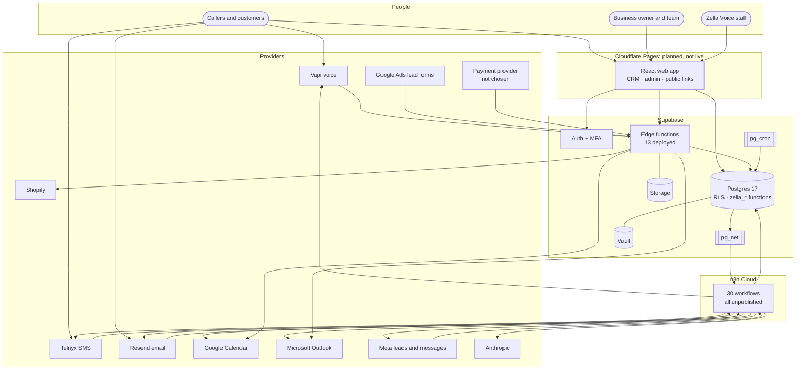

---

## 4. Responsibility boundaries

| Layer | Owns | Must not own | Evidence |
|---|---|---|---|
| **Frontend** (React 19 + Vite, `web/src`) | Display, input validation for convenience, honest loading/empty/error states, leave guards, navigation from server data | Authorization, eligibility, pricing, consent decisions | `web/src/App.jsx`, `router.js`, `adminPermissions.js` (fails closed), `navigation/` |
| **Supabase Auth** | Identity, sessions, password and recovery, invitations, MFA (TOTP) | Business roles (in `business_members`) or platform roles (in `platform_admins`) | `staff-invite`, `owner-provision-business`, `sql/zella_mfa_enforcement.sql` |
| **Postgres functions + RLS** | **Every business rule:** roles, tenant isolation, capabilities, consent, calling hours, availability, booking locks, retries, message policy, idempotency, audit | Talking to external providers (except `pg_net` calls to n8n) | `sql/*.sql`, `sql/baseline/` |
| **Edge functions** (Deno) | Authenticating callers that are not signed-in users (Vapi, OAuth, webhooks, links); service-key tasks (invites, provisioning); shaping Vapi responses within a latency budget | Rules duplicated from SQL | `web/supabase/functions/*` |
| **n8n** | Calling external providers for queued work: claim → prepare (DB) → send or dry-run → report | Deciding eligibility, retries, timing | `n8n/src/*.js`, `n8n/workflows/*.json` |
| **Voice and telephony** (Vapi; phone numbers through Vapi or Telnyx) | Speech, model turns, dialling, transfers, end reasons | Business facts (from tools), permissions | `voice-rules`, `_shared/vapi-*.js` |
| **SMS / email** (Telnyx, Resend) | Delivery; status events (Resend only today) | Consent and timing | `n8n/src/sms-*.js`, `email-*.js`; Resend events in `zella-email-events` |
| **Calendar** (Google, Microsoft) | Mirror of bookings; external busy times | Being the booking authority: **Zella Voice's database is authoritative** | `zella-calendar-sync`, `calendar-connect` |
| **Lead sources** (Google Ads forms, Meta lead ads, website forms) | Delivering lead payloads | Creating CRM rows directly | `google-lead`, `website-lead`, `zella-meta-leads` |
| **Billing provider** | Taking payment (none chosen) | Card data in Zella Voice | `billing-webhook` (signature-checked, provider-agnostic) |
| **Monitoring and audit** | `platform_alerts`, `audit_logs`, `provider_health`, `workflow_executions`, `automation_dead_letters`, `/status` | External alerting (not configured) | §21 |

**Where logic sits outside Postgres today** (acceptable, documented): Vapi end-reason → outcome mapping
(`_shared/vapi-call-events.js`, shared with n8n); phone normalisation and Vapi request shaping (`n8n/src/call-plan.js`);
voice latency budget and safe-failure replies (`voice-rules/logic.ts`).

---

## 5. What protects correctness

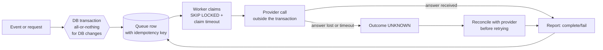

| Mechanism | What it protects | What it does **not** protect | Evidence |
|---|---|---|---|
| Transaction per function | Database writes of one call are all-or-nothing | Provider side effects | Postgres semantics |
| Per-business booking lock (`zella_booking_lock`) | Two bookings into one slot at the same time | External calendar conflicts not yet pulled | `sql/zella_voice_reliability.sql`. Reported: 20 parallel attempts → 1 booking (voice reliability doc, 28 Oct) |
| Idempotency keys | Repeated tool calls (`ai_tool_calls.idempotency_key`), webhooks (`vapi_request_receipts`), usage (`usage_records.idempotency_key`), message dedupe keys | A provider action whose result was lost | schema |
| Claim / complete queues | Two workers taking the same item; a worker dying (claim timeout returns the item) | A worker that sent the message, then died before reporting (possible duplicate) | `zella_claim_*` functions |
| Reconciliation | Calls without an end-of-call report (`Zella - Call Reconciliation`, `zella_reconcile_call`) | Only when switched on: `call_reconcile_live` = false | n8n workflow `xYtKbV3YQhWgiRbL` |
| Stuck-call sweep | Outbound calls with no report after 45 min are freed | It counts them as a **failed attempt**, so the next retry can call someone who was in fact reached: gap G-04 | `zella_sweep_stuck_calls` |

**AI constraints.** Tools only (`zella_ai_tool`), capability-filtered tool list, read-back before booking, transfers
only to authorised numbers, `ready` knowledge only, and unanswered questions logged as knowledge gaps. When unsure, the
prompt directs: say you cannot confirm, then offer a message, a follow-up or a person (`sql/zella_voice_assistant.sql`,
`zella_prompt_v4_unknown`).

---

## 6. The SaaS lifecycle, area by area

```mermaid
flowchart LR
  a[Website visit] --> b[Zella Voice sales lead] --> c[Assisted onboarding:<br/>Create Business] --> d[Owner invite<br/>+ sign-in + MFA]
  d --> e[Setup: hours, services,<br/>knowledge, team] --> f[Phone number<br/>+ receptionist] --> g[Integrations] --> h[Test call<br/>+ activation]
  h --> i[Daily use:<br/>CRM, calls, automations] --> j[Billing, usage,<br/>reports, support] --> k[Pause / cancel /<br/>export / offboard]
```

| # | Area | Purpose and main users | Screens | Backend and data | Integrations and automations | Permissions | Errors and recovery | Status | Gaps and decisions |
|---|---|---|---|---|---|---|---|---|---|
| 1 | Public website and lead capture | Prospects learn about Zella Voice | **None in this repo** | — | — | public | — | **MISSING** (not in repo; may exist elsewhere: UNVERIFIED) | G-15; D-05 |
| 2 | Zella Voice's own sales leads | Track prospects for Zella Voice | none | none. Business lead tables are per business and must never hold Zella Voice prospects | — | — | — | **MISSING** | G-15: needs a separate platform-level pipeline, never in a business tenant |
| 3 | Signup / assisted onboarding | Get a business started | Admin wizard only; no self-signup page | `owner-provision-business` | — | platform admin | draft saved, resumable (`RESUME_STEP`) | **PARTIAL**: assisted only | D-06: self-serve signup or assisted only |
| 4 | Authentication and recovery | Sign in safely | sign-in, `/welcome` (link landing with Continue), MFA | Supabase Auth, `zella_mfa_satisfied` | Resend SMTP (verified domain) | everyone | mail-scanner-safe links; friendly errors (`authErrors.js`) | **VERIFIED-PROD** for magic link (owner's 30 Oct note); MFA flow VERIFIED-TEST (`mfa_test.sql`) | Leaked-password protection off (G-13) |
| 5 | Business creation | Create the tenant and defaults | Admin › Create Business (§7) | `owner-provision-business` v16, `create_business` | — | platform `businesses.manage` | resumable draft, server-side finish checks | **VERIFIED-TEST** (13 edge tests; browser sweep 7 Nov); 4 businesses exist in prod | owner-provision-business not redeployed with the latest wording (G-12) |
| 6 | Owner and team invitations | Give people access | Team access, admin invite | `staff-invite` v4, `business_invitations`, `zella_staff_invite_finalize` | Supabase invite email | owner/admin (admins only by owner) | invite bound to email, expires, failures recorded | **VERIFIED-TEST** (9 unit tests, `invitations_test.sql`, concurrency test); smoke-tested in prod 9 Nov | — |
| 7 | Business onboarding and setup | Make the business ready | wizard steps, Settings | `zella_readiness`, `zella_setup_enforcement` | — | owner/admin | readiness lists what's missing | **VERIFIED-TEST** (`readiness_test.sql`, setup enforcement 5 checks) | — |
| 8 | Industry and configuration | Industry words, records, capabilities, policies | Settings › Industry and workflows, Customize records | `industry_configurations`, `business_capabilities`, presets | — | owner/admin | — | **VERIFIED-TEST** (capabilities, presets v2; industry matrix 5 Nov report) | Real-world requirements per industry need validation (§20) |
| 9 | AI receptionist setup | Voice, greeting, rules | AI Receptionist, Voice and setup, Call handling rules | `zella_assistant_config`, `business_voice`, `agent_config_versions` | Vapi | owner/admin/manager | readiness problems block "ready_to_send" | **PARTIAL**: config built and tested; per-call assistant delivery **not yet used in prod** (0 deliveries) | G-08 |
| 10 | Phone number provisioning and routing | Calls reach the right business | Admin › Voice & numbers | `business_phone_numbers`, `zella_business_for_number` | Vapi/Telnyx numbers | platform `telephony.manage` | unknown number → `unknown_number` (fallback assistant if set) | **MISSING in prod** (0 numbers); code VERIFIED-TEST | Buying and porting numbers is manual (D-07) |
| 11 | Knowledge base | Facts the AI may use | Knowledge base | `knowledge_items` (`ready` only), versions, gaps | n8n Knowledge; Anthropic drafts (off) | owner/admin/manager | edits go back to `processing` | **PARTIAL**: 0 knowledge items in prod; ready-knowledge path VERIFIED-TEST (learning 5 checks) | Knowledge worker unpublished; who marks items ready while it's off? (G-21) |
| 12 | Services, hours, prices, booking rules | What can be booked | Hours & services, Scheduling | `business_hours`, closures, services, buffers, resources | — | owner/admin | holiday and closure rules | **VERIFIED-TEST** (buffers 7, scheduling 8, slot blocks 1, windows 6); prices are entered by the business only | — |
| 13 | Calendar and provider connections | Mirror bookings, read busy times | Settings › Calendar connections, Integrations | `calendar-connect`, `calendar_connections`, `calendar_sync_queue` | Google, Microsoft (n8n Calendar Sync) | owner/admin | `not_configured` explained; token error → reconnect reminder | **DISABLED** (`calendar_sync_live` false; OAuth clients not set up) | D-08 |
| 14 | Testing and activation | Prove it works before going live | "Test AI Voice" (calls the real number), readiness | `zella_readiness`, `activation_tests` (0 rows) | Vapi | owner/admin | — | **PARTIAL**: no in-browser test call; activation tests table unused | G-22 |
| 15 | Business CRM | Daily work | §14 | — | — | roles | — | VERIFIED-TEST (browser sweep 7 Nov, local stand-in) | §14 |
| 16 | Platform admin | Run the platform | §7 | — | — | platform permissions | fails closed | VERIFIED-TEST (admin permissions browser test) | §7 |
| 17 | Plans, billing, entitlements, usage | Charge and limit | Plans, Offers, Calling usage | `plans` (0), `subscriptions` (0), `usage_records`, `billing-webhook` | payment provider **not chosen** | `billing.*` | idempotent webhook, grace policy jobs | **PARTIAL**: ledger and webhook built; no plans, no provider, entitlements not enforced at call time | G-11; D-09 |
| 18 | Business reports | Daily summary, weekly review, scheduled reports | Reports & analytics, Settings › Daily report | `zella_report_build`, `business_report_schedules` | Owner Emails | owner/admin/manager (managers read-only) | — | **VERIFIED-TEST** (report 6 checks); emails DISABLED | — |
| 19 | Support and incidents | Help businesses, communicate outages | Support tickets, Platform monitoring, `/status` | `support_tickets`, `platform_incidents`, `zella_public_status` | — | `support.manage` | — | **CODE-ONLY / PARTIAL**: no external alerting or on-call | G-24 |
| 20 | Pause, cancel, export, retention, offboarding | Leave safely | Continue plan page, Data rights | `continue-plan`, `zella_apply_scheduled_cancellations`, `data_rights_requests`, `zella_retention_scan` | — | owner | cancellation link signed and dated | **PARTIAL**: retention scan lists but **deletes nothing**; no self-serve full export found | G-23; D-13 |

---

## 7. Create Business and the platform admin

### 7.1 Create Business (`web/src/CreateBusinessWizard.jsx`, `owner-provision-business`)

Steps (from `STEPS` in the wizard): **Business → Owner & verification → Hours & services → Team (optional) →
AI receptionist → Phone & integrations (optional) → Automations → CRM setup (optional) → Review.**

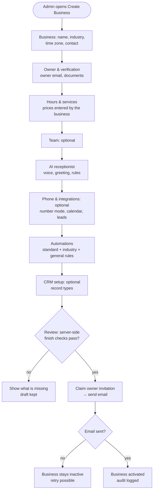

| Concern | How it is handled | Status / evidence |
|---|---|---|
| Identity and contact, time zone | Business step | VERIFIED-TEST |
| Industry configuration | Industry picker applies presets, capabilities, message policy | VERIFIED-TEST (presets v2, capabilities) |
| Owner invitation | Claimed before email; business activates only after the email went out | VERIFIED-TEST (`ownerInvitation_test.ts`, `owner_invite_test.ts`) |
| Team and roles | Optional step; staff invites | VERIFIED-TEST |
| Phone number | Modes `new_number` and `call_forwarding`; the number itself is assigned later in Voice & numbers | PARTIAL: no automatic purchase |
| Voice assistant | Voice from approved list | VERIFIED-TEST |
| Knowledge | Not a wizard step; added after creation | PARTIAL (G-21) |
| Hours, services, prices | Hours & services step; receptionist checked **before** writing hours (fixed 7 Nov) | VERIFIED-TEST |
| Appointment settings, integrations | Phone & integrations step; Gmail/Outlook mailbox choice **stored but unused** | PARTIAL (G-25) |
| Automation settings | Lists standard, industry-made and general rules with "tell the owner by" | VERIFIED-TEST (industry rule list) |
| Lead follow-up and outgoing-call settings | Per-automation `trigger_config` (`new_lead_callback`, `missed_call_follow_up` with `fallback_sms`); attempt limit and delay live on each callback (`max_attempts`, `retry_delay_minutes`) | PARTIAL: no dedicated outgoing-call settings screen (G-02) |
| SMS / email / consent settings | Message policy per industry, owner-adjustable | VERIFIED-TEST (`caller_and_courtesy_test.sql`) |
| Plans and entitlements | Not enforced | MISSING (G-11) |
| Provider readiness, test call, activation checks | `zella_readiness` | PARTIAL (G-22) |
| Save, resume, duplicate prevention | Drafts resume at `RESUME_STEP`; double-submit guarded | VERIFIED-TEST (wizard browser journey) |
| Audit, failure and rollback | Audit rows; failed finish leaves an inactive draft; `zella_recover_provisioning` (hourly) finishes half-done setups | CODE-ONLY for the recovery job (cron off) |

### 7.2 Platform admin pages

| Page (file) | Purpose | Permission | Status |
|---|---|---|---|
| Overview (`OwnerOverview.jsx`) | Platform KPIs | any admin | VERIFIED-TEST |
| Businesses list and detail (`OwnerDashboard.jsx`, `BusinessDetails.jsx`, `BusinessAdminControls.jsx`) | Search, filter (draft, setup complete, live, canceling, suspended, canceled), detail, pause/suspend | `businesses.view` / `manage` | VERIFIED-TEST |
| Create Business (`CreateBusinessWizard.jsx`) | §7.1 | `businesses.manage` | VERIFIED-TEST |
| Users & access (`UsersAccess.jsx`) | Platform admins and roles | Zella Voice owner only | VERIFIED-TEST (`platform_roles_test.sql`) |
| Plans (`PlansPage.jsx`), Offers (`OffersPage.jsx`) | Plans and promotions | `plans.manage` | CODE-ONLY in prod (0 plans) |
| Voice & numbers (`admin/VoiceNumbersPage.jsx`) | Assign, release numbers; shows `calls_live` state | `telephony.manage` | VERIFIED-TEST; 0 numbers in prod |
| Messaging (`admin/MessagingPage.jsx`) | Sending state, failed messages, retry | `comms.manage` | VERIFIED-TEST |
| Automations (`admin/AutomationsPage.jsx`) | Cron jobs, queues, dispatcher state, dead letters | `analytics.view` / ops | VERIFIED-TEST |
| Integrations (`IntegrationsPage.jsx`) | Provider health | `integrations.manage` | PARTIAL (provider checks off) |
| Monitoring (`PlatformMonitoring.jsx`), Operations (`PlatformOperations.jsx`) | Health, alerts, incidents | ops | VERIFIED-TEST |
| Security & abuse (`SecurityAbuse.jsx`), Spam (`SpamPage.jsx`) | Incidents, block rules | `security.*` | VERIFIED-TEST |
| Audit logs (`AuditLogs.jsx`) | Who did what | `audit.view` | VERIFIED-TEST |
| Support (`SupportTickets.jsx`) | Tickets and notes | `support.manage` | CODE-ONLY (0 tickets) |
| Verification queue (`VerificationQueue.jsx`) | Business documents | `security.manage` | CODE-ONLY |
| Industry configuration, Modules, AI agents, Reviews, Scorecards | Platform configuration | various | VERIFIED-TEST (browser sweep) |
| Settings (`SettingsPage.jsx`) | Platform settings, maintenance mode | Zella Voice owner | VERIFIED-TEST |
| Kill switches | Live switches in `platform_settings`; dispatcher switch | Zella Voice owner | DISABLED (all off) |

**Access states** (`web/src/adminPermissions.js`): `loading`, `authorized`, `unauthorized` (401/403, `NOT_PERMITTED`,
`MFA_REQUIRED`) and `failed` (lookup failed; grants nothing). Background refresh failures keep the current view;
refusals always apply. **VERIFIED-TEST** (`tests/browser/admin-permissions.cjs`, 7 Nov report).

---

## 8. AI receptionist and inbound calls

### 8.1 Inbound call sequence

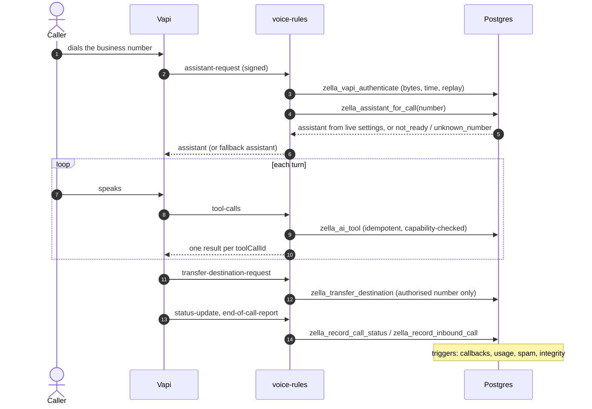

### 8.2 Tools (15) and their evidence

| Tool | Guard | Production evidence (9 Nov) | Test evidence |
|---|---|---|---|
| `check_availability` | capability `bookings`; hours, staff, resources, buffers, holds | 3 × ok | VERIFIED-TEST |
| `book_appointment` | exact `start` from availability, read-back, booking lock | **2 booked + verified**; 2 `need_info` (asked for a phone number on calls with no caller ID) | VERIFIED-TEST (concurrency) |
| `find_my_appointments`, `reschedule_appointment`, `cancel_appointment` | caller identity by number | none | VERIFIED-TEST (industry matrix 5 Nov) |
| `search_knowledge` | `ready` items only | 3 × `no_information` (0 knowledge items) | VERIFIED-TEST |
| `check_open_hours` | time zone | 2 × ok | VERIFIED-TEST |
| `lookup_caller`, `update_caller` | number match | 1 × not recognised | VERIFIED-TEST |
| `take_message`, `request_follow_up` | creates notification / callback | none | VERIFIED-TEST |
| `report_emergency`, `transfer_to_human` | escalation rules, authorised numbers | none | VERIFIED-TEST (escalation 6 checks) |
| `report_unanswered_question` | needs a contact | **3 × failed `NO_CONTACT`** | — (G-06) |
| `lookup_order` | capability `orders`, Shopify | none | VERIFIED-TEST (orders v2) |

### 8.3 What happens when the AI is uncertain

1. If `search_knowledge` finds nothing, the AI says it cannot confirm. The question is recorded as a knowledge gap
   (3 gaps exist in production).
2. It offers a message, a follow-up (`request_follow_up` → callback) or a person (`transfer_to_human`).
3. If the transfer fails, an urgent `transfer_failed` callback is created (trigger `zella_calls_to_callbacks`).
4. If a tool times out, it returns a safe failure: no action taken, and the AI offers a message (`voice-rules`
   budget: 4 s per DB call, 12 s per request).

**Caller identity:** the caller's number is used to find their appointments. Caller ID can be spoofed, so changing or
cancelling a booking based on caller ID alone is a risk (G-18).

### 8.4 Status

**PARTIAL / VERIFIED-PROD for the tool path on browser test calls.** Not yet verified:
- a real phone number;
- the per-call assistant-request (0 deliveries);
- end-of-call data (all 5 calls lack duration and transcript);
- usage metering (0 rows).

---

## 9. Outgoing lead calls

### 9.1 Two kinds of leads, kept apart

| | A. Zella Voice's own sales leads | B. Leads of businesses using Zella Voice |
|---|---|---|
| Where stored | **Nothing exists.** Must be a platform-level store, never a business tenant | `customers` (as leads), `lead_submissions`, `callbacks`, `followup_tasks`, per business |
| Who may see | Zella Voice sales staff only (new platform permission needed) | that business's members by role |
| Status | **MISSING** (G-15) | **PARTIAL** (below) |

### 9.2 Business lead journey (as built)

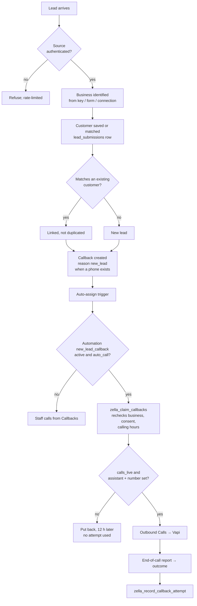

**Lead sources:**

| Source | Entry point | Authenticated by | Status |
|---|---|---|---|
| Google Ads lead forms | `google-lead` edge function → `zella_google_leads` | per-business Google key in the payload | **VERIFIED-TEST** (`google_leads_test.sql` passed 9 Nov; unit tests). Deployed v1, 0 keys in prod, never used |
| Website forms | `website-lead` → `zella_capture_web_lead` | form key, rate limit | CODE-ONLY in prod (0 forms); VERIFIED-TEST in industry matrix |
| Incoming calls | voice tools save the caller as a lead | Vapi signature | VERIFIED-TEST |
| Messages (SMS, email) | Event Gateway / Inbound Email → inbox | provider signature | DISABLED |
| Meta lead ads | Meta Webhook / Meta Leads (n8n) | Meta signature on raw body | DISABLED (app review pending) |
| Manual entry | Leads page, staff can add leads | role | VERIFIED-TEST (`staff_add_lead_test.sql`) |

### 9.3 Outgoing call configuration (what exists vs. what is needed)

| Setting | Today | Status |
|---|---|---|
| Enabled | automation `new_lead_callback` active + `callbacks.auto_call` | PARTIAL (both automations inactive in prod) |
| AI or human | `auto_call` true = AI dials, false = staff | VERIFIED-TEST |
| Eligible lead sources | not configurable per source | MISSING (D-01) |
| Caller number | **one platform number** `vapi_phone_number_id` for every business | **Gap G-01**: callers see the platform number, not the business's |
| Calling hours, time zone | fixed **09:00–19:00** business time (`zella_next_call_time` defaults) | PARTIAL: not configurable; legal hours need review (D-03) |
| Contact purpose and consent | `zella_can_contact(..., 'call', 'transactional')`; lead reactivation is `marketing` | PARTIAL: classing first lead calls as transactional is a legal decision (D-04) |
| Maximum attempts, delay | per callback: `max_attempts`, `retry_delay_minutes` (≥ 5 min) | VERIFIED-TEST; defaults are product decisions (D-02) |
| Overall attempt window | none | MISSING |
| SMS/email after calls | `fallback_sms` flag on the automation → `callback_sms` follow-up when attempts are exhausted | VERIFIED-TEST |
| Staff assignment, escalation | auto-assign triggers; `needs_review` → "A callback needs a person" | VERIFIED-TEST |
| Stop rules | §9.6 | PARTIAL |
| Emergency kill switch | `calls_live` (platform-wide); per-business pause = automation off | VERIFIED (setting exists) |
| AI script | **one platform assistant** (`vapi_assistant_id`) with variables `business_name`, `first_name`, `call_reason`, `appointment_*` | **Gap G-01**: no per-business outbound assistant, knowledge or tools |
| Industry restrictions | message policy applies to texts; not to calls | MISSING for calls |

### 9.4 When the lead answers

| Step | Built | Notes |
|---|---|---|
| Provider reports answered | Vapi `status-update` and end reason | VERIFIED-TEST (parsing) |
| Person vs answering machine | `voicemail` if Vapi's end reason contains "voicemail" | PARTIAL: depends on Vapi detection; reliability not measured |
| Introduce the business, confirm willing to continue | in the platform assistant's script | UNVERIFIED (assistant not configured in prod) |
| Answer questions, offer times, book, message, transfer, callback, not interested, opt-out | outbound assistant has **no business tools** today | **MISSING** for outbound (G-01) |
| Save the outcome | callback: `connected` → status **`contacted`**. Follow-up task: `connected` becomes `rescheduled`, `wants_callback` or `declined` | **Gap G-02**: "answered" is treated as "contacted" for callbacks |
| Update lead and timeline, cancel future attempts | callback leaves the retry loop on `contacted` | PARTIAL |
| Notify staff | only on `needs_review` | PARTIAL |

### 9.5 When the lead does not answer

| Outcome | Recorded as | Retry? | When exhausted |
|---|---|---|---|
| No answer | `no_answer` | yes, after `retry_delay_minutes` moved into 09:00–19:00 | `needs_review`, auto-call off, staff notified, optional `callback_sms` |
| Busy | `busy` | yes | same |
| Voicemail | `voicemail` (only when Vapi says so) | yes. Leaving a voicemail is **not built** (D-10) | same |
| Invalid number | `invalid_number` | no | `needs_review`, no SMS |
| Provider failure / rejected / unknown end reason | `failed_connection` | yes | same |
| No report after 45 min | swept, counted as failed | yes | **risk of a duplicate call if the call happened** (G-04) |

### 9.6 Stop conditions (rechecked at every claim)

| Condition | Checked before each attempt? | Evidence |
|---|---|---|
| Opt-out, do-not-contact | yes (`zella_can_contact`; consent by number for unknown callers) | `zella_claim_callbacks` (prod) |
| Business paused, suspended, cancelled | yes → `needs_review` | same |
| Outside calling hours | yes → moved to next window | same |
| Not interested / declined | yes → `completed` | `zella_record_callback_attempt` |
| Resolved by staff or AI | staff can close; AI "connected" → `contacted` | PARTIAL |
| Appointment booked | not linked to the callback automatically | MISSING |
| Customer replied by text before the attempt | not checked | **MISSING** (G-09) |
| Invalid number | yes | yes |
| Workflow disabled | `auto_call` only set at creation; disabling the automation later does not stop existing callbacks | **Gap G-10** |
| Attempt limit | yes | yes |
| Duplicate or spam | spam scoring on calls; duplicate review queue | PARTIAL |

### 9.7 Attempt history: what is recorded

`callback_attempts` has: `callback_id`, `business_id`, `attempt_no`, `attempted_at`, `outcome`, `provider_ref`,
`error`, `notes`, `next_attempt_at`, `initiated_by`. **Missing:** scheduled time, calling number, final provider status
(separate from the business outcome), duration, handler (AI/staff), summary, consent decision, correlation ID (G-17).

**Five separate statuses that must never be merged:**

| Status | Lives on | Values today |
|---|---|---|
| Lead status | `customers` (lead pipeline) | pipeline stages |
| Call attempt status | `callback_attempts.outcome` | connected, no_answer, busy, voicemail, invalid_number, failed_connection, declined |
| Conversation outcome | **missing for callbacks**; `followup_tasks.outcome` has rescheduled / wants_callback / declined | G-02 |
| Callback task status | `callbacks.status` | new, scheduled, due, in_progress, retry_scheduled, contacted, completed, needs_review, cancelled |
| Appointment status | `appointments.status` | scheduled, confirmed, completed, no_show, cancelled … |

---

## 10. Missed calls and follow-up attempts

### 10.1 Call classifications (as built)

| Situation | Classification | What follows | Status |
|---|---|---|---|
| Answered by the AI | `calls.status = answered`, `ai_handled = true` | nothing, unless the AI escalated | VERIFIED-PROD (5 calls) |
| Answered by a human (transfer connected) | `transfer_status = connected` | open "needs a person" callback is closed automatically | VERIFIED-TEST |
| Hung up before answer / rang, no answer | `status = missed` | callback `missed_call` (normal priority) | CODE-ONLY in prod (no missed calls yet); VERIFIED-TEST |
| Provider or system error | `status = failed` ("Didn't connect") | no automatic callback | PARTIAL: decide whether to call back (D-11) |
| AI-answered but unresolved | `needs_human = true` | callback `needs_human` (high) | VERIFIED-TEST |
| Transfer failed / no one available | `transfer_status = failed / no_one_available` | callback `transfer_failed` (urgent) | VERIFIED-TEST |
| Suspected spam | spam incident; may be screened | no callback when blocked | VERIFIED-TEST (spam suite) |

### 10.2 Missed-call journey

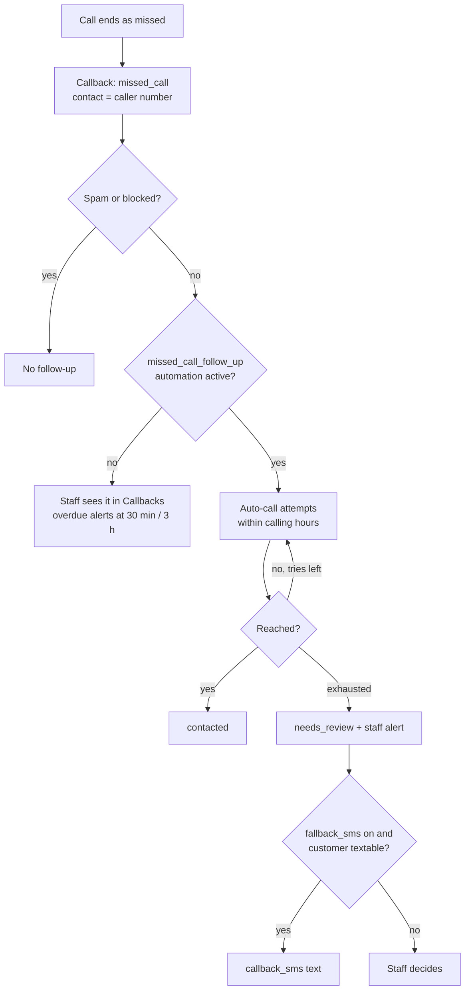

| Requirement | Today | Status |
|---|---|---|
| Immediate missed-call text | **Not found.** A text is sent only as a fallback after call attempts are exhausted | **MISSING** (G-07; D-12) |
| Repeated calls from the same number | `zella_create_callback` merges into an open callback for the same number (inference from the 'missed_call_follow_up' design; not re-verified) | UNVERIFIED |
| Staff already called | staff records an attempt (counts) or closes it | VERIFIED-TEST |
| Customer replies before an attempt | not checked | MISSING (G-09) |
| Opt-out | rechecked at each claim → cancelled | VERIFIED-TEST |
| SMS or call fails | retry policy; then `needs_review` | VERIFIED-TEST |
| CRM visibility, pause/retry/assign/close | Callbacks page | VERIFIED-TEST (browser) |
| Safe testing | dry run: `calls_live` off puts the item back, no attempt used | VERIFIED-TEST |

---

## 11. SMS and email

### 11.1 Pipeline

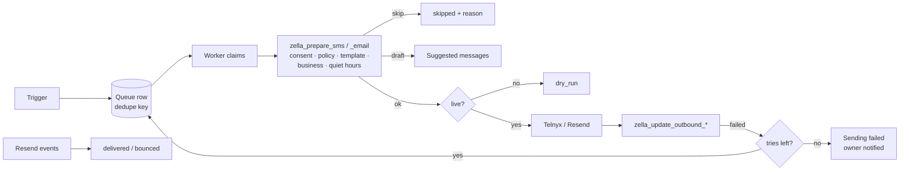

### 11.2 Message catalogue

| Message | Trigger | Category | Channel | Quiet hours | Status |
|---|---|---|---|---|---|
| Missed-call text | only as fallback after call attempts (`callback_sms`) | service | SMS | yes | PARTIAL (G-07) |
| Lead follow-up text/email (`lead_follow_up`, `lead_final_follow_up`) | lead rules | service | SMS / email | yes | CODE-ONLY; DISABLED |
| Appointment confirmation | booking | service | SMS / email | **none** (answers the customer's action) | VERIFIED-TEST; 1 dry run in prod |
| Appointment reminder | appointment start minus offsets | service | SMS / email | **none today** (D-03 of messaging policy) | VERIFIED-TEST; 4 pending in prod |
| Reschedule / cancellation confirmation | booking moved / cancelled | service | SMS / email | 09:00–19:00 | VERIFIED-TEST |
| Check-in message | none found | — | — | — | **MISSING** (D-15) |
| Waitlist offer | cancellation frees a fitting time | service | SMS only (never email) | sent at once | VERIFIED-TEST |
| Callback reminder (to staff) | `zella_remind_upcoming_callbacks` | internal | email / SMS | — | CODE-ONLY; cron off |
| Staff notifications | `staff_notifications` | internal | email (Owner Emails), SMS (Staff Texts) | — | DISABLED |
| Business reports | daily 08:00 local, weekly Monday | internal | email | — | VERIFIED-TEST; DISABLED |
| Integration disconnected | `zella_check_connections` | internal | email | — | CODE-ONLY |
| Billing notification | trial, payment failure | internal | email | — | CODE-ONLY |
| Knowledge update notice | gap reports, knowledge conflicts | internal | email | — | CODE-ONLY |
| Review request | 2 days after completed visit, needs review link | **classification undecided** (D-16) | SMS / email | yes | VERIFIED-TEST; DISABLED |
| Reactivation, cross-sell | schedules / triggers | **marketing** (opt-in + `sms_marketing_allowed`) | SMS; email blocked until unsubscribe works | yes | VERIFIED-TEST |
| Welcome, feedback, post-visit, aftercare | customer created / visit completed | service, per industry policy | SMS / email | yes | VERIFIED-TEST |

### 11.3 Opt-out and preferences

- **SMS STOP / START / HELP:** handled by the Event Router through consent records. HELP queues `reply_help`. Status
  DISABLED (router unpublished); logic VERIFIED-TEST.
- **Email unsubscribe:** `/u/<32 hex>` → `zella_unsubscribe_email`. Marketing email is blocked
  (`marketing_email_not_ready`) until the unsubscribe flow is verified live.
- **Effect on other channels:**
  - `do_not_contact` stops every channel.
  - A channel-specific opt-out stops that channel only.
  - Calls check `zella_can_contact(..., 'call', ...)`.
- **SMS delivery receipts (Telnyx status webhooks): not handled.** The CRM can show "Sent" but never "Delivered" for
  texts (G-08b).

---

## 12. Communication status model

| Honest status | Meaning | Source | Available today |
|---|---|---|---|
| Queued | waiting for the worker | Zella Voice | yes |
| Attempting | claimed, being sent or dialled | Zella Voice | yes (`in_progress` / `sending`) |
| Provider accepted | provider took the request | provider API | SMS/email `sent`; calls: Vapi call id stored |
| Ringing | call ringing | Vapi status-update | yes (calls) |
| Answered | someone or something picked up | Vapi | yes (`answered`/`completed`) |
| No answer / Busy | not picked up | Vapi end reason | yes |
| Voicemail / machine | **only** when Vapi's end reason says voicemail | Vapi | partial reliability (unmeasured) |
| Failed | provider refused or failed | provider | yes |
| Delivered | provider confirmed delivery | Resend events (email); **not available for SMS** | email only |
| Cancelled | no longer needed | Zella Voice | yes |
| Skipped (reason) | a rule said no | Zella Voice | yes |
| Not sent (test mode) | live switch off | Zella Voice | yes (`dry_run`) |

**Rule:** "contacted" means a conversation that met the purpose (decision D-17), not "connected". Today callbacks map
`connected` → `contacted` (G-02).

---

## 13. Appointments, check-in and waitlist

### 13.1 Booking lifecycle

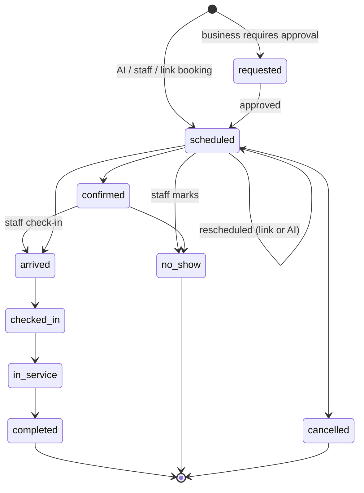

| Topic | How it works | Status |
|---|---|---|
| Authoritative booking system | Zella Voice's database | VERIFIED-TEST |
| Calendar synchronisation | push events; pull busy times hourly (`zella_schedule_calendar_pulls`) | DISABLED. Busy times can be up to an hour stale (G-19) |
| Concurrency | per-business lock; holds expire every 5 min | VERIFIED-TEST |
| External conflicts | pulled busy times excluded; a conflict made in Google after the last pull is not seen | PARTIAL (G-19) |
| Timeout / uncertain result | tool idempotency returns the first result; `book_appointment` `verified` flag | VERIFIED-PROD (2 verified bookings) |
| Confirmation, reminders | queued by appointment triggers; withdrawn on cancel or move | VERIFIED-TEST |
| Time zone | business time zone, DST-safe | VERIFIED-TEST |
| Customer identity | caller number or signed link; staff in CRM | PARTIAL (G-18) |
| Staff double booking | staff may deliberately double-book in the CRM (kept by design) | documented |

### 13.2 Check-in (as built)

Check-in is **staff-recorded attendance** (`sql/zella_attendance.sql`, `zella_set_attendance`).
- **Actions:** arrived, checked_in, in_service, completed, no_show, cancelled, undo, assign. Each change is logged
  with its source (`staff` or `integration`).
- **Never automatic:** nothing is assumed just because the appointment time has passed.
- **Not built:**
  - customer self check-in (QR code, text "I'm here", kiosk);
  - check-in reminders;
  - any check-in message.
- **Status:** VERIFIED-TEST (Check-ins page in the browser sweep; capability `check_ins`). Self check-in is
  **MISSING** (D-15).

### 13.3 Waitlist (as built)

| Question | Answer | Status |
|---|---|---|
| How a customer joins | staff adds to `waitlist_entries` (no customer self-join found) | VERIFIED-TEST; self-join MISSING |
| Matching | on cancellation, the next entry that fits the freed time | VERIFIED-TEST |
| Order | one person at a time, in order | VERIFIED-TEST |
| Offer expiry | `zella_expire_waitlist_offers` every 5 min passes it on | CODE-ONLY in prod (cron off) |
| Several people at once | no: sequential | by design |
| Acceptance | `/w/<64 hex>` link → `reschedule-appointment` → books under the lock; a taken time is refused | VERIFIED-TEST |
| Simultaneous acceptance | impossible by design (one open offer); the lock protects anyway | VERIFIED-TEST |
| External availability change | re-checked at acceptance | VERIFIED-TEST |
| Permissions | service message; text only | VERIFIED-TEST |
| CRM visibility | Waitlist page | VERIFIED-TEST |

---

## 14. CRM, page by page

Navigation is built from `web/src/navigation/navConfig.js` and `zella_workspace_navigation`. Each item is shown only
when **all** of these hold:
- the industry offers the module;
- the business enabled it;
- the user's role allows it.

The database refuses the rest anyway. All pages have distinct loading, empty, error and unauthorized states. The
browser sweep checked this on 7 Nov, on a local stand-in, for owner, manager, staff and viewer; it was not re-run in
this review.

| Page | Owner's job | Data source | Key actions | Roles | Provider dependency | Status |
|---|---|---|---|---|---|---|
| Today | what needs me now | `zella_today_operations`, KPIs | open items | all | — | VERIFIED-TEST |
| Calendar | bookings | appointments, holds, blocks | new, move, cancel | staff+ (viewer read) | calendar (off) | VERIFIED-TEST |
| Tables (restaurants) | seating | `restaurant_tables`, states | seat, combine, block | staff+ | — | VERIFIED-TEST |
| Dispatch, Resources, Recurring visits | field service | `job_dispatch`, `resources`, `recurring_*` | assign, plan | staff+ | — | VERIFIED-TEST |
| Check-ins | attendance | `zella_set_attendance` | arrived … completed | staff+ | — | VERIFIED-TEST |
| Waitlist | earlier times | `waitlist_entries` | add, offer | staff+ | SMS (off) | VERIFIED-TEST |
| Tasks & follow-ups, Follow-through | work queue, approvals, milestones | `crm_tasks`, `record_*` | complete, approve | staff+ | — | VERIFIED-TEST (31/31 browser, 7 Nov) |
| Leads | pipeline | `customers`, `lead_submissions` | add, assign, convert | staff+ | lead sources | VERIFIED-TEST |
| Money | invoices, payments (no cards) | `customer_charges`, payments | raise, record payment (manager+) | staff+ | none | VERIFIED-TEST (`money_test.sql`) |
| Needs attention, Inbox, Messages | replies and notices | conversations, SMS, email | reply | staff+ | SMS/email (off) | PARTIAL: no staff reply sending live |
| Calls | call history, outcomes | `calls_view` (transcripts gated) | set outcome, call back | all (transcripts manager+) | Vapi | VERIFIED-TEST; 5 prod calls |
| Outgoing call attempts | per-attempt history | `callback_attempts` | — | — | — | **MISSING as a page** (G-17) |
| Callbacks | missed calls, leads, escalations | `callbacks` | call, mark contacted, assign, close | staff+ | Vapi | VERIFIED-TEST |
| Suggested messages | drafts awaiting approval | `message_drafts` | send, edit, discard | staff+ | SMS/email | VERIFIED-TEST |
| Sending failed | failed sends, 7 days | `zella_failed_work` | retry (queued, not "sent") | owner+ retry | — | VERIFIED-TEST |
| Spam protection | incidents, lists | `spam_*` | confirm, allow, block | owner/admin | — | VERIFIED-TEST |
| AI Receptionist, Voice and setup, Transcripts, Call handling rules | receptionist config | `ai_agents`, `business_voice`, rules | edit | owner/admin/manager | Vapi | VERIFIED-TEST |
| Knowledge base | answers | `knowledge_items` | add, edit, approve suggestion | owner/admin/manager | Knowledge worker (off) | PARTIAL (G-21) |
| Automations | rules on/off, "write your own rule" | `automations` | toggle, edit | owner/admin | — | VERIFIED-TEST |
| Lead sources | forms, Google, Meta keys | `website_forms`, `google_lead_keys`, `meta_connections` | create keys | owner/admin | Google, Meta | VERIFIED-TEST (Google); Meta DISABLED |
| Reviews | Google reviews, AI reply drafts | `reviews` | approve reply | owner/admin | Google, Anthropic (off) | DISABLED |
| Reports & analytics | performance | `zella_report_build` | schedule | owner/admin/manager | — | VERIFIED-TEST |
| Team & staff, Scorecards, Team access, Approvals, Security log | people and access | members, invitations, approvals, audit | invite, approve | owner/admin | Auth | VERIFIED-TEST |
| Integrations, Notifications, Settings, Customize records | configuration | settings tables | edit | owner/admin | various | VERIFIED-TEST |
| Billing | plan, invoices | — | — | owner | payment provider | **MISSING** (G-11) |
| Support | contact Zella Voice | `support_tickets` | open ticket | owner/admin | — | CODE-ONLY |

**Unified customer timeline:** the customer profile shows calls, texts, emails, appointments, callbacks, notes and
record events, scoped to one business by RLS (`BusinessProfile.jsx`). Outgoing call attempts and automation outcomes
(skipped and why) are not all on one timeline yet (G-17). **PARTIAL.**

---

## 15. Knowledge and AI quality

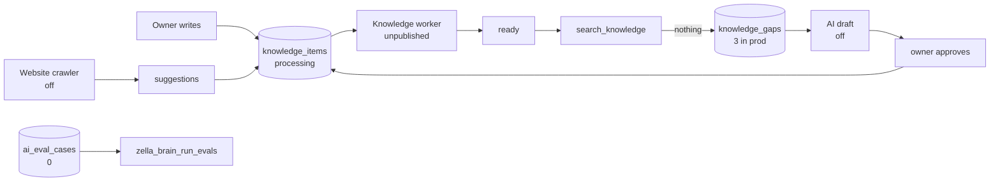

| Item | Status |
|---|---|
| Ready-only rule, versioning, stale-confirmation protection | VERIFIED-TEST (learning 5 checks) |
| Knowledge worker (marks items ready) | DISABLED. While it is off, nothing becomes `ready` through it: production has 0 items (G-21) |
| AI drafting, website crawl, call intelligence, review replies | DISABLED (switches off; Anthropic key not set) |
| Evaluation set | mechanism exists; **0 cases** in production (G-26) |
| Response sampling | job exists; cron off |

---

## 16. Integrations

| Integration | Direction | Code | Configured in prod | Deployed / published | Enabled | Tested | Used in prod |
|---|---|---|---|---|---|---|---|
| Vapi (inbound voice) | both | yes | Bearer credential, server URL set; **no assistant ID, no phone number** | `voice-rules` v6 | — | VERIFIED-TEST (39 unit tests) | **yes: 5 browser test calls, 16 tool calls** |
| Vapi (outbound calls) | out | yes | no | workflow unpublished | `calls_live` off | VERIFIED-TEST (n8n) | no |
| Telnyx SMS | both | yes | no number, no 10DLC | workflows unpublished | off | VERIFIED-TEST | 1 dry run |
| Resend email | both | yes | domain verified; Auth SMTP works; sender address empty | workflows unpublished | off | VERIFIED-TEST | Auth emails only |
| Google Calendar / Outlook | both | yes | no OAuth clients | `calendar-connect` v1; workflow unpublished | off | VERIFIED-TEST | no |
| Google Ads lead forms | in | yes | 0 keys | `google-lead` v1 | — | VERIFIED-TEST (9 Nov) | no |
| Website forms | in | yes | 0 forms | `website-lead` v4 | — | VERIFIED-TEST | no |
| Meta lead ads / Messenger / WhatsApp | both | yes | app review pending | workflows unpublished | — | VERIFIED-TEST (n8n) | no |
| Shopify | out | yes | 0 stores | `store-connect` v1 | — | VERIFIED-TEST | no |
| Google reviews | both | yes | no | unpublished | `reviews_live` off | VERIFIED-TEST (n8n) | no |
| Anthropic | out | yes | no key in n8n | — | off | — | no |
| Payment provider | in | webhook only | none chosen | `billing-webhook` v5 | — | VERIFIED-TEST (8 tests) | no |
| Gmail / Outlook mailbox | — | **wizard choice only** | — | — | — | — | MISSING (G-25) |

---

## 17. Automation engine and complete workflow catalogue

### 17.1 Three kinds of automated work

| Kind | Mechanism | Examples |
|---|---|---|
| **Event-triggered** | database triggers on row changes, inbound webhooks | missed call → callback; booking → reminders; STOP → consent |
| **Durable future jobs** | a queue row with `due_at`, created by an event | reminder 24 h before; follow-up 3 h after a visit; retry at next calling window |
| **Periodic reconciliation and health** | `pg_cron` job groups | stuck-call sweep, expire holds, overdue alerts, tenant self-check |

Rule: never replace event-driven work with broad polling. The dispatcher counts due queue rows; that is a wake-up
signal, not a substitute for events.

### 17.2 The dispatcher and its back-off problem

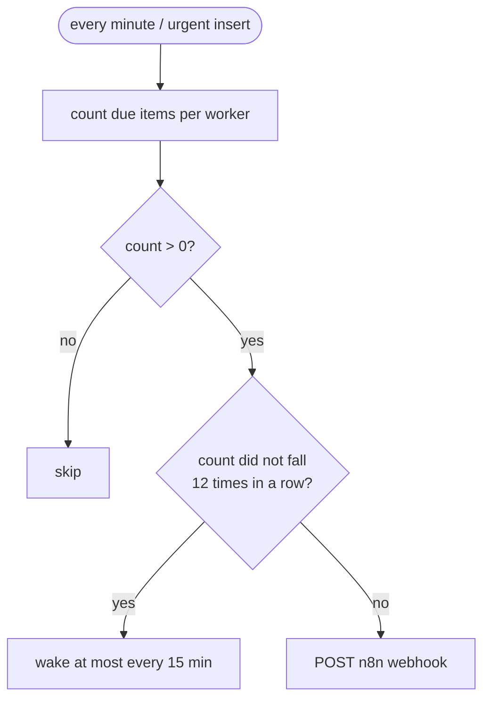

**Problem (G-03):**
- The "same" test is `n >= last_count`. A stuck item plus new urgent work still counts as "not falling", so after 12
  runs new reminders, callbacks and replies wait up to 15 minutes.
- Production uses the same code (verified by reading the function body, 9 Nov).
- `n8n/README.md` says 5 runs; the code says 12.

**Recommended fix (not implemented):** back off only while the **oldest due item** stays the same. Compare
`min(due_at)` or the set of item IDs, not the count. Wake immediately when a new item with a newer `created_at` is due.

### 17.3 Database triggers (event sources)

| Table | Trigger | Starts | Status |
|---|---|---|---|
| calls | `zella_calls_callbacks_trg` | missed → `missed_call` callback; `needs_human` → callback; transfer failed → urgent callback; transfer connected closes it | VERIFIED-TEST |
| calls | `zella_calls_usage` | minute ledger | VERIFIED-TEST; 0 rows in prod (calls lacked duration) |
| calls | `zella_spam_call`, `zella_call_integrity` | spam score; one row per provider call | VERIFIED-TEST |
| appointments | `zella_appointment_new`, `_after_trg`, `_before_trg`, `_source_trg` | confirmation, reminders, calendar queue, waitlist offer on cancel, withdraw follow-ups | VERIFIED-TEST; reminders exist in prod |
| appointments | `zella_no_show_followup` | no-show follow-up | VERIFIED-TEST |
| appointments | `zella_cross_sell_booked/completed` | cross-sell (opt-in) | VERIFIED-TEST |
| appointments | `zella_spam_booking_guard/record` | booking abuse limits | VERIFIED-TEST |
| customers | `zella_welcome_new_customer` | welcome message | VERIFIED-PROD (1 skipped by policy) |
| customers | `zella_auto_assign_lead_trg`, `zella_customer_change` | lead assignment; `customer.*` event | VERIFIED-TEST |
| callbacks | `zella_auto_assign_callback_trg` | assignment | VERIFIED-TEST |
| crm_records | `zella_industry_status` | industry status actions | VERIFIED-TEST |
| sms_messages, email_messages | `zella_spam_sms/email` | spam score | VERIFIED-TEST |
| followup_tasks | `zella_spam_reply_guard` | no auto-reply to spam | VERIFIED-TEST |
| staff_notifications | `zella_mark_staff_sms_trg` | staff text queued | VERIFIED-TEST |
| knowledge_items | `zella_knowledge_*` | version log; back to processing | VERIFIED-TEST |
| reviews | `zella_review_*` | AI reply draft queued | VERIFIED-TEST (n8n) |
| sensitive_approvals | `zella_approval_decided_trg` | carry out approved action | VERIFIED-TEST |
| subscriptions, payments | `zella_subscription_*`, `zella_offer_*` | plan state, offers | VERIFIED-TEST |
| invitations, phone numbers | capacity triggers | plan limits | VERIFIED-TEST |
| privileged tables | `zella_audit_privileged_trg` | audit log | **VERIFIED-PROD** (145 audit rows, 6 admin-change alerts) |
| ~30 tenant tables | `zz_tenant_links` | refuse cross-business links | VERIFIED-TEST (isolation suite) |

### 17.4 Scheduled jobs (pg_cron)

| Cron job | Schedule (UTC) | Runs | Prod |
|---|---|---|---|
| `zella_dispatch` | every minute | `zella_dispatch_n8n()` | **off** (last run 23 Oct) |
| `zella_jobs_every5/15/hourly/daily/weekly` | */5, */15, hourly, 04:00, Mon 08:00 | job groups below | **off** |
| `zella_spam_hourly` | :17 | spam summaries | off |
| `zella_cron_cleanup` | 03:30 | prune run history | off (856 run rows retained) |
| `zella_billing_reconcile` | */15 | `zella_reconcile_billing_events()` | **on** (last success 9 Nov 18:45) |
| `zella_usage_thresholds` | :23 | `zella_check_usage_thresholds()` | **on** (last success 9 Nov 18:23) |

Every job in the groups runs through `zella_run_scheduled_job`, which checks it against an allow-list. A failure raises
one grouped platform alert. Status: **CODE-ONLY in production** (groups off); the scheduler mechanism is VERIFIED-TEST.

| Group | Jobs |
|---|---|
| every 5 min | overdue leads, expire holds, expire waitlist offers, detect transfer failures, overdue callbacks, stuck-call sweep, engine health, rebalance assignments, unassigned work, escalation acks, upcoming-callback reminders, sweep open calls, offers tick |
| every 15 min | quote follow-ups, recover orphaned work, response times, reconcile call usage, uptime, on-call reminders |
| hourly | daily summaries (08:00 local), calendar pulls, customer requests, callback digests, team summaries, recover failed texts, overdue tasks, repeated questions, unrecorded appointments, recover provisioning, sweep approvals, **industry timers**, verify calls, recover knowledge, milestones, scorecard nudge |
| daily 04:00 | lead reactivation (≤200), setup incomplete, trials, payment policy, customer touches, KPIs, renewals, connections, sample AI responses, reconcile, retention scan (lists only), knowledge conflicts, tenant check, message failures, data-rights deadlines, duplicates, reconnect reminders, scheduled cancellations, permission check |
| weekly Mon 08:00 | weekly reviews, integration reminders, knowledge gap reports |

### 17.5 n8n workflows: full catalogue (30, all unpublished)

Every worker follows the same contract:
- **Claim** with `SKIP LOCKED`, an attempt counter and a timeout.
- **Prepare**: the database checks business status, consent, policy and template.
- **Send or dry-run**, depending on the live switch.
- **Report** back. A missing report returns the item after its claim timeout.
- **Idempotency:** a dedupe key per message or attempt.
- **Tenant isolation:** each item carries its `business_id`, and every query is scoped to it.
- **Errors:** "Zella - Failure Alert" (to be set as the error workflow on each).

| # | Workflow | Trigger | Purpose and steps | Success / failure | Retry | Stop / cancel | Gate | Evidence | Status |
|---|---|---|---|---|---|---|---|---|---|
| 1 | Event Gateway | `POST /webhook/zella/events` | validate → `zella_ingest_event` (stored once) → fast reply | stored / 400 | provider retries; dedupe by event id | — | — | n8n tests; ran 23 Oct | DISABLED |
| 2 | Event Router | dispatcher `run/event-router` | claim 20 events → handler → complete | done / retry / dead letter ("no handler yet") | DB backoff | — | — | n8n tests; ran 23 Oct | DISABLED |
| 3 | SMS Sender | `run/sms-sender` | reminders and confirmations by text | sent / skipped / dry_run / failed | DB retry ×2 then staff | appointment cancelled | `sms_live` | n8n tests; ran 23 Oct | DISABLED |
| 4 | Follow-up Texts | `run/followup-texts` | follow-up texts, waitlist offers, replies, `callback_sms` | same | same | policy, cancel | `sms_live` | n8n tests | DISABLED |
| 5 | Email Sender | `run/email-sender` | reminders and confirmations by email | same | same | same | `email_live` | n8n tests | DISABLED |
| 6 | Follow-up Emails | `run/followup-emails` | follow-ups by email | same | same | marketing blocked | `email_live` | n8n tests | DISABLED |
| 7 | Owner Emails | `run/owner-emails` | notifications, summaries to owners | same | same | preferences | `email_live` | n8n tests; Plan node updated 9 Nov | DISABLED |
| 8 | Staff Texts | `run/staff-sms` | alerts to staff by text (≤5/hour/business) | same | — | `sms_alerts` off | `sms_live` | n8n tests | DISABLED |
| 9 | Admin Alerts | `run/admin-alerts` | digest to Zella Voice admins | sent / failed | — | prefs | `email_live` | n8n tests; Plan node updated 9 Nov | DISABLED |
| 10 | Outbound Calls | `run/outbound-calls` | callbacks + call follow-ups → Vapi | dialled / released (dry run, 12 h) / invalid | DB policy | §9.6 | `calls_live` + assistant + number | n8n tests | DISABLED |
| 11 | Call Results | `POST /webhook/zella/vapi` | **fallback** end-of-call recording | recorded | — | — | Vapi auth | n8n tests; manual run 28 Oct | DISABLED (voice-rules is primary) |
| 12 | Call Reconciliation | `run/call-reconcile` | fetch Vapi record for calls without a report | reconciled | — | — | `call_reconcile_live` | manual run 28 Oct | DISABLED |
| 13 | Receptionist Brain Tools | `POST /webhook/zella/vapi-brain` | **fallback** tool handler | — | idempotent | — | Vapi auth | manual runs 28 Oct | DISABLED |
| 14 | Voice Rules | `/webhook/zella/vapi-voice` | fallback | — | — | — | Vapi auth | manual run 28 Oct | DISABLED |
| 15 | Assistant Tools | `/webhook/zella/vapi-tools` | fallback | — | — | — | Vapi auth | manual runs 28 Oct | DISABLED |
| 16 | Appointment Booking | `/webhook/zella/vapi-booking` | fallback booking tools | — | idempotent | — | Vapi auth | manual run 28 Oct | DISABLED; repo JSON has an unshipped `seating` change (G-27) |
| 17 | Calendar Sync | `run/calendar-sync` | push events; pull busy times | synced / error → reconnect | DB | disconnect | `calendar_sync_live` | n8n tests | DISABLED |
| 18 | Knowledge | `run/knowledge-sync` | mark knowledge ready; AI gap drafts | ready / stale | DB | — | `knowledge_ai_live` for drafts | n8n tests | DISABLED |
| 19 | Call Intelligence | `run/call-intel` | AI call insights (monthly cap) | saved | — | cap | `call_intel_live` | n8n tests | DISABLED |
| 20 | Website Crawler | `run/website-crawl` | discover and read approved pages | pages saved | — | owner approval | `website_crawl_live` | n8n tests | DISABLED |
| 21 | Review Replies | `run/review-replies` | fetch Google reviews, AI draft, post approved | posted / failed | — | owner approval | `reviews_live`, `review_ai_live` | manual run 28 Oct | DISABLED |
| 22 | Spam Response | `run/spam-response` | severity routing, repeat offenders, optional AI | finished via DB re-check | DB | policy | `spam_workflow_live`, `spam_ai_live` | n8n tests | DISABLED |
| 23 | Connection Tests | `run/connection-tests` | provider health checks | recorded | — | — | `provider_checks_live` | n8n tests | DISABLED |
| 24 | Email Events | `POST /webhook/zella/resend` | delivered, bounced, complained (signed) | recorded | provider | — | signature | n8n tests | DISABLED |
| 25 | Inbound Email | `POST /webhook/zella/inbound-email` | customer replies (signed, rate-limited) | inbox | — | — | signature | n8n tests | DISABLED |
| 26 | Meta Webhook | `GET/POST /webhook/zella/meta` | verify; receive messages and leads | stored | Meta | — | signature | n8n tests | DISABLED |
| 27 | Meta Leads | `run/meta-leads` | fetch lead details → capture | captured / failed | DB | — | Meta connection | n8n tests | DISABLED |
| 28 | Meta Sender | `run/meta-sender` | outbox to Messenger/WhatsApp | sent / failed | DB | templates | Meta connection | n8n tests | DISABLED |
| 29 | Meta Health | `run/meta-health` | token and template checks | recorded | — | — | — | n8n tests | DISABLED |
| 30 | Failure Alert | n8n error trigger | raise platform alert for any workflow error | alert | — | — | — | n8n tests | DISABLED; **not yet set as error workflow** on the others (G-28) |

### 17.6 Industry rule engine

Per-business rules live in `automations`: 63 rows in production (active by type: `appointment_followup` 7,
`record_due_reminder` 4, `record_stale` 16, `record_status_action` 18, `service_due` 6, `appointment_confirmation` 1,
`appointment_reminder` 1; `missed_call_follow_up`, `new_lead_callback`, `no_show_follow_up`,
`post_appointment_follow_up` all **inactive**). They are evaluated:
- hourly, by `zella_run_industry_timers` (cron off);
- immediately, by the `zella_industry_status` trigger.

Customer-facing actions still pass the message policy. **VERIFIED-TEST** (industry matrix, 5 Nov report).

---

## 18. Billing, plans and usage

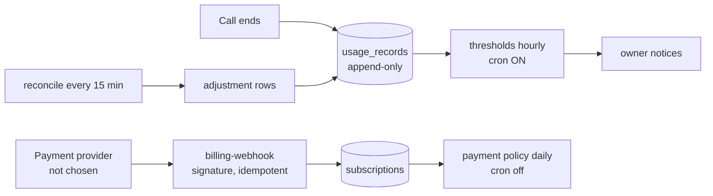

| Item | Status | Evidence |
|---|---|---|
| Minute ledger (one usage row per call, adjustments) | VERIFIED-TEST; **0 rows in prod**: the 5 test calls had no duration, so nothing was metered | `sql/zella_call_usage.sql` |
| Thresholds | cron on; nothing to measure | cron history |
| Billing webhook (provider-agnostic, signed, idempotent) | VERIFIED-TEST (8 tests; `billing_test.sql`, concurrency) | deployed v5 |
| Plans, prices, trials | **0 plans**. Only the owner creates them (rule BIL-1) | prod |
| Entitlement enforcement at call time | **MISSING** (G-11) | — |
| Card handling | never in Zella Voice (by design) | — |

---

## 19. Security, privacy and trust

### 19.1 Review with evidence

| Area | Finding | Evidence | Status |
|---|---|---|---|
| Business-to-business isolation | RLS on every public table (170 policies in the baseline); `zz_tenant_links`; role checks first in functions | `isolation_test.sql` and 21 other suites: **58 checks passed, 9 Nov** (isolated, Postgres 16) | VERIFIED-TEST |
| RLS on exposed tables | Advisor: 10 tables with RLS and no policy (deny-all; intended for server-only tables, to confirm) | advisor 9 Nov | VERIFIED (advisor) |
| Storage policies | private `record-files` bucket; uploads "checking" until inspected | `record_files_test.sql` passed | VERIFIED-TEST |
| Realtime | no Realtime subscriptions found in `web/src` | code search | Not used |
| Business and platform roles | ordered business roles; granular platform permissions; admin UI fails closed | `platform_roles_test.sql`, `viewer_test.sql` passed | VERIFIED-TEST |
| SECURITY DEFINER functions | pinned `search_path`; role check first (convention). Advisor: **355** callable by signed-in users, **6** by anon (public endpoints) | advisor | PARTIAL: no automated proof that all 355 check roles. The daily permission self-check exists but cron is off (G-29) |
| Null user / service context | `zella_has_role`: anon is false; server is trusted | `sql/zella_role_check_hardening.sql` | VERIFIED-TEST |
| `calls_view` SECURITY DEFINER | advisor ERROR; intended as the transcript gate | advisor | needs review (G-13) |
| Service-role credentials | only in edge secrets and the n8n credential | config | UNVERIFIED (cannot read secrets) |
| n8n credential access | anyone with access to the n8n account can use the service-role credential | n8n | risk to accept or reduce (G-30) |
| Webhooks and replay | Vapi: HMAC/Bearer over raw bytes with timestamp and replay table; Resend and Meta: signatures; n8n: `X-Zella-Secret` | `vapi_request_receipts` (2 rows) | VERIFIED-PROD (Vapi auth) |
| Caller identity | caller ID used to find and change bookings | §8.3 | **Risk** (G-18) |
| Communication policy checks | at prepare time and at each claim | §9.6, §11 | VERIFIED-TEST |
| Link tokens (`/r`, `/w`, `/u`) | random 64/32 hex, single purpose, expiring, server-checked; malformed → customer page | `BrokenLink.jsx` | VERIFIED-TEST; revocation on booking change: UNVERIFIED |
| AI prompt injection | tools re-checked server-side; spam phrase detection; no secrets in prompts | `zella_spam_assess` | VERIFIED-TEST (spam); eval set empty (G-26) |
| Sensitive industries | transcripts never to staff; private fields in `crm_record_secrets`; follow-ups as drafts | `call_privacy_test.sql`, `record_links_secrets_test.sql` passed | VERIFIED-TEST |
| Transcripts and recordings retention | no deletion job | — | MISSING (G-23) |
| Audit logs | privileged triggers; 145 rows in prod | prod | VERIFIED-PROD |
| Backup and restore | PITR state UNVERIFIED (not visible to this review); schema baseline and restore script exist | `sql/baseline/` | UNVERIFIED (G-31) |
| Support access | audited admin functions; no impersonation feature | code | VERIFIED-TEST |
| Rate limiting | `zella_rate_limit` on public entry points | `rate_limits` (14 rows in prod) | VERIFIED-PROD |
| Spam false positives | only explicit lists block; automatic restriction needs 2+ signals and a high score, and lasts 24 h | spam design | VERIFIED-TEST |
| Data export and offboarding | data-rights requests table and deadline job; no full export | — | PARTIAL (G-23) |
| Leaked-password protection | **off** | advisor | G-13 |
| MFA for admins | enforced | `mfa_test.sql` passed | VERIFIED-TEST |

### 19.2 Legal and professional review needed (no compliance is claimed)

- Outbound calls to leads: consent basis, calling hours and do-not-call registries for each country served.
- SMS: A2P 10DLC (US), carrier rules, STOP handling.
- Recording and transcribing calls: notice and consent rules.
- Sensitive industries: health, legal, financial and children's data obligations.
- Review requests: transactional or marketing.
- Data residency and cross-border transfer.
- Retention periods.

---

## 20. Industries

The 28 industries configured in production (verified 9 Nov) are listed in §20.1. **"Tested" means the isolated
industry matrix (1,383 checks, 5 Nov report, not re-run). No industry is complete:** none has run with a real
business, real numbers or live channels. Real-world requirements need validation with businesses (marked **Q**).

### 20.1 Matrix

| Industry | Typical journey | Scheduling | Key records | Sensitive | Messaging policy (defaults) | Built | Tested | Missing / questions | Priority |
|---|---|---|---|---|---|---|---|---|---|
| Beauty & Salon | call → book service → remind → visit → review | yes | client notes | low | standard | presets, booking, reminders | matrix + salon journey | live run; Q: deposits | **P0 launch candidate** |
| Spa & Wellness | same | yes | client prefs | low/medium | standard | presets | matrix | Q: intake forms | P1 |
| Fitness | classes, memberships | classes, capacity | member IDs (private) | low | standard | class capacity | matrix | Q: membership billing | P2 |
| Restaurant | reservations, tables | tables, seating | tables, combinations | low | welcome off | tables, seating | matrix + seating tests | Q: deposits, no-show fees | P1 |
| Hospitality | bookings, stays | yes | stays | low | standard | presets | matrix | Q: PMS integration | P2 |
| Travel | enquiries, bookings | yes | trips | low | standard | presets | matrix | Q | P2 |
| Dental | appointments, recalls | yes | patient (private) | **high** | welcome/feedback/review off; drafts | presets, privacy | matrix + privacy | Q: recall rules; legal review | P1 |
| Healthcare | appointments | yes | patient (private) | **high** | same as dental | presets, privacy | matrix | legal review; Q: triage scripts | P2 |
| Pet Care & Veterinary | appointments per pet | yes | pets (linked bookings) | medium | standard | linked bookings | matrix | Q: vaccination reminders | P1 |
| Childcare | enquiries, tours | yes | children (private) | **high** | review off | private fields | matrix | legal review | P2 |
| Education | classes, enrolments | yes | students | medium | standard | presets | matrix | Q | P2 |
| HVAC | service calls, dispatch | jobs, arrival windows | jobs, equipment | low | job-completed note | dispatch, windows, workflows | matrix + workflows (31/31) | Q: emergency after-hours | P1 |
| Plumbing | same | same | same | low | same | same | matrix | same | P1 |
| Electrical | same | same | same | low | same | same | matrix | same | P2 |
| Home Services | same | same | same | low | same | same | matrix | — | P2 |
| Cleaning Services | recurring visits, access codes | recurring | properties, access codes (private) | medium | same | recurring, secrets | matrix | Q | P2 |
| Landscaping & Lawn Care | recurring, seasonal | recurring | properties | low | same | seasonal rules | matrix | — | P2 |
| Pest Control | recurring treatments | recurring | properties | low | same | presets | matrix | — | P2 |
| Automotive | service bookings | yes | vehicles (VIN unique) | low | same | linked vehicles | matrix | Q: parts status updates | P2 |
| Property Management | maintenance requests | jobs | properties, units | medium | review off | presets | matrix | Q | P2 |
| Real Estate | viewings, leads | yes | listings | low | standard | presets | matrix | Q: lead speed-to-call | P2 |
| Legal | consultations | yes | matters (private) | **high** | drafts; review off | privacy | matrix | legal review | P2 |
| Financial Services | consultations | yes | clients (private) | **high** | same | privacy | matrix | legal review | P2 |
| Insurance | enquiries, claims | yes | policies (unique) | **high** | same | presets | matrix | legal review | P2 |
| Professional Services | consultations | yes | clients | medium | standard | presets | matrix | — | P2 |
| Photography & Events | bookings, deposits | yes | events | low | standard | presets | matrix | Q: deposits | P2 |
| E-commerce | order questions | **no bookings** | orders (Shopify) | low | welcome off | order lookup; booking tools removed | matrix + orders | Shopify live test | P2 |
| Other | generic | yes | generic | low | standard | generic | matrix | — | P2 |

---

## 21. Reliability, monitoring, deployment and recovery

| Topic | Today | Status | Gap |
|---|---|---|---|
| Idempotency | keys on tool calls, webhooks, usage, messages | VERIFIED-TEST | — |
| Event durability (outbox) | events stored once (`automation_events`) before routing | VERIFIED-TEST | — |
| Claim timeouts | 10–30 min per queue | VERIFIED-TEST | — |
| Unknown provider outcomes | calls: sweep counts as failure | PARTIAL | G-04 |
| Dead letters | `automation_dead_letters` | VERIFIED-TEST | — |
| Provider outage | live switches act as kill switches; safe failures in voice | VERIFIED-TEST | no automatic switch-off |
| n8n downtime | queues hold work; dispatcher retries; nothing lost | VERIFIED (design) | backlog alert needs cron on |
| Database outage | voice answers with safe failure; calls not answered by the AI if `voice-rules` can't reach the DB | PARTIAL | G-32: decide the fallback assistant (`assistant_fallback_id`) |
| Transfer fallback | urgent callback | VERIFIED-TEST | — |
| Calendar disconnect | marked error → reconnect reminder | VERIFIED-TEST | — |
| SMS/email failure | retries → Sending failed → owner | VERIFIED-TEST | SMS delivery receipts missing |
| Metrics and alerts | platform alerts, monitoring pages | PARTIAL | no external pager, no log drain (G-24) |
| Correlation IDs | provider call id, `zella_id` metadata, event ids | PARTIAL | no single correlation id across call → callback → message (G-17) |
| Backups | UNVERIFIED | — | G-31 |
| Deployment and rollback | migrations with rollbacks; release rehearsal script; owner approval | VERIFIED-TEST | some prod changes not in the migration ledger (G-20); no CI (G-14) |
| Dev / staging / prod separation | isolated local test DB only; **no hosted staging** | PARTIAL | G-33 |

---

## 22. Testing: what exists, what ran, what is missing

### 22.1 Test inventory

| Suite | Location |
|---|---|
| Web unit | `web/src/*.test.mjs` (4 files) |
| Edge unit | `web/supabase/functions/*/*_test.ts` |
| n8n | `n8n/test.mjs` |
| Database security | `tests/security/run.sh` (22 SQL suites + concurrency scripts) |
| Release rehearsal | `tests/deploy/run_all.sh` |
| Feature SQL suites | `tests/{booking,channel,escalation,orders,reports,knowledge,assistant,plans,windows,tables,relationships,scheduling,slotblocks,workflows,...}` |
| Industry matrix | `tests/workflows/industry_matrix.mjs` |
| Browser | `tests/browser/*.cjs` (Playwright, local stand-in) |
| Voice reliability | `tests/voice-reliability/` |
| Runtime | `tests/runtime/` |

### 22.2 Runs in this review (9 Nov 2026, isolated local Postgres 16; production is 17)

| Suite | Result |
|---|---|
| Database security suite | **58 PASS, 0 FAIL** ("ALL PASSED") |
| Release rehearsal, first run | 23 PASS. 7 FAIL, all from the test environment (`deno` not on PATH). All SQL suites, web build, full rollback and re-apply **passed** |
| Release rehearsal with Deno (re-run) | **29 PASS, 0 FAIL** ("ALL PASSED") |
| n8n | **396 passed, 0 failed** |
| Edge unit tests | staff-invite 9, owner-provision-business 13, billing-webhook 8, voice-rules 39: **69 passed** |
| Edge type check | all pass except `record-files` (TS2315 on the Deno 2.1.4 used here; likely a Deno version difference, not re-checked on the project's Deno) |
| Web unit tests | 4/4 files pass; build passes; lint warnings only |
| Browser, industry matrix, runtime | **not re-run** (need the local stand-in and a full backend) |

### 22.3 Test plan: required tests and their state

| Scenario | Exists? | Ran? | Result | To do |
|---|---|---|---|---|
| Two-business isolation | yes (`isolation_test.sql`) | yes, 9 Nov | pass | add for every new table (TEN-7) |
| Inbound call end to end on a real number | no | — | — | **P0** |
| Outbound call: lead answers | parsing only (n8n tests) | yes | pass | **P0** live test with a test number |
| Lead doesn't answer / busy / voicemail / unknown | retry policy (SQL) | partly | — | add unknown-outcome reconciliation test |
| Repeated attempts and limit | yes (callback policy) | in matrix 5 Nov | reported pass | — |
| Opt-out during an active sequence | consent checks | yes | pass | add an explicit "opt-out between attempts" test |
| Customer replies before the next attempt | **no** | — | — | P0 (with G-09) |
| Duplicate lead events | Google dedupe | yes | pass | Meta and website |
| Missed-call text | **no** (feature missing) | — | — | after D-12 |
| Failed SMS / email bounce | yes (n8n) | yes | pass | live provider test |
| Booking concurrency | yes (voice reliability) | 28 Oct report | reported pass | — |
| External calendar conflict | **no** | — | — | P1 |
| Reschedule cancels reminders | yes | matrix | reported pass | — |
| Waitlist acceptance conflict | yes | matrix | reported pass | — |
| Local-time reports, DST | yes (report suite) | yes, 9 Nov (rehearsal) | pass | — |
| Voice provider failure | voice-rules timeouts | yes | pass | live failover drill |
| n8n outage and recovery | **no** | — | — | P1 |
| Business disabled while work queued | yes (claims check status) | yes | pass | — |
| Billing and entitlement changes | billing webhook | yes | pass | entitlements missing |
| Admin permission failures | yes (browser) | 7 Nov report | reported pass | — |
| Backup restore, no duplicates after recovery | **no** | — | — | P1 |
| Dispatcher back-off with new work | **no** | — | — | P0 (with G-03) |

### 22.4 Release rehearsal re-run with Deno on PATH (9 Nov 2026)

**29 PASS, 0 FAIL.** The run applied all 19 pending files twice and passed every feature SQL suite. It also passed:
- **28 industries × 2 businesses through the current voice-rules runtime, including assistant-request: 391/391
  checks.**
- The deployed-era voice-rules (c4d7127): 335/335.
- voice-rules unit tests: 39/39.
- owner-provision-business unit tests: 13/13.
- Deno type checks.
- The web build.
- A full rollback, identical to the state before, followed by a re-apply.

Environment: isolated local Postgres 16 and a local stand-in API. Not production, not real phones.

---

## 23. Current-state evidence matrix

| Feature | Verified status | Evidence | Tested? | Enabled? | Dependencies | Gap |
|---|---|---|---|---|---|---|
| Tenant isolation | VERIFIED-TEST | security suite 58/58 (9 Nov) | yes | yes | — | TEN-7 coverage for new tables |
| Auth, invites, MFA | VERIFIED-TEST; magic link VERIFIED-PROD | edge tests 22, SQL suites | yes | yes | Resend SMTP | G-13 |
| Create Business | VERIFIED-TEST | edge 13, browser 7 Nov | yes | yes | — | G-12 |
| Inbound AI tools | VERIFIED-PROD (browser calls) | 16 tool calls, 2 verified bookings | yes | yes (test assistant) | Vapi | G-06, G-08 |
| Per-call assistant delivery | CODE-ONLY in prod | 0 deliveries | yes (5 checks) | — | phone number | G-08 |
| Phone numbers | MISSING in prod | 0 rows | yes | — | Vapi/Telnyx | D-07 |
| Call recording (end-of-call) | PARTIAL | 5 calls, no duration/transcript | yes | yes | Vapi | G-05 |
| Minute metering | VERIFIED-TEST; 0 in prod | `usage_records` 0 | yes | trigger on | duration | G-05 |
| Outbound calls | DISABLED | workflow unpublished; `calls_live` off | n8n tests | no | assistant, number | G-01, G-02, G-04 |
| Missed-call callbacks | VERIFIED-TEST | trigger in prod | yes | trigger on; auto-call automation off | — | G-07, G-09, G-10 |
| SMS | DISABLED | 1 dry run | yes | no | Telnyx 10DLC | delivery receipts |
| Email (product) | DISABLED | 0 | yes | no | sender address | — |
| Reminders | DISABLED (queued, not sent) | 4 pending | yes | no | SMS/email | — |
| Waitlist | VERIFIED-TEST | matrix | yes | no (SMS off) | SMS | self-join |
| Check-in | VERIFIED-TEST (staff) | attendance SQL | yes | yes | — | self check-in |
| Calendar sync | DISABLED | — | yes | no | OAuth | G-19 |
| Google leads | VERIFIED-TEST | suite passed 9 Nov | yes | deployed | keys | — |
| Website leads | VERIFIED-TEST | matrix | yes | deployed | forms | — |
| Meta | DISABLED | — | n8n | no | app review | — |
| Knowledge | PARTIAL | 0 items, 3 gaps | yes | worker off | Knowledge worker | G-21 |
| Industry rules | VERIFIED-TEST | 63 automations | yes | timers off | cron | — |
| Dispatcher | DISABLED; defect | prod function body | — | off | — | G-03 |
| Scheduled jobs | DISABLED (2 of 10 on) | cron | yes | 2 on | — | go-live |
| Billing | PARTIAL | webhook tests | yes | cron on | provider | G-11 |
| Reports | VERIFIED-TEST | 6 checks | yes | email off | email | — |
| Spam | VERIFIED-TEST | suites | yes | workflow off | — | — |
| Audit | VERIFIED-PROD | 145 rows | yes | yes | — | — |
| Status page | VERIFIED-PROD | function returns live data (9 Nov) | yes | yes | — | not hosted yet |
| Web hosting | MISSING | — | build passes | — | Cloudflare | go-live |
| Zella Voice sales pipeline | MISSING | — | — | — | — | G-15 |
| Self-serve signup | MISSING | — | — | — | — | D-06 |
| Billing UI for businesses | MISSING | — | — | — | provider | G-11 |
| CI | MISSING | no `.github/workflows` | — | — | — | G-14 |

---

## 24. Detailed gap report

| ID | Problem | Evidence | Impact | Risk | Recommended change | Dependencies | Priority | Suggested test | Type |
|---|---|---|---|---|---|---|---|---|---|
| G-01 | Outbound calls use **one platform assistant and one platform number** for every business; the outbound assistant has no business knowledge or tools | `zella_call_config`, `n8n/src/call-plan.js` | callers see an unknown number; AI can't book or answer on outbound calls | wrong caller ID; poor answer rates; carrier spam labelling | per-business outbound number and assistant via assistant-request (as inbound) | D-01, D-07 | **P0** before outbound | outbound call in two businesses shows each business's number | incomplete |
| G-02 | Callback "connected" becomes **"contacted"**; no conversation outcome for callbacks | `zella_record_callback_attempt` (prod) | a voicemail greeting misread, or a 3-second hang-up, closes the lead | lost leads | add a conversation outcome from the assistant (structured data) as follow-up tasks already do; contacted only on a qualifying outcome | D-17 | **P0** | "connected but no conversation" stays open | broken (semantics) |
| G-03 | Dispatcher back-off delays **new** work up to 15 min; README says 5, code 12 | `zella_dispatch_n8n` (prod) | late reminders, callbacks, replies | missed appointment reminders | back off on unchanged oldest item, not count; fix README | — | **P0** | stuck item + new urgent item → called within 1 min | broken |
| G-04 | Unknown call outcome is treated as failure → retry | `zella_sweep_stuck_calls`; `failed_connection` default | duplicate calls to the same person | annoyance, complaints | reconcile with Vapi (`Call Reconciliation`) **before** any retry; `unknown` state | `call_reconcile_live` | **P0** | lost end-of-call report → no second call until reconciled | incomplete |
| G-05 | All 5 production calls lack duration and transcript; usage ledger empty | prod `calls` | billing and history incomplete | revenue loss, poor history | verify end-of-call report on a real phone call; alert on calls without a report | real number | **P0** | real call → duration, transcript, 1 usage row | unverified |
| G-06 | `report_unanswered_question` fails `NO_CONTACT` when the caller has no number (3/3 in prod) | `ai_tool_calls` | unanswered questions without contact are logged as errors | knowledge gaps lost (partly mitigated: 3 gaps exist via `search_knowledge`) | allow logging the question without a contact; contact optional | — | P1 | web test call → gap recorded, tool ok | broken |
| G-07 | No immediate missed-call text; text only after call attempts are exhausted | `zella_record_callback_attempt`, follow-up kinds | slower response to missed callers | lost customers | optional immediate missed-call text (owner setting) | D-12 | P1 | missed call → one text within 1 min, once | missing |
| G-08 | Per-call assistant delivery and phone routing never used in production; no numbers | `assistant_deliveries` 0, numbers 0 | the live receptionist path is unproven | launch risk | assign one test number to the salon; real call test | Vapi number | **P0** | real call → 1 `served` delivery | unverified |
| G-08b | SMS delivery receipts not handled | `n8n/README.md` "Not covered" | CRM can't show "Delivered" for texts | support confusion | Telnyx status webhook → message status | Telnyx | P1 | delivered event updates the row | missing |
| G-09 | A customer reply does not cancel pending call attempts | no check in `zella_claim_callbacks` | AI calls someone who just texted back | annoyance | on inbound message from the number, pause open callbacks for that customer | — | **P0** before outbound | reply → no further attempt | missing |
| G-10 | Turning off an automation doesn't stop already-created auto-call callbacks | `auto_call` set at creation only | calls continue after the owner says stop | trust | recheck automation status at claim | — | **P0** | disable → claim skips | broken |
| G-11 | No plans, no payment provider, no entitlement enforcement, no billing page | prod 0 plans | can't charge; no limits | revenue, abuse | choose provider; plans; enforce in `zella_assistant_for_call` and claims | D-09 | **P0** before paying customers | over-limit business → humane limit behaviour | missing |
| G-12 | `owner-provision-business` not redeployed with the brand wording | deploy history | old wording in admin errors | cosmetic | deploy via CLI | owner | P2 | — | incomplete |
| G-13 | Leaked-password protection off; `calls_view` SECURITY DEFINER to review; 10 deny-all tables to confirm | advisor | weaker sign-in security | account takeover | switch on; review view | — | **P0** | advisor clean | incomplete |
| G-14 | No CI | no workflows | regressions reach main | quality | GitHub Actions running §22 suites | — | **P0** | PR blocked on failure | missing |
| G-15 | No Zella Voice sales pipeline or public website in this repo | search | no lead capture for Zella Voice itself | growth | separate platform-level module, never in tenants | D-05 | P1 | — | missing |
| G-17 | Attempt history lacks provider status, duration, handler, consent decision, correlation id; no attempts page; timeline incomplete | `callback_attempts` columns | weak audit and support answers | disputes | extend attempts; add page; correlation id across call → callback → message | — | P1 | timeline shows every attempt with reason | incomplete |
| G-18 | Caller ID used as identity for finding and changing bookings | §8.3 | spoofed number could cancel someone's booking | privacy, sabotage | require a second factor (name + date, or a text link) for change and cancel | D-18 | P1 | spoofed number can't cancel | risk |
| G-19 | External calendar busy times up to an hour stale | hourly pulls | double booking with Google-only events | trust | push notifications (webhooks) or shorter pulls before offering | calendar live | P1 | Google event added → slot not offered | incomplete |
| G-20 | Some production changes are not in the migration ledger | list_migrations vs tables | can't prove what's applied | deploy errors | migration ledger table written by every migration | — | **P0** | ledger equals repo list | incomplete |
| G-21 | Nothing marks knowledge `ready` while the Knowledge worker is off; 0 items in prod | prod | receptionist knows nothing | wrong "I don't know" | publish Knowledge worker, or mark ready in-database when no external sync is needed | — | **P0** before launch | add item → ready → answered on a call | incomplete |
| G-22 | No in-browser test call; activation tests unused | `activation_tests` 0 | hard to prove readiness | launch risk | guided activation test (real call to the number + checklist) | number | P1 | — | incomplete |
| G-23 | Retention scan deletes nothing; no full export | `zella_retention_scan` | data kept forever | privacy | deletion jobs per class; export | D-13 | P1 | expired recording removed | missing |
| G-24 | No external alerting, log drain or on-call | config | outages noticed late | reliability | pager + log drain for voice-rules | — | P1 | alert fires | missing |
| G-25 | Gmail/Outlook mailbox choice stored but unused | wizard | owners expect it to work | trust | build or remove | D-19 | P2 | — | incomplete |
| G-26 | 0 AI eval cases | prod | AI regressions undetected | wrong answers | load per-industry eval set; gate releases | — | P1 | eval run passes | missing |
| G-27 | Repo workflow JSON (Appointment Booking, Brain Tools) has an unshipped `seating` change | rebuild 9 Nov | repo ≠ live | confusion | review and ship, or revert | — | P2 | — | incomplete |
| G-28 | Failure Alert not set as error workflow on the 29 others | `docs/GO_LIVE.md` | silent n8n failures | reliability | set at go-live | publish | **P0** at go-live | forced error → alert | incomplete |
| G-29 | No automated proof that all 355 definer functions check roles | advisor | a missed check = data leak | security | static test: every definer function's first statement is a role check or it's on an allow-list | — | P1 | test fails on a new unchecked function | missing |
| G-30 | n8n holds the service-role credential | n8n | n8n account compromise = full DB access | security | MFA on n8n, minimal users; consider a scoped role for workers | — | P1 | — | risk |
| G-31 | Backups / PITR not verified | — | data loss | critical | confirm PITR; restore drill | owner | **P0** | restore drill | unverified |
| G-32 | Database outage = AI receptionist can't answer | voice-rules safe failure | missed calls | P1 | standby assistant (`assistant_fallback_id`) that takes messages | — | P1 | DB down → message taken | incomplete |
| G-33 | No hosted staging environment | — | first real test is production | risk | staging Supabase + n8n | cost | P1 | — | missing |

---

## 25. Implementation priorities

**P0: before a real business depends on Zella Voice, or before paying customers**

| Item | Gaps |
|---|---|
| Prove the live inbound path on a real number: delivery, end-of-call, usage | G-05, G-08 |
| Knowledge can become ready | G-21 |
| Fix dispatcher back-off; set the Failure Alert workflow | G-03, G-28 |
| Outbound safety: per-business number and assistant, honest outcomes, reconcile before retry, stop on reply, stop when disabled. Do these **before any outbound call** | G-01, G-02, G-04, G-09, G-10 |
| Security switches and review | G-13 |
| Backups and a restore drill | G-31 |
| CI, migration ledger | G-14, G-20 |
| Billing provider, plans, entitlements, before charging | G-11 |
| Go-live steps (hosting, secrets, cron groups, dispatcher, workflows, one switch at a time) | `docs/GO_LIVE.md` |

**P1: dependable operations**

| Item | Gaps |
|---|---|
| Unanswered questions without a contact | G-06 |
| Missed-call text option | G-07 |
| SMS delivery receipts | G-08b |
| Attempt history, page, correlation id | G-17 |
| Caller verification for changes | G-18 |
| Calendar freshness | G-19 |
| Activation test | G-22 |
| Retention and export | G-23 |
| Alerting | G-24 |
| Eval set | G-26 |
| Definer-function test | G-29 |
| n8n credential risk | G-30 |
| DB-down fallback | G-32 |
| Staging | G-33 |
| Zella Voice sales pipeline | G-15 |

**P2: improvements and scale**

| Item | Gaps or references |
|---|---|
| owner-provision-business redeploy | G-12 |
| Mailbox choice | G-25 |
| Seating workflow change | G-27 |
| Partitioning, read replicas, code splitting, TypeScript | as in version 2 |
| Self check-in, waitlist self-join | D-15 |

---

## 26. Open product decisions

| ID | Decision needed | Why it matters |
|---|---|---|
| D-01 | Outgoing lead calls: AI, human staff, or both? Which lead sources first? | shapes G-01 and the CRM |
| D-02 | Default maximum attempts, spacing and overall window for lead calls and missed-call callbacks | today per-callback values; no product defaults |
| D-03 | Calling hours: keep 09:00–19:00 or make it per business; reminder quiet hours | legal and customer experience |
| D-04 | Consent basis for first calls to new leads (transactional vs marketing) per country | legal review |
| D-05 | Zella Voice's own website and sales pipeline: where it lives | G-15 |
| D-06 | Self-serve signup or assisted onboarding only | onboarding design |
| D-07 | Phone numbers: buy new, port, or forward; who pays | telephony |
| D-08 | Calendar providers at launch (Google, Outlook) | OAuth setup |
| D-09 | Billing provider, plans, prices, trials, limits (owner only) | G-11 |
| D-10 | Leave voicemails on lead calls? Content? | policy and provider capability |
| D-11 | Call back after a provider-failed inbound call? | missed-call design |
| D-12 | Missed-call text: immediate, delayed, or only as fallback | G-07 |
| D-13 | Retention periods per data class (rulebook proposes defaults) | G-23 |
| D-14 | Countries served; data residency | legal |
| D-15 | Check-in behaviour: staff only, or customer self check-in; waitlist self-join | product |
| D-16 | Review requests: transactional or marketing | legal |
| D-17 | What "contacted" means for a lead | G-02 |
| D-18 | Caller verification for changing bookings | G-18 |
| D-19 | Gmail/Outlook mailbox: build or remove | G-25 |
| D-20 | Industries to launch first (recommendation: Beauty & Salon, then Restaurant and HVAC/Plumbing) | focus |
| D-21 | Brand rule: always "Zella Voice", or allow "Zella" in running sentences (rulebook `BRD-1` currently allows it) | wording consistency |

---

## 27. Repository map

| Need | Path |
|---|---|
| Rules | `ZELLA_VOICE_RULES.md`, `CLAUDE.md`, `AGENTS.md` |
| Schema snapshot / restore | `sql/baseline/` |
| Feature SQL / rollbacks | `sql/zella_<feature>.sql` / `sql/rollback/` |
| Dispatcher and jobs | `sql/zella_dispatcher.sql` |
| Callbacks and outbound | `sql/zella_run_all.sql` (`zella_claim_callbacks`, `zella_record_callback_attempt`), `sql/zella_outbound_calls.sql`, `n8n/src/call-plan.js` |
| Vapi parsing | `web/supabase/functions/_shared/vapi-call-events.js`, `vapi-brain-tools.js` |
| Voice endpoint | `web/supabase/functions/voice-rules/` |
| Lead capture | `sql/zella_lead_capture.sql`, `sql/zella_google_leads.sql`, `web/supabase/functions/google-lead`, `website-lead` |
| Attendance / check-in | `sql/zella_attendance.sql` |
| Waitlist | `sql/zella_waitlist_offers.sql` |
| n8n source / built | `n8n/src/` / `n8n/workflows/` |
| Web app | `web/src/App.jsx`, `router.js`, `navigation/`, `CreateBusinessWizard.jsx`, `adminPermissions.js` |
| Tests | `tests/` (§22) |
| Go-live | `docs/GO_LIVE.md`, `n8n/GO-LIVE.md` |

## 28. Gap → target requirement (for planning changes)

| Gap | Target requirement in `docs/ARCHITECTURE.md` | Web app work |
|---|---|---|
| G-01 outbound assistant and number shared | REQ-LC-10, §13.4 (business caller number and outbound assistant) | Outreach settings (REQ-CRM-20), Voice & numbers (REQ-ADM-07) |
| G-02 answered treated as contacted | REQ-MSG-11, REQ-OUT-12/13 | Callbacks, Outgoing calls, Leads pages show conversation outcome |
| G-03 dispatcher back-off | REQ-AUT-11 | Automation queues page shows oldest due (REQ-ADM-09) |
| G-04 unknown outcome | REQ-AUT-05, §13.7 | "Unknown, being checked" status label |
| G-05 / G-08 inbound proof | REQ-VOX-01, REQ-VOX-08, REQ-LC-14 | Activation tests in Create Business and AI receptionist |
| G-06 unanswered questions | REQ-VOX-07 | Knowledge gaps view |
| G-07 missed-call text | REQ-MC-02, REQ-MC-09 | Outreach settings |
| G-08b SMS delivery receipts | REQ-MSG-12 | honest "Sent" vs "Delivered" |
| G-09 reply doesn't stop attempts | REQ-MC-03, §13.5 | Inbox and Callbacks show "paused: customer replied" |
| G-10 disabling doesn't stop | REQ-AUT-06, §13.5 | Automations toggle effect shown |
| G-11 billing | REQ-BIL-01–06 | Billing page (REQ-CRM-25), Plans and Billing admin |
| G-13 security switches | §20 | — |
| G-14 / G-20 CI, migration ledger | §21 | — |
| G-15 Zella Voice growth | REQ-LC-01–03, REQ-ADM-18 | Growth admin page; public site |
| G-17 attempt history and timeline | REQ-OUT-20/21, REQ-CRM-30 | Outgoing calls page; unified timeline |
| G-18 caller identity | REQ-ID-01 | — (voice) |
| G-19 calendar freshness | REQ-APT-02 | — |
| G-21 knowledge readiness | REQ-KNW-01 | Knowledge approve = ready |
| G-22 activation | REQ-LC-14 | activation checklist screen |
| G-23 retention, export | REQ-LC-20, §20 | Data rights, export |
| G-24 alerting | §21 | Monitoring |
| G-26 eval set | REQ-KNW-06, REQ-VOX-10 | — |
| self check-in, waitlist self-join | REQ-CHK-02, REQ-WL-01 | `/c/<token>` page; waitlist join |
