# Zella Voice: payments, billing and scale architecture

> **Status: DRAFT for the owner's review (12 Nov 2026).** Nothing here is built, applied or switched on. It designs how
> the commercial policy in `docs/ARCHITECTURE.md` §17 is implemented. When the owner approves it, the parts that change
> the required design move into `ARCHITECTURE.md` and this file becomes the detailed reference. Real charges, refunds
> and auto-reloads need the owner's explicit approval before they go live (`NN-3`, `NN-9`, `BIL-10`).
>
> **Provider: Stripe (D-34, changed 13 Nov 2026).** Zella Voice is registered as a Wyoming LLC, so payments go through
> Stripe instead of Razorpay. §16 is the Stripe integration reference, written from Stripe's current documentation
> (13 Nov 2026). Stripe charges a saved card later for any USD amount, so auto-reload and pay as you go are charged
> automatically (D-54 is closed), and a cancellation stays reversible until the period ends.

Contents: [1 Goals](#1-goals-and-non-negotiables) · [2 Context](#2-system-context) · [3 Components](#3-components-and-trust-boundaries)
· [4 Data model](#4-data-model) · [5 Money rules](#5-money-rules) · [6 Flows](#6-flows) · [7 State machines](#7-state-machines)
· [8 Idempotency](#8-idempotency-and-safe-retries) · [9 Security](#9-security) · [10 Reconciliation](#10-reconciliation-and-audit)
· [11 Scale](#11-scalable-architecture-1-to-10000-people) · [12 Failure modes](#12-failure-modes) · [13 Testing](#13-testing)
· [14 Rollout](#14-rollout-and-gates) · [15 Open points](#15-open-points) · [16 Stripe reference](#16-stripe-integration-reference)

---

## 1. Goals and non-negotiables

| # | Goal | How |
|---|---|---|
| G1 | **No card data ever touches Zella Voice** (`NN-9`) | Cards are entered only on Stripe's hosted pages (Checkout, or the Customer Portal for card changes). We store provider IDs, never card numbers, CVV or bank details. PCI scope stays at the smallest level (hosted payment page). |
| G2 | **No money movement is applied twice, and none is lost silently** | Layers that work together (§8): scoped idempotency keys, a de-duplicating webhook inbox, an outbox for every provider call, unique keys on provider object IDs and local operations, and reconciliation; an outcome we cannot confirm is held and alerted, never guessed. |
| G3 | **The database decides; screens only ask** (`NN-6`, `SEC-5`) | Prices, eligibility, proration and limits are computed in database functions. The browser never sends an amount. |
| G4 | **The provider is the source of truth for money; we are the source of truth for entitlement** | A payment is "paid" only when a verified webhook (or a server-side fetch from Stripe) says so. Minutes, texts and emails are granted only by our ledger. |
| G5 | **Nothing is lost and nothing is guessed** | Unknown outcomes are reconciled with the provider before any retry. Every change is an append-only ledger entry with its source. |
| G6 | **A live call is never cut** (`BIL-5`) | Entitlement checks happen before a call is answered by the AI; a call in progress always finishes. |
| G7 | **Same speed with 1 or 10,000 people** | Stateless functions, pooled connections, per-business balance rows, queues with `SKIP LOCKED`, indexes on every tenant query (§11). |
| G8 | **Every sensitive action is audited and reversible where money allows** | Refunds, credits, plan changes and admin adjustments need a reason, a second confirmation and leave an audit record (`SEC-18`). |

---

## 2. System context

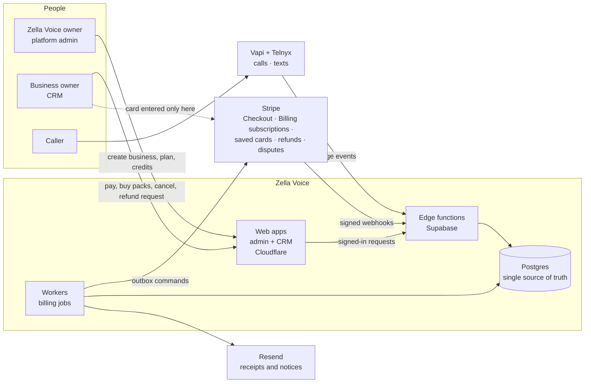

---

## 3. Components and trust boundaries

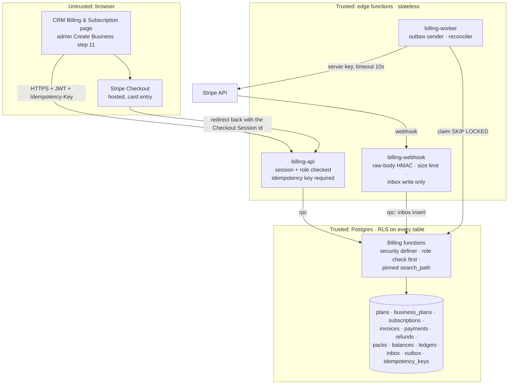

| Boundary | Rule |
|---|---|
| Browser → edge | Signed-in session required. The function re-checks the role in the database (owner for billing, `billing.manage` + MFA for admins). The browser sends **what** it wants (plan change, pack ID), never **how much** it costs. |
| Stripe → edge | `Stripe-Signature` header: HMAC-SHA256 with the endpoint secret over `<t>.<raw body>`, compared in constant time against every `v1` value, timestamp within 5 minutes; body limit 500 KB; unknown event types acknowledged and ignored; the function only writes to the inbox, so it answers fast. |
| Edge → Stripe | Only workers call Stripe, with a restricted secret key from edge secrets, an `Idempotency-Key` on every POST, a 10 s timeout and the per-operation idempotency and recovery rules of §8. |
| Edge → database | Server key used only by workers and the webhook. User requests run as the user, so row security applies. |
| Admin actions | Platform-admin functions with a named permission, MFA, a reason and an audit row. |

---

## 4. Data model

Existing tables are kept and extended; nothing is dropped (`DB` rules: expand, then contract).

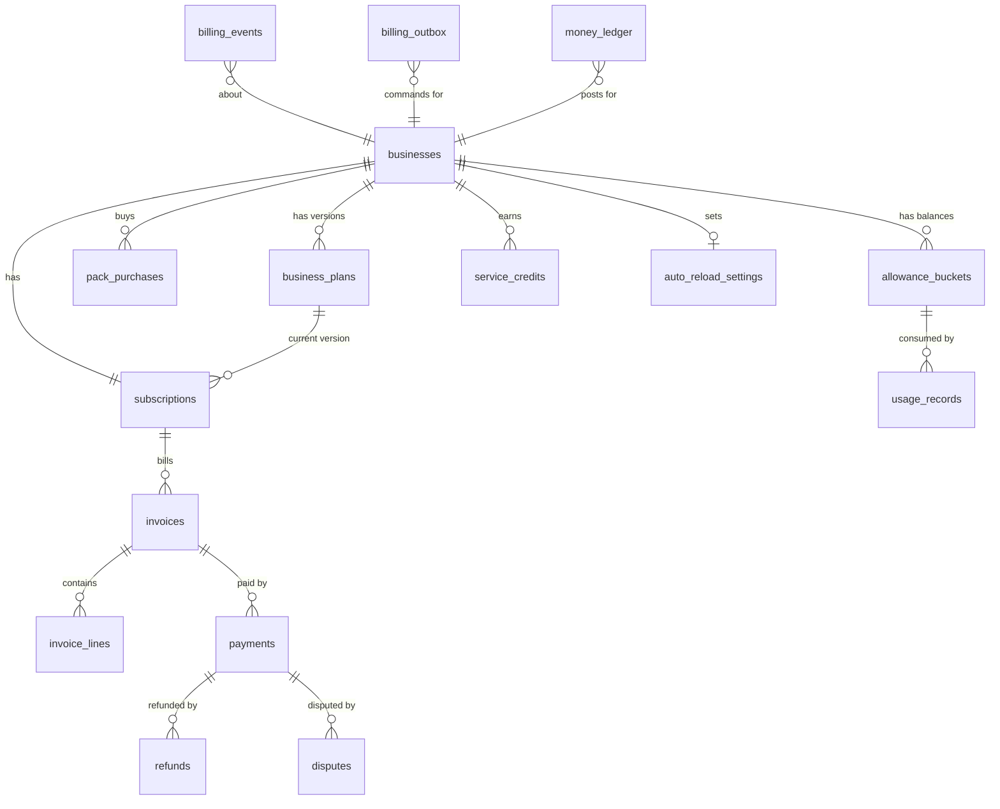

| Table | New or existing | Purpose | Key rules |
|---|---|---|---|
| `business_plans` | new (built, step 2, not applied) | The business's own plan, **versioned**: tier label (Base or Pro), interval, price, setup fee, allowances, languages, caps, trial on/off; every value entered per business, no presets | append a new version per change, never edit; `effective_from`; integer cents |
| `plans` | existing | stays for compatibility; prices move to integer cents (`BIL-7`) | its "anyone can view active plans" policy must not expose per-business prices |
| `subscriptions` | existing | state machine (§7) | one per business (existing unique key); state changes only through functions |
| `invoices`, `invoice_lines` | new | what was charged and why: plan, setup fee, pack, overage, proration, credit, tax | immutable once `issued`; corrections are credit notes |
| `payments` | existing | provider payments; add unique `(provider, external_payment_id)`; amounts in cents | status moves forward only |
| `refunds` | new | requested → approved → sending → processed, failed or uncertain | unique `(provider, external_refund_id)`; **reserved amount** counted while requested, approved, sending or uncertain; sum of reserved and processed ≤ captured; every refund approved by the Zella Voice owner |
| `disputes` | new | chargebacks; suspend while open (`REQ-BIL-37`) | from webhooks only |
| `pack_purchases` | new (built, step 2, not applied) | each pack bought: kind, quantity, price, purchased_at, expires_at (end of the period it was bought in, REQ-BIL-20), rollover_allowed (20% of a minutes pack, 0 for texts and emails), remaining | refundable only if unused and ≤ 14 days |
| `allowance_buckets` | new (built, step 2, not applied) | **current balances** per business and resource: rollover, plan, each pack | one row per bucket; updated in the same transaction as the ledger entry (§11) |
| `billing_periods` | new (built, step 2, not applied) | one row per business per monthly allowance period (yearly plans too, D-46) | every change to a business's balances locks this row, so concurrent usage is serialised |
| `usage_charges` | new (built, step 2, not applied) | every subtraction from, or return to, a balance: quantity, the buckets used, what no balance covered | idempotency key unique (`call:`, `sms:`, `email:`); never edited; serves as the usage key registry until partitioning |
| `billing_pack_catalog` | new (built, step 2, not applied) | the fixed pack prices of §17.3 | platform-owned |
| `usage_records` | existing | append-only usage ledger | idempotency key unique; adjustments, never edits; if partitioned (§11), uniqueness is kept in `usage_keys` |
| `service_credits` | new | outage credits (`REQ-BIL-46`) | capped at one month's fee; applied to next invoices |
| `auto_reload_settings` | new (built, step 2, not applied) | threshold, pack, monthly spend cap, on/off | owner only; changes audited |
| `billing_events` | existing | **webhook inbox**; unique `(provider, external_event_id)` | applied once, in order, never backwards; **never partitioned** (processed events are archived after a retention period, keeping their keys) |
| `provider_accounts` | new | the Stripe account and mode (live or sandbox) each event and object must match (`livemode`, account id) | platform admin only; no secrets stored here |
| `payment_quarantine` | new | events or payments that failed the binding check (§6.0a) or arrived during a secret-compromise window | nothing is granted until a person resolves it; audited |
| `usage_keys` | new, when partitioning | one row per usage idempotency key, **not partitioned** | inserted in the same transaction as the usage entry, so a duplicate is rejected across all months |
| `billing_outbox` | new | **commands to Stripe** (Checkout Session, subscription change, off-session charge, invoice item, refund, cancel) | written in the same transaction as the business change (§8) |
| `idempotency_keys` | new | user request keys: unique `(business_id, operation, key)`, request-body hash, stored response | 24 h retention; same key + different body = 409; authorisation re-checked before a stored response is returned |
| `money_ledger` | new | **double-entry** journal: every cent in or out (charge, payment, refund, credit, tax) | each posting balances to zero; the books can be rebuilt from it; each posting has an operation key |
| `ledger_operation_keys` | new, **not partitioned** | one row per ledger operation key (`invoice:`, `payment:`, `refund:`, `credit:` …) | inserted in the same transaction as the postings, so the same operation can never be posted twice in any month |

**Why a double-entry money ledger:** each invoice, payment, refund and credit posts two or more balancing lines,
for example *receivable +$299 / revenue −$299*, then *cash +$299 / receivable −$299*. Any mismatch shows up as a
non-zero balance, which makes reconciliation with Stripe exact and auditable.

---

## 5. Money rules

| Rule | Detail |
|---|---|
| Amounts | `bigint` cents plus a currency code (`BIL-7`). Never floats. Display in the business's locale. |
| Currency | Customers are charged in USD (`REQ-BIL-28`); Stripe amounts are integer cents, so no conversion inside our code. Payouts go in **USD to the LLC's US bank account**; each payment stores the amount charged and, from its balance transaction, Stripe's fee and the net, so reconciliation (§10) matches both. |
| Rounding | Proration and per-day credits use integer maths, rounding **half up to the cent once, at the line level**; the invoice total is the sum of rounded lines. |
| Proration (upgrade) | `charge = round((new_price − old_price) × remaining_seconds / period_seconds)`; extra allowance for the rest of the cycle is prorated the same way (`REQ-BIL-30`). |
| Service credit | `round(monthly_fee / 30) × affected_days`, capped at `monthly_fee` (`REQ-BIL-46`). |
| Tax | A separate invoice line whose rule is **not built until D-50 is decided**. The design leaves a tax line and a tax ID on the invoice. |
| Prices come from | `business_plans` (plan, setup fee) and a fixed `pack_catalog` (§17.3 prices). Never from the request. |

---

## 6. Flows

### 6.1 Create Business → first payment

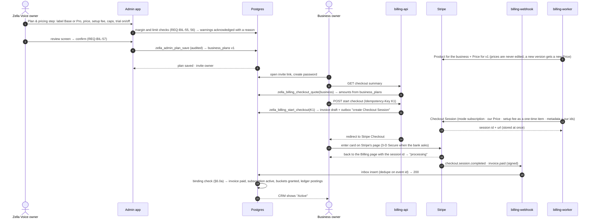

The return to our page only shows "processing". **Access is granted only when the verified webhook (or the worker's
fetch from Stripe) confirms the paid invoice, and the payment passes the binding check below.** A lost redirect never
loses a payment, and a forged redirect never grants anything.

### 6.0a Payment binding (applies to every paid grant)

Before any paid access, allowance, pack or invoice status is granted, one database function checks that the paid
invoice or PaymentIntent belongs to exactly what we expected. **All of these must match a row we created ourselves:**

| Check | Against |
|---|---|
| Account and mode | the configured Stripe account; `livemode` must match the environment, so a sandbox event can never grant in live, and the reverse |
| Business | derived from **our own** mapping (the Checkout Session, subscription, customer or PaymentIntent we created and stored for that business), never from browser input or Stripe `metadata` alone |
| Stripe object | a Checkout Session, subscription, invoice or PaymentIntent ID stored by us before the customer paid |
| Invoice | the local invoice that Stripe invoice or PaymentIntent was created for |
| Amount and currency | the invoice total in cents, in USD |
| Status | invoice `paid`, or PaymentIntent `succeeded` (a subscription becoming `active` or `trialing` alone is **not** proof that an invoice was paid) |

**Fetch before grant:** the webhook payload is only a notice. Before any money grant the worker retrieves the invoice
or PaymentIntent from Stripe's API with our key, and the binding check runs on that fetched object, so a stale,
replayed or reordered payload can never grant. **Stripe-computed totals** (proration, tax): the local invoice records
Stripe's lines and total from our own API response when the invoice is created, and the paid amount must equal that.

Any missing, ambiguous or mismatched field puts the event in **quarantine** (no grant, platform alert, a person
decides). A trial start (§6.2) is a separate, unpaid confirmation and never marks an invoice paid. The grant, the
invoice update and the ledger postings happen in **one transaction**, guarded by unique keys on the Stripe invoice,
PaymentIntent and charge IDs and on the local operation (invoice, pack purchase), so the same money can never be
applied twice.

### 6.2 Trial: card at the start, charged at the end (`REQ-BIL-11`, `REQ-BIL-12`)

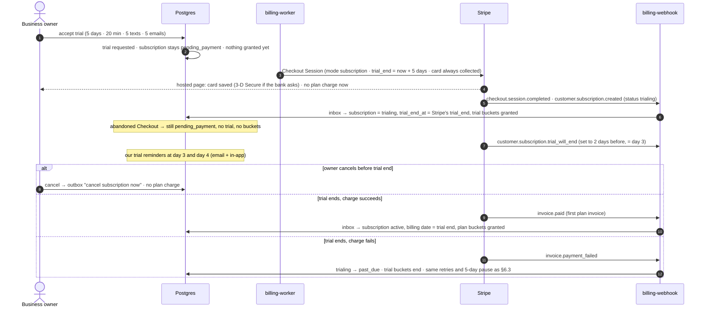

**Trial dates stay aligned:** the local `trial_end_at` is always Stripe's stored `trial_end`, so the trial end and
the first charge are the same moment. A Checkout Session that is never completed expires and charges nothing; a new
one is created when the owner returns. **Setup fee during a trial:** a one-time item on a trial subscription goes on
its first invoice; whether that is the $0 invoice at the start (charged now) or the first paid one is confirmed in the
sandbox before the trial ships, and the owner decides which is wanted (§15).

Trial abuse guard (D-48, proposed): one trial per business, per phone number and per owner email domain. **No
card-derived identifier is used** (not even a fingerprint), because card details are never collected (`NN-9`). A repeat
is offered a paid plan instead.

### 6.3 Renewal and failed payment (`REQ-BIL-33`)

**Stripe retries a failed renewal itself** (Smart Retries, on by default). We set a **custom retry schedule** in the
Dashboard to match `REQ-BIL-33` (days 2, 3 and 4 after the due date), and "after all retries fail" to **leave the
subscription past due**, so our 5-day rule decides the pause. Our worker never charges a renewal itself; it only sends
the owner our in-app notice and email on each failure event.

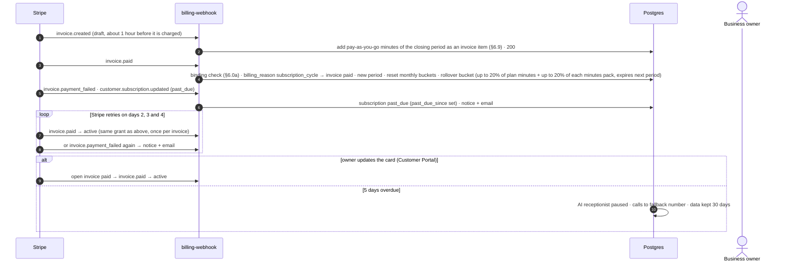

`invoice.payment_action_required` (the bank asks for 3-D Secure on a renewal) sends the owner a link to Stripe's page
to confirm the payment. Which unpaid invoices must be settled before a `past_due` subscription returns to `active` is
a Dashboard setting; we set it to the most recent invoice, and service is restored only when the current period's
invoice is paid.

### 6.4 Packs and auto-reload, race-free (`REQ-BIL-23`)

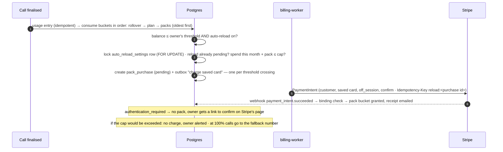

A unique partial index `(business_id) where status = 'pending'` on auto-reload purchases makes a second reload
impossible while one is in flight, however many calls finish at the same moment. A pack bought by the owner on the
Billing page is a Checkout Session in payment mode (or a confirmed PaymentIntent on the saved card), granted the same
way on `payment_intent.succeeded` / `checkout.session.completed` after the binding check.

### 6.5 Entitlement check at call time (`REQ-BIL-22`)

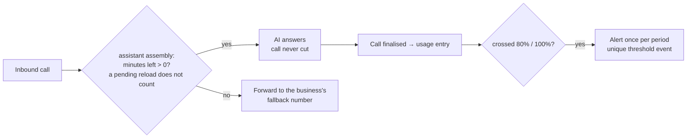

The check reads **one balance row** per business (indexed, no summing), so it costs the same at any scale.

### 6.6 Upgrade and downgrade (`REQ-BIL-30`)

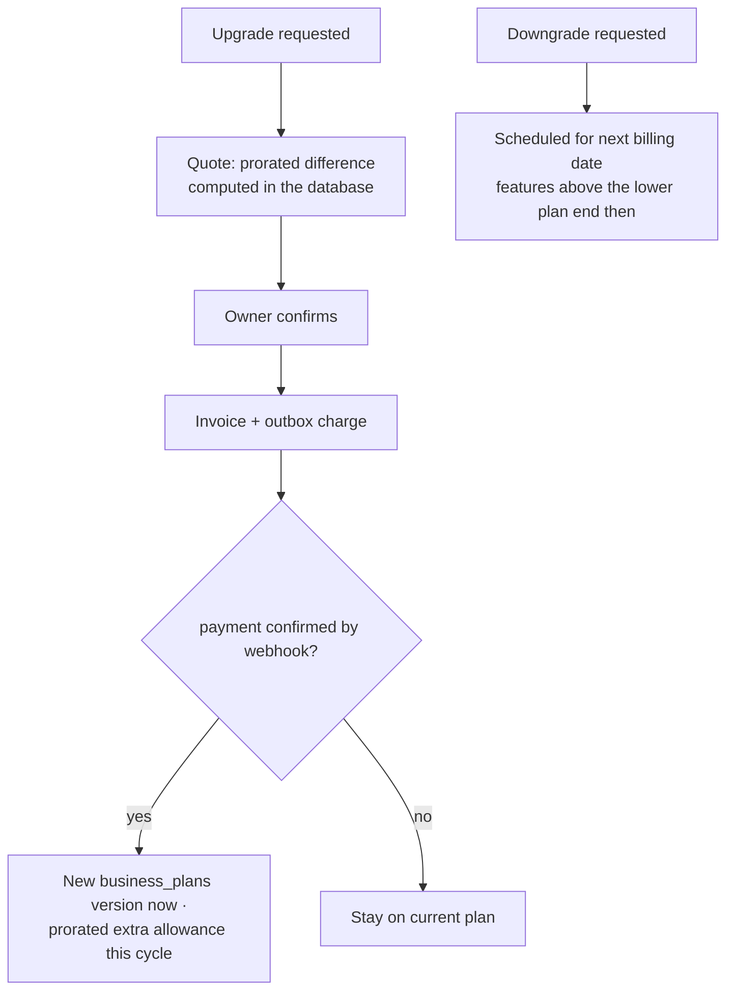

**Stripe mechanics (§16.2):** a Stripe Price cannot change its amount, so each sold `business_plans` version gets
its own Price. An **upgrade** updates the subscription item to the new Price with `proration_behavior: always_invoice`
and `payment_behavior: pending_if_incomplete`: Stripe invoices the prorated difference at once, and **applies the new
Price only if that invoice is paid** (otherwise the update expires and nothing changes). `invoice.paid` for that
invoice, after the binding check (§6.0a), applies the new `business_plans` version and the prorated extra allowance.
Our quote uses Stripe's preview of the invoice (`POST /v1/invoices/create_preview` with the change), so the owner sees
the amount that is really charged. A **downgrade** is a subscription schedule whose next phase, starting at the end of
the current period, uses the lower Price: no credit and no refund now.

### 6.7 Refund request with server-side eligibility (`REQ-BIL-38`…`45`)

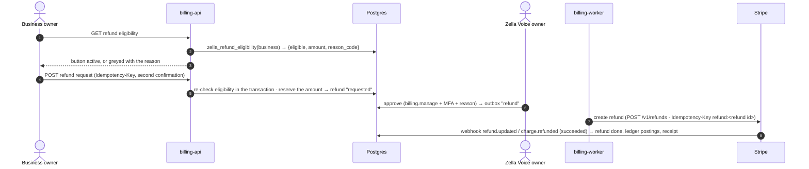

Eligibility is computed again at approval and at sending: a stale screen can never cause a refund that the policy no
longer allows. **Refundable amounts are reserved** when a refund is requested: requested, approved, sending and
uncertain refunds all count against the payment, so concurrent requests can never refund more than was captured.

### 6.9 Pay as you go (D-44), billed with the next renewal

When the owner chose pay as you go (D-44), minutes past the allowance are counted at the business's own rate, up to
the monthly spending limit. They are billed **on the next renewal invoice**: when Stripe creates that invoice as a
draft (`invoice.created`, about an hour before it is charged), the worker adds one invoice item for the closing
period's pay-as-you-go minutes (`POST /v1/invoiceitems` with that draft `invoice`, Idempotency-Key `payg:<period id>`), then
answers 200. Usage recorded after the invoice is finalised, up to the billing close below, goes on the following invoice as a pending invoice item (Idempotency-Key `payg:<period id>:late`).
The webhook must answer `invoice.created` quickly and with 2xx, because Stripe holds the invoice back from being charged
until it does (up to 72 hours). Yearly plans have no monthly invoice, so their pay-as-you-go minutes are charged at
the end of each monthly allowance period as an off-session PaymentIntent on the saved card (§6.4 rules).

**Billing close:** pay-as-you-go minutes belong to the period their call happened in (step 2). For billing, a period
**closes 72 hours after it ends**: usage for that period that arrives before the close is billed; usage that arrives
later is still counted against balances but **not billed** (recorded and reported, so a late provider report can never
surprise the owner with a charge weeks later).

**After a cancellation** there is no renewal invoice. Two final invoices at most, each created once:

| Invoice | When | Contents | Keys |
|---|---|---|---|
| `main` | on `customer.subscription.deleted` (period end) | pay-as-you-go minutes recorded so far for the closing period | `final:<period id>:main:item`, `:main:invoice`, `:main:finalize`, `:main:pay` |
| `late` | **once, at the billing close** (period end + 72 h), only if more minutes arrived after `main` | all of those later minutes together | the same with `late` |

Each is built the same way: `POST /v1/invoiceitems`, then `POST /v1/invoices` for the customer with
`pending_invoice_items_behavior: include`, `collection_method: charge_automatically` and `auto_advance: true` (a
manually created invoice is a draft that Stripe doesn't advance by default), then `POST /v1/invoices/:id/finalize`
(the invoice becomes `open`), then `POST /v1/invoices/:id/pay` to attempt payment on the saved card **at once**
instead of waiting for automatic collection. The outcome arrives as `invoice.paid` or `invoice.payment_failed`
(`billing_reason: manual`, matched to our stored invoice id). A failed payment is retried on Stripe's schedule (§16.6);
still unpaid after the last retry, it becomes a finance task for a person; service has already ended, so nothing is
paused. Each final invoice is stored locally with its kind before the first call, unique by (period, kind).

The rate field and the owner's choice are stored already (step 2); nothing is billed until payments are switched on.

### 6.8 Disputes (chargebacks)

`charge.dispute.created` → dispute row, account suspended while open (`REQ-BIL-37`), owner alerted.
`charge.dispute.closed` with status `won` → that dispute is closed; the account is restored **only when no other
dispute on the subscription is still open** (§7). Status `lost` → ledger postings for the loss; the account stays
suspended until settled. `charge.dispute.updated` and `charge.dispute.funds_withdrawn` / `funds_reinstated` are
recorded and alert a platform admin; evidence is submitted through Stripe's dispute API or Dashboard by a person.

---

## 7. State machines

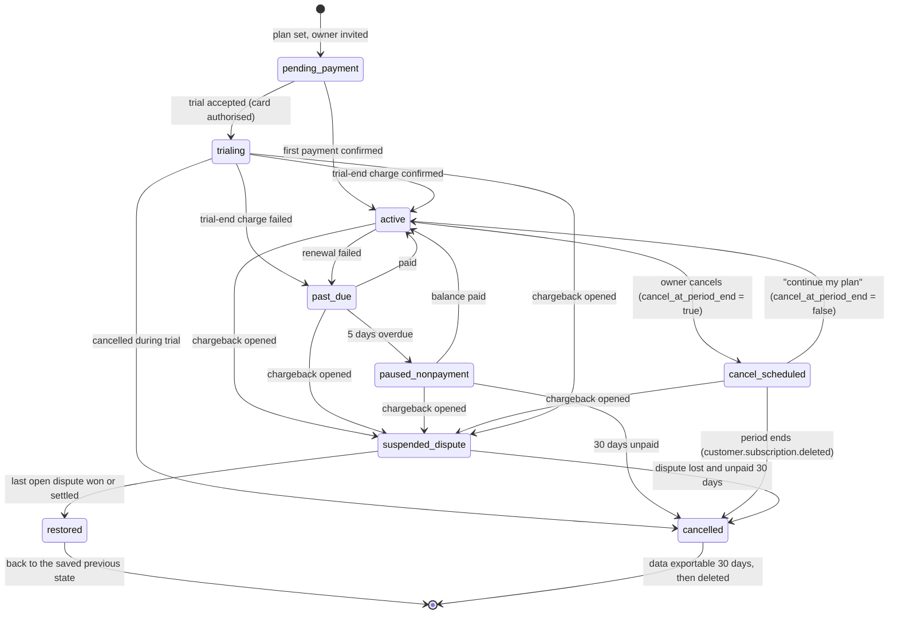

Transitions are allowed only by a table of `(from, to, cause)` checked in one database function. An event that would
move a subscription backwards (an older event arriving late) is recorded and ignored.

**Disputes from any state.** A chargeback can arrive in any state except `cancelled`. The subscription moves to
`suspended_dispute`, and the state it came from is saved **on the subscription** (not on each dispute) when the first
dispute opens.
- **Several disputes:** open disputes are tracked in `disputes`; the subscription stays suspended until **every** one
  is won, settled or lost. A second dispute never overwrites the saved state.
- **Events while suspended:** payment and lifecycle events still apply to the **saved state**, which keeps moving as
  normal; only service stays suspended. For example, a `past_due` subscription whose balance is paid during the dispute
  has its saved state moved to `active`, so it is restored as `active` with no retries or pause; a `cancel_scheduled`
  one whose period ended moves its saved state to `cancelled` (Stripe's scheduled cancellation is unaffected by the
  dispute).
- **Restore:** when the last dispute closes in the business's favour, the subscription takes the saved state as it is
  then. A lost dispute follows the `dispute lost` path in the diagram.
- A dispute on a `cancelled` subscription is recorded and handled by money only (ledger postings), with no state change.

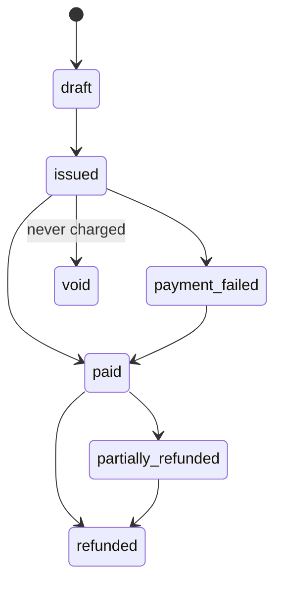

---

## 8. Idempotency and safe retries

Four layers that work **together**; no single layer is relied on alone. Each money operation also has its own
idempotency and recovery rule (table below).

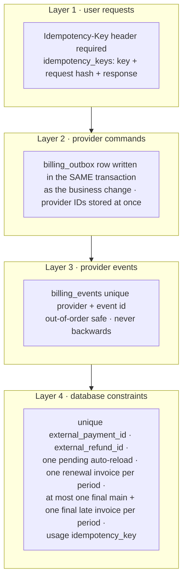

| Situation | What happens |
|---|---|
| Owner double-clicks "Buy pack" | Same `Idempotency-Key` → the stored response is returned; one purchase. Keys are scoped to **(business, operation, key)**, stored with a hash of the request body, and the caller's authorisation is **checked again** before a stored response is returned. |
| Same key, different body | `409 idempotency_key_reused`. |
| Worker crashes after Stripe accepted the charge but before saving | The outbox row is still `sending`. Every Stripe POST carries an **Idempotency-Key** derived from the outbox row, so resending within 24 hours returns the original result instead of charging again; after that, the reconciler looks the PaymentIntent up by our `metadata.outbox_id` before any retry and records the real outcome. A receipt is only a label, never relied on as a lookup or a guarantee. Never blind-retry a charge; an outcome that stays uncertain is held and alerted. |
| Worker loses the reply to **create a Checkout Session or subscription** | Resend with the same Idempotency-Key (same parameters) within 24 hours: Stripe returns the original object. Later, the reconciler searches by `metadata.outbox_id`; an unpaid, never-completed session or `incomplete` subscription charges nothing and is expired or cancelled. |
| Stripe sends a webhook twice | Stripe delivers at least once and may create two events for one change. The event ID (`evt_…`) is a **delivery de-duplication aid**, not a replay guarantee. The real protection is semantic: unique keys on the provider payment, refund and dispute IDs and on the local operation, so a repeated event has no second effect. |
| Webhooks arrive out of order | Each event carries the provider's creation time; state only moves forward (§7). An event for an unknown payment is kept and applied when its parent arrives. |
| Our webhook handler times out | Stripe retries with exponential back-off for **up to 3 days** in live mode (a few hours in a sandbox), and doesn't guarantee order. The handler only inserts, so it answers in milliseconds; events missed for longer are fetched by the reconciler from the Events API (events can be resent for up to 30 days). |
| Two calls cross the threshold at once | The auto-reload row lock and the unique pending index allow one reload. |

**Per-operation rules:**

| Operation | Idempotency | Recovery when the reply is lost |
|---|---|---|
| Create order (checkout, pack, upgrade) | one order per local operation; order ID stored at once | an unpaid order charges nothing: mark it unused and create a new one |
| Renewal and its retries | done by Stripe (Smart Retries, our schedule), never by us (§6.3) | fetch the subscription's invoices and their PaymentIntents |
| Charge a saved card later (auto-reload, yearly pay as you go) | one charge attempt row per purchase; Idempotency-Key `reload:<purchase id>` or `payg:<period id>` (§8.1) | resend with the same key, or find the PaymentIntent by `metadata.purchase_id` |
| Add pay-as-you-go to a renewal (invoice item) | Idempotency-Key = `payg:<period id>`; one item per period | list the invoice's lines |
| Final pay-as-you-go invoices after a cancel | Idempotency-Keys `final:<period id>:<main\|late>:<item\|invoice\|finalize\|pay>`; unique (period, kind) locally; `late` made once, at the billing close | list the customer's invoices by `metadata.final_kind` |
| Upgrade (update subscription) | one pending update per subscription; Idempotency-Key `upgrade:<change id>` | fetch the subscription's `pending_update` and latest invoice |
| Create Checkout Session or subscription | Idempotency-Key `checkout:<outbox id>`; `metadata.outbox_id` | §8 table above |
| Refund | Idempotency-Key `refund:<refund id>` | resend with the same key, or list the PaymentIntent's refunds |
| Cancel at period end / continue | the owner's **latest** choice wins: each click stores `desired_cancel_at_period_end` with an increasing version on the subscription row; one outbox row per subscription (unique), and the worker locks that row, sends the current desired value (not the value of the click that queued it), then fetches the subscription and resends if Stripe's `cancel_at_period_end` differs from the latest desired value. **Each send has its own Idempotency-Key** `cancel:<subscription id>:<desired version>:<attempt>`; the same key is reused only to retry that same uncertain send (same body), and a resend after reconciliation takes a new attempt number | fetch the subscription and compare with the latest desired value |

Each flow is enabled only after its provider behaviour is proven in a Stripe sandbox (§16.8).

**Outbox sending protocol:** claim with `FOR UPDATE SKIP LOCKED` → mark `sending` with a lease → call Stripe → store the
provider ID at once → mark `sent`. A lease that expires sends the row to **reconcile**, not to retry.

### 8.1 Idempotency key map (every money path, one rule each)

**Rules for every Stripe call**

1. The outbox row stores the **exact request body** and its **Idempotency-Key** before the first send, in the same
   transaction as the business change. A retry resends that stored body with that key, never a rebuilt one.
2. Keys are **deterministic** from the local operation (below), so a crashed worker, a second worker or a manual retry
   all produce the same key.
3. Stripe keeps a key for **at least 24 hours**. Within that time, a lost reply is retried with the same key. After
   it, the reconciler first **searches Stripe by our `metadata`** (`outbox_id`, `purchase_id`, `refund_id`,
   `period_id`); only if nothing exists is a **new attempt** (key suffix `:a2`, `:a3` …) allowed, and only for
   operations that are safe to repeat (never a refund or charge whose outcome stays unknown: those are held and alerted).
4. A Stripe `idempotency_error` (same key, different body) means a bug: the row is held and alerted; no new key is
   made automatically.
5. Every object we create carries `metadata` with our ids, so it can always be found again.

| Operation | Stripe call | Idempotency-Key | Local uniqueness | Lookup when the reply is lost |
|---|---|---|---|---|
| Customer | `POST /v1/customers` | `customer:<business id>` | one per business | search by `metadata.business_id` |
| Price for a plan version | `POST /v1/prices` | `price:<business_plans id>` | one per version | search by `metadata.plan_version_id` |
| First checkout / trial | `POST /v1/checkout/sessions` | `checkout:<outbox id>` | one open session per business | session by stored id |
| Pack bought by the owner | Checkout (payment) or `POST /v1/payment_intents` | `pack:<purchase id>` | one per purchase | PaymentIntent by `metadata.purchase_id` |
| Auto-reload | `POST /v1/payment_intents` (`off_session`) | `reload:<purchase id>` | one pending reload per business (partial unique index) | same |
| Yearly pay as you go | `POST /v1/payment_intents` | `payg:<period id>` | one per period | PaymentIntent by `metadata.period_id` |
| Monthly pay as you go | `POST /v1/invoiceitems` | `payg:<period id>` | one item per period | the invoice's lines |
| Final invoices after a cancel | invoice item + `POST /v1/invoices` + finalize + pay | `final:<period id>:<main\|late>:<item\|invoice\|finalize\|pay>` | unique (period, kind) | invoices by `metadata.final_kind` |
| Upgrade | `POST /v1/subscriptions/:id` | `upgrade:<change id>` | one pending change per subscription | subscription `pending_update`, latest invoice |
| Downgrade | `POST /v1/subscription_schedules` | `downgrade:<change id>` | one scheduled change per subscription | the subscription's schedule |
| Cancel / continue | `POST /v1/subscriptions/:id` | `cancel:<subscription id>:<desired version>:<attempt>` | one outbox row per subscription; latest choice wins | fetch the subscription |
| Trial cancel now | `DELETE /v1/subscriptions/:id` | `cancelnow:<subscription id>` | — | fetch the subscription |
| Refund | `POST /v1/refunds` | `refund:<refund id>` | reserved amount ≤ captured | refunds of the PaymentIntent by `metadata.refund_id` |

**Rules for every grant (webhook side)**

| What could repeat | Protection |
|---|---|
| The same event delivered twice | inbox unique `(provider, event id)` |
| Two events for one payment (`invoice.paid` and `payment_intent.succeeded`) | the grant is keyed on the **Stripe object**: unique `invoice id` for plan and pay-as-you-go grants, unique `payment_intent id` for packs and reloads; the second event finds the grant done |
| The same money posted twice | `ledger_operation_keys`: `invoice:<id>`, `payment:<pi id>`, `refund:<id>`, `dispute:<id>`, inserted with the postings in one transaction |
| Events out of order | state moves forward only (§7); an event for an unknown object waits for its parent or is fetched from Stripe |
| Usage counted twice | `usage_charges` idempotency key (`call:`, `sms:`, `email:`) — built (step 2) |
| User double-click | `Idempotency-Key` header, scoped (business, operation, key), body hash, stored response (§8) |

---

## 9. Security

| Area | Control |
|---|---|
| Card data | Stripe-hosted pages only (Checkout, Customer Portal). No card fields in our pages, logs, analytics or support tools (`NN-9`). |
| Webhook authenticity | `Stripe-Signature`: HMAC-SHA256 with the endpoint secret over `<t>.<raw body>` (never parsed and re-serialised), constant-time compare against every `v1` value, timestamp within 5 minutes; reject on any mismatch. The event ID only de-duplicates deliveries; replays have no effect because of unique keys on Stripe object IDs and local operations (§8). During a secret roll both secrets are valid for the overlap Stripe allows. |
| Checkout return | Not verified or trusted: the session id on the return URL only shows "processing" and lets the server fetch the session; the webhook or that server-side fetch grants access (§6.1). |
| Amount tampering | The browser never sends an amount. Every amount is computed in the database from `business_plans` and the pack catalog. |
| Authorization | Business billing: **owner role only** (`TEN-9`), checked in the database. Admin billing: `billing.view` / `billing.manage`, MFA, audit. Row security on every billing table; server-only tables have no client policies. |
| Sensitive actions | Refunds, credits, plan overrides, trial extensions: reason, second confirmation, audit (`SEC-18`). **Every provider refund needs the Zella Voice owner's approval** (REQ-BIL-45); there is no automatic or threshold-based refund. |
| Secrets | Stripe restricted secret key and webhook signing secret only in edge function secrets; never in tables, code, logs or chat (`NN-2`). Routine rotation: the old and new webhook secrets overlap for a short, planned window. **Suspected compromise is different:** the old secret is revoked at once with no overlap; events received during the exposure window are quarantined and each is re-checked against Stripe's API (fetch the invoice, PaymentIntent, refund or subscription) before anything is applied. |
| Restricted API key | The worker's key has only the permissions it uses (write: Customers, Checkout Sessions, Subscriptions, Subscription Schedules, Invoices, Invoice Items, PaymentIntents, Refunds, Billing Portal sessions; read: Events, Charges, Balance Transactions, Disputes). No secret key with full access is used by code. The webhook needs no API key except for fetch-before-grant reads. |
| Stripe metadata | Our ids only (`business_id`, `outbox_id`, `purchase_id`, `refund_id`, `period_id`, `plan_version_id`); never names, emails, phone numbers or call content. |
| Database access | Inbox, outbox, ledger, idempotency and quarantine tables have **no client policies** and no grants to `anon` or `authenticated`; only `security definer` functions with a pinned `search_path` and a role check first touch them. The service role is used only by the webhook and the worker. Owners read their billing only through owner-checked functions (`TEN-9`). Every money function is tested for cross-tenant denial in the isolated database. |
| Data minimisation | Store only provider IDs, status and amounts. **No card details of any kind**, not even the last 4 digits or the card brand; the owner manages the card on Stripe's own page. |
| Rate limits | Checkout start, pack purchase and refund request: per user and per business limits; 429 with retry-after. |
| Fraud | Trial guard (D-48); velocity checks on pack purchases; spend cap on auto-reload; alerts on unusual refund or dispute rates. |
| Logging | Structured logs with business ID and correlation ID; no personal data, no tokens, no full provider payloads. |
| Availability attacks | Webhook body limit 500 KB; JSON bodies limited (`SEC-12`); timeouts on every outbound call (`BE-3`). |

---

## 10. Reconciliation and audit

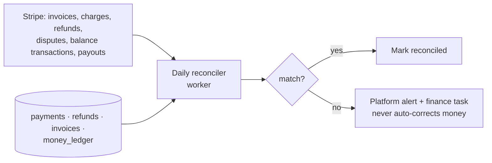

- **Daily:** every Stripe invoice, charge, refund and dispute of the last 7 days is matched to our rows by provider ID and
  amount. A mismatch raises an alert; a person decides.
- **Ledger check:** the money ledger balances to zero overall and per invoice.
- **Usage check:** allowance balances equal the sum of their ledger entries (rebuilt nightly in a read-only check).
- **Audit:** every admin billing action is in the audit log with who, when, why and before/after values.

---

## 11. Scalable architecture: 1 to 10,000 people

The same design serves one owner or 10,000 people at once because every request is stateless, every tenant query is
indexed by `business_id`, hot counters live in one row per business, and slow work goes through queues.

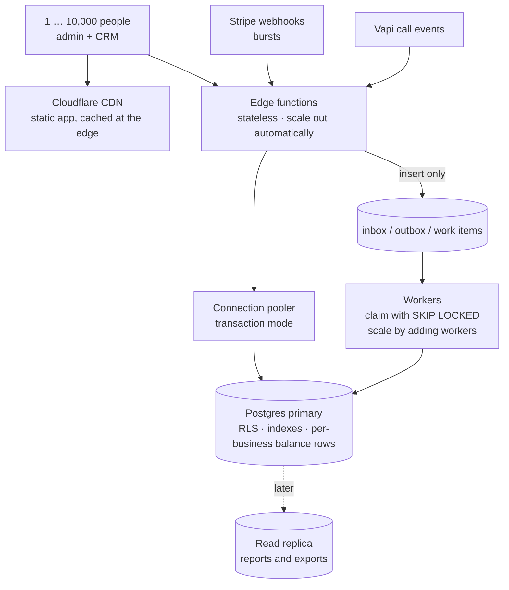

| Concern | Design | Why it scales |
|---|---|---|
| Web app | Static build on Cloudflare's CDN | Pages are served from the edge; no server per user. |
| API | Edge functions are stateless | More traffic → more instances; no session state to share. |
| Database connections | Pooler in transaction mode | Thousands of requests share a small pool of connections. |
| Tenant queries | Every billing and CRM table indexed on `business_id` (plus time) | Each query touches one business's rows, whatever the total size. |
| Hot path at call time | `allowance_buckets`: one balance row per business and resource, updated with the ledger in one transaction | O(1) reads; locks are per business, so businesses never wait for each other. |
| Webhook bursts | Handler only inserts into the inbox; workers apply | Thousands of events a minute are absorbed; processing catches up safely. |
| Background work | Queues with `FOR UPDATE SKIP LOCKED`, leases and back-off | Add workers to go faster; no double processing. |
| Large tables | `usage_records` and `money_ledger` partitioned by month when they pass ~10 M rows. PostgreSQL enforces uniqueness only within a partition, so each gets a small non-partitioned key registry written in the same transaction: `usage_keys` for usage entries, and `ledger_operation_keys` for money-ledger postings (every posting carries an operation key such as `invoice:<id>`, `payment:<id>`, `refund:<id>` or `credit:<id>`, including postings that have no provider ID, like service credits). The webhook inbox `billing_events` is not partitioned. | Old months stay cold; indexes stay small; duplicates are still rejected across months. |
| Reports and exports | Run against a read replica when load requires | Heavy reads never slow down calls or payments. |
| Realtime screens | Subscriptions filtered by row security, only on the pages that need them | No broadcast of other businesses' data, bounded fan-out. |
| Limits | Per-user and per-business rate limits on write endpoints | One noisy business cannot starve others. |

**Capacity plan (to verify with load tests before launch, §13):**

| Stage | People at once | What is needed |
|---|---|---|
| Pilot | 1–50 | Current setup. |
| Launch | 50–1,000 | Pooler on; indexes checked with `EXPLAIN`; workers outside n8n for billing jobs. |
| Growth | 1,000–10,000 | Larger database compute; read replica for reports; partitioned ledgers; more workers; alerting on queue age and p95 latency. |

**One known bottleneck today:** n8n Cloud Starter allows about 2,500 runs a month (`docs/MEMORY.md`). Billing jobs
(outbox sender, renewals, dunning, reconciliation) must therefore run as database-claimed workers in edge functions,
not as n8n runs. n8n stays for messaging workflows, or moves to a larger plan before scale.

**Targets (SLOs, proposed):** checkout start p95 < 500 ms; webhook acknowledgement p95 < 200 ms; entitlement check
p95 < 20 ms; outbox queue age < 60 s; zero unreconciled payments older than 24 h.

---

## 12. Failure modes

| Failure | Effect | Handling |
|---|---|---|
| Stripe down | Checkout and charges unavailable | Outbox waits with back-off; owners see "payment provider unavailable, we'll retry"; existing access unaffected. |
| Webhook delayed for hours | Payment shown as "processing" | After 15 min the reconciler fetches the Checkout Session, invoice or PaymentIntent we stored, applies it through the binding check (§6.0a), and alerts if Stripe and we still disagree. |
| Our database down | Nothing can be granted | Stripe retries webhooks for up to 3 days; inbox applies them when back. |
| Duplicate charge by the provider | Customer charged twice | Daily reconciliation finds it; a full **refund request** is raised at once and sent after the Zella Voice owner's approval (`REQ-BIL-45`), within the 5–10 business days of `REQ-BIL-43`. |
| Worker crash mid-send | Unknown outcome | Lease expiry → reconcile with the per-operation lookup (§8.1: same key within 24 hours, otherwise the `metadata` search), never blind retry; held and alerted if still unclear. |
| Stripe API error | Call not done or unknown | `429`, `5xx` and timeouts: retry the **stored request with the same key** with exponential back-off and jitter (§8.1); `409` / `idempotency_error` and other `4xx`: no retry, the row is held and alerted. |
| Clock skew | Wrong period boundaries | All periods computed in the database clock, stored in UTC. |
| Secret leaked | Forged webhooks possible | Incident: revoke the old secret immediately (no overlap), set a new one, quarantine events from the exposure window and apply only those confirmed by fetching the object from Stripe; rotate the API key too if it may be exposed; review grants made in the window. |

---

## 13. Testing

| Level | What is proven | Where |
|---|---|---|
| Unit | proration, rounding, eligibility rules, signature checks, event mapping | Deno tests, Node tests |
| Database | state machine, uniqueness, ledger balance, row security per role, cross-tenant isolation | isolated test database only |
| Idempotency drills | double click, duplicate webhooks, out-of-order webhooks, crash after send, concurrent threshold crossing, concurrent refund requests that would exceed the captured amount | isolated database + mocked provider |
| Binding and abuse | wrong amount, wrong currency, wrong business mapping, test-mode event in live, `subscription.activated` without a captured payment, forged webhook with a leaked secret: each is quarantined, nothing granted | isolated database + mocked provider |
| Provider sandbox | a real Stripe **sandbox**: checkout, trial, renewal, failure, refund, dispute | staging, test keys only |
| Load | 10,000 virtual users on CRM reads; 1,000 webhooks/min burst; 500 concurrent call finalisations | staging, synthetic data |
| Reconciliation | seeded mismatches are detected and alerted, never auto-corrected | isolated database |

No real card, real charge or real customer data is used in any test.

---

## 14. Rollout and gates

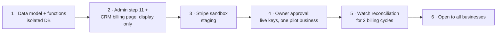

Each step: its own pull request reviewed by CodeRabbit, tests green, the owner's approval for anything that touches
production or real money (`NN-3`, `NN-4`).

---

## 15. Open points

| # | Point | Needed for |
|---|---|---|
| D-51 | Stripe account for the Wyoming LLC: account verified (EIN, the owner's identity, a US bank account for USD payouts), Billing enabled, sandbox keys made; then the sandbox proofs in §16.8 | step 3 |
| — | Setup fee for a trial business: charged at the start of the trial or with the first paid invoice (owner), then proven in the sandbox (§6.2) | before the trial ships |
| D-54 | ~~Variable charges in USD~~ **closed 13 Nov 2026:** with Stripe, auto-reload and yearly pay as you go are off-session charges on the saved card, and monthly pay as you go is an invoice item on the renewal invoice (§6.4, §6.9) | — |
| D-50 | Tax rules for a US LLC (US state sales tax on software; Stripe Tax can calculate and collect it) | invoices with tax |
| D-45…D-48 | fair-use multiple, annual allowances, founding customers, trial limits | step 1 |
| — | Event names, endpoints and limits: **checked against Stripe's docs on 13 Nov 2026** (§16); check again at build time and pin the API version | step 3 |

---

## 16. Stripe integration reference

Checked against Stripe's documentation on **13 Nov 2026** (pages in §16.9). Nothing here was tested against Stripe yet:
every flow is proven in a **sandbox** before it ships (§16.8). Amounts are integer cents in `usd`. The API version is
pinned in the request header and changed only on purpose.

### 16.1 Which Stripe product does what

| Need | Stripe product | Notes |
|---|---|---|
| Monthly or yearly plan charge | **Billing** subscription (a Product per business, a Price per plan version) | Stripe creates and charges each invoice and retries failures (Smart Retries) |
| First payment and card entry | **Checkout** (hosted, mode `subscription`) | card entered on Stripe's page; saved for later charges |
| Setup fee | one-time line item on the Checkout Session | on the first invoice |
| Trial | subscription `trial_end` | card collected at the start, first charge at `trial_end` |
| Upgrade / downgrade | subscription update with `pending_if_incomplete` / subscription schedule | §6.6 |
| Pay as you go | invoice item on the renewal invoice | §6.9 |
| Auto-reload, packs | PaymentIntent on the saved card (`off_session`), or Checkout in payment mode | §6.4 |
| Card change, receipts | **Customer Portal** (card update only), Stripe receipts | no card data in our pages |
| Refunds | **Refunds** API | partial allowed, never above the charge |
| Chargebacks | **Disputes** | events + evidence API |
| US sales tax | **Stripe Tax** (optional, D-50) | |

### 16.2 API calls we make (server side only, restricted secret key from edge secrets)

| Call | Endpoint | Key fields | Our rule |
|---|---|---|---|
| Customer | `POST /v1/customers` | email, name, `metadata.business_id` | one per business, stored |
| Product and Price | `POST /v1/products`, `POST /v1/prices` | `unit_amount` cents, `currency: usd`, `recurring.interval` month or year | a new Price per sold `business_plans` version; Prices are never edited |
| Checkout Session | `POST /v1/checkout/sessions` | `mode: subscription`, our Price, setup fee item, `subscription_data.trial_end` (trial), `customer`, `success_url`, `metadata` | §6.1, §6.2 |
| Update subscription | `POST /v1/subscriptions/:id` | item `price`, `proration_behavior: always_invoice`, `payment_behavior: pending_if_incomplete` | upgrade (§6.6) |
| Subscription schedule | `POST /v1/subscription_schedules` | `from_subscription`, next phase with the lower Price | downgrade at period end |
| Preview invoice | `POST /v1/invoices/create_preview` | the proposed change | the upgrade quote |
| Cancel at period end | `POST /v1/subscriptions/:id` with `cancel_at_period_end: true` (and `false` to continue) | | owner cancel; reversible until the period ends |
| Cancel now | `DELETE /v1/subscriptions/:id` | | trial cancel only |
| Invoice item | `POST /v1/invoiceitems` | `customer`, `invoice` (the renewal draft) or `subscription`, `amount`, `currency`, `description` | pay as you go (§6.9) |
| Off-session charge | `POST /v1/payment_intents` | `customer`, `payment_method`, `amount`, `currency`, `off_session: true`, `confirm: true`, `metadata` | auto-reload, yearly pay as you go; `authentication_required` → the owner confirms on Stripe's page |
| Customer Portal | `POST /v1/billing_portal/sessions` | `customer`, `return_url`; portal configured for card update only | card change after a failure |
| Refund | `POST /v1/refunds` | `payment_intent`, `amount`, `metadata.refund_id` | after the Zella Voice owner's approval (`REQ-BIL-45`, §6.7) |
| Dispute evidence | `POST /v1/disputes/:id` | evidence fields, `submit` | a person decides |
| Look-ups | `GET` invoices, PaymentIntents, refunds, events, balance transactions | | reconciler (§10) |

**Every POST carries `Idempotency-Key`**, built as in §8.1 (at most 255 characters, no personal data). A key is reused only to retry the identical request.
Stripe returns the first result for a repeated key with the same parameters, errors if the parameters differ, and may
forget keys after 24 hours.

### 16.3 What changed from the Razorpay design

| Before (Razorpay, India) | Now (Stripe, US LLC) |
|---|---|
| No USD off-session charge for a variable amount; auto-reload and pay as you go blocked (D-54) | off-session PaymentIntents and invoice items: both automatic |
| A cancel couldn't be undone, so it was kept local until 6 hours before the charge | `cancel_at_period_end` is reversible until the period ends; the owner's cancel is sent at once |
| Plan changes only on international cards, Razorpay's proration | `pending_if_incomplete` applies an upgrade only when its prorated invoice is paid |
| Payouts in INR at the payment-time exchange rate | payouts in USD to the LLC's bank account |
| Refund idempotency through a refund-only header | one `Idempotency-Key` header on every POST |

### 16.4 Signatures

| What | How |
|---|---|
| Webhook | `Stripe-Signature: t=<unix>,v1=<hex>[,…]`; HMAC-SHA256(endpoint secret, `<t>.<raw body>`); compare in constant time with **every** `v1`; reject if `t` is more than 5 minutes from now; ignore other entries (`v0` and debug metadata are never trusted). Already built this way in `billing-webhook/logic.ts` (`verifySignature`). |
| Return from Checkout | not trusted: the session id is only used to show "processing" and to fetch the session server-side |
| De-duplication | the event `id`, unique in the inbox; `created` is not used for ordering |

### 16.5 Webhook events we subscribe to

| Event | We do |
|---|---|
| `checkout.session.completed` | link the Stripe customer and subscription to the business (our stored session id) |
| `customer.subscription.created`, `.updated` | state only (trialing, active, past_due, cancel at period end); a status alone grants nothing |
| `customer.subscription.trial_will_end` | our trial reminder (§6.2) |
| `customer.subscription.deleted` | `cancelled` at period end, or a trial cancel |
| `invoice.created` | add pay as you go to the renewal draft, then 200 quickly (§6.9) |
| `invoice.paid` | binding check (§6.0a), then by the invoice's `billing_reason`: `subscription_create` → first period and buckets (§6.1, §6.2); `subscription_cycle` → renewal: new period, monthly reset, rollover (§6.3); `subscription_update` → the paid upgrade: new plan version and the prorated extra allowance for the **current** period, no reset (§6.6); `manual` → the invoice we created (final pay-as-you-go invoice, §6.9) matched by our stored invoice id. Any other reason is quarantined |
| `invoice.payment_failed`, `invoice.payment_action_required` | `past_due`, notice + email; link to confirm on Stripe's page |
| `payment_intent.succeeded`, `payment_intent.payment_failed` | packs and auto-reload (§6.4) |
| `refund.created`, `refund.updated`, `refund.failed`, `charge.refunded` | §6.7 |
| `charge.dispute.created`, `.updated`, `.closed`, `.funds_withdrawn`, `.funds_reinstated` | §6.8 |

Unknown events are acknowledged and ignored. Stripe doesn't guarantee order, so an event for an object we haven't seen
yet is kept and applied when its parent arrives, fetching the object from the API when needed.

### 16.6 Settings we choose (Stripe Dashboard)

| Setting | Value | Why |
|---|---|---|
| Smart Retries | custom schedule: days 2, 3 and 4 after the due date | `REQ-BIL-33` |
| After all retries fail | leave the subscription past due | our 5-day pause decides service |
| Past-due resolution | the most recent invoice | §6.3 |
| Trial ending events | 2 days before the end (day 3) | our reminders |
| Customer emails | Stripe receipts and failed-payment emails on, with the Zella Voice name; our own notices for the pause | *prove* in the sandbox |
| Customer Portal | card update only (no plan changes or cancel there) | plan changes go through our checks |
| Payment methods | cards | USD, US customers |
| Separate sandbox and live webhook endpoints | sandbox → staging, live → production; each endpoint pinned to the same API version as our requests | a sandbox event can never grant in live (§6.0a: `livemode` and account checked); payload shapes stay what we tested |

### 16.7 The owner's account checklist (needs the owner; nothing here is done by Claude)

1. Stripe account in the name of the **Wyoming LLC**: EIN, the owner's identity, the business address, a **US bank
   account** for USD payouts. Stripe verifies these before live payouts.
2. Billing on; the settings in §16.6.
3. A sandbox restricted key (only the permissions the worker needs) and a sandbox webhook signing secret, saved by the
   owner as edge function secrets on **staging only** (never pasted in chat, code or docs, `NN-2`).
4. A sandbox webhook endpoint pointing at the staging `billing-webhook`, with the events in §16.5.
5. After the sandbox proofs (§16.8) and the owner's approval: live keys, live webhook, one pilot business (§14).

### 16.8 Sandbox proofs before each flow ships

**None of these flows or tests exist yet**; they are built in step 4, which needs the owner's approval. Each flow
ships only with database tests in the isolated test database for its state rules **and** the sandbox proof below.
For cancellation the database tests are: cancel then continue then cancel (latest choice wins, versions increase);
two clicks while the worker holds the lock (the worker sends the latest value); a lost reply retried with the same
key; a mismatch found by reconciliation resent with a new key; a scheduled cancel on a disputed subscription (the
dispute suspension is kept, the cancel still takes effect at period end); the final pay-as-you-go invoice after
`customer.subscription.deleted`. (The Razorpay-era cut-off and late-cancel tests no longer apply: Stripe's
`cancel_at_period_end` is reversible until the period ends.)

| Flow | Prove in a Stripe sandbox |
|---|---|
| First payment | Checkout in USD with a 3-D Secure test card; `invoice.paid` carries the invoice and PaymentIntent; binding check passes |
| Trial | `trial_end` 5 days ahead; no plan charge at the start; setup-fee timing; first charge at `trial_end` (test clock) |
| Failed renewal | declining test card → `past_due`; retries on days 2, 3 and 4 (test clock); card update in the Customer Portal pays the open invoice |
| Pay as you go | invoice item added on `invoice.created` appears on the renewal invoice; a late item goes on the next one |
| Auto-reload | off-session PaymentIntent succeeds; `authentication_required` test card leads to the confirm link; a double threshold crossing makes one purchase |
| Upgrade | `pending_if_incomplete` applies the new Price only after payment; a failed payment leaves the plan unchanged; quote equals the preview |
| Cancel | `cancel_at_period_end` true then false keeps the subscription; true at period end sends `customer.subscription.deleted`; a fast cancel-continue-cancel sequence ends in the owner's last choice; the `main` invoice is finalised and paid at once; several late usage events before the close all land on one `late` invoice made at the close; usage after the close is counted but billed nowhere; a declined card on a final invoice follows the retries, then a finance task |
| Refund | partial refund with an Idempotency-Key; a resend returns the same refund |
| Webhooks | forged or stale signature rejected; duplicate and out-of-order events have no second effect |

### 16.9 Pages read (Stripe documentation, 13 Nov 2026)

Billing: subscriptions overview, subscription webhooks, trials, change price, prorations, pending updates, cancel,
billing cycle, collection method, subscription invoices, invoices overview, revenue recovery and Smart Retries,
usage-based (legacy). Payments: save and reuse a payment method (off-session), creating PaymentIntents, 3-D Secure.
Webhooks: receive events, signatures. API: idempotent requests, create and update subscription, create invoice item.
Refunds, disputes, Stripe Tax for subscriptions, go-live checklist. All under `docs.stripe.com`. The earlier Razorpay
reading (also 13 Nov 2026) is kept in `docs/MEMORY.md` as a lesson.
