# Zella Voice: payments, billing and scale architecture

> **Status: DRAFT for the owner's review (12 Nov 2026).** Nothing here is built, applied or switched on. It designs how
> the commercial policy in `docs/ARCHITECTURE.md` §17 is implemented. When the owner approves it, the parts that change
> the required design move into `ARCHITECTURE.md` and this file becomes the detailed reference. Real charges, refunds
> and auto-reloads need the owner's explicit approval before they go live (`NN-3`, `NN-9`, `BIL-10`).
>
> **Razorpay checked on 13 Nov 2026:** §16 is the integration reference, written from Razorpay's current documentation.
> It changed three parts of this design: Razorpay itself retries failed renewals (§6.3), and **charging a saved card
> later for a variable amount in USD is not offered** (subscription add-ons are deprecated and the card-token charge
> API takes INR only), so auto-reload and pay-as-you-go billing wait for D-54 (§6.4, §6.9).

Contents: [1 Goals](#1-goals-and-non-negotiables) · [2 Context](#2-system-context) · [3 Components](#3-components-and-trust-boundaries)
· [4 Data model](#4-data-model) · [5 Money rules](#5-money-rules) · [6 Flows](#6-flows) · [7 State machines](#7-state-machines)
· [8 Idempotency](#8-idempotency-and-safe-retries) · [9 Security](#9-security) · [10 Reconciliation](#10-reconciliation-and-audit)
· [11 Scale](#11-scalable-architecture-1-to-10000-people) · [12 Failure modes](#12-failure-modes) · [13 Testing](#13-testing)
· [14 Rollout](#14-rollout-and-gates) · [15 Open points](#15-open-points) · [16 Razorpay reference](#16-razorpay-integration-reference)

---

## 1. Goals and non-negotiables

| # | Goal | How |
|---|---|---|
| G1 | **No card data ever touches Zella Voice** (`NN-9`) | Cards are entered only on Razorpay's hosted checkout. We store provider IDs, never card numbers, CVV or bank details. PCI scope stays at the smallest level (hosted payment page). |
| G2 | **No money movement is applied twice, and none is lost silently** | Layers that work together (§8): scoped idempotency keys, a de-duplicating webhook inbox, an outbox for every provider call, unique keys on provider object IDs and local operations, and reconciliation; an outcome we cannot confirm is held and alerted, never guessed. |
| G3 | **The database decides; screens only ask** (`NN-6`, `SEC-5`) | Prices, eligibility, proration and limits are computed in database functions. The browser never sends an amount. |
| G4 | **The provider is the source of truth for money; we are the source of truth for entitlement** | A payment is "paid" only when a verified webhook (or a server-side fetch from Razorpay) says so. Minutes, texts and emails are granted only by our ledger. |
| G5 | **Nothing is lost and nothing is guessed** | Unknown outcomes are reconciled with the provider before any retry. Every change is an append-only ledger entry with its source. |
| G6 | **A live call is never cut** (`BIL-5`) | Entitlement checks happen before a call is answered by the AI; a call in progress always finishes. |
| G7 | **Same speed with 1 or 10,000 people** | Stateless functions, pooled connections, per-business balance rows, queues with `SKIP LOCKED`, indexes on every tenant query (§11). |
| G8 | **Every sensitive action is audited and reversible where money allows** | Refunds, credits, plan changes and admin adjustments need a reason, a second confirmation and leave an audit record (`SEC-18`). |

---

## 2. System context

---

## 3. Components and trust boundaries

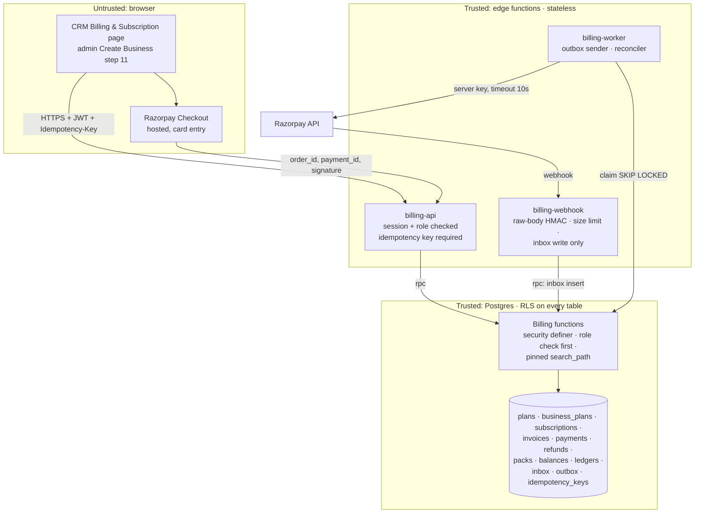

| Boundary | Rule |
|---|---|
| Browser → edge | Signed-in session required. The function re-checks the role in the database (owner for billing, `billing.manage` + MFA for admins). The browser sends **what** it wants (plan change, pack ID), never **how much** it costs. |
| Razorpay → edge | HMAC-SHA256 signature over the **raw** body with the webhook secret, compared in constant time; body limit 500 KB; unknown event types acknowledged and ignored; the function only writes to the inbox, so it answers fast. |
| Edge → Razorpay | Only workers call Razorpay, with the key secret from edge secrets, a 10 s timeout and the per-operation idempotency and recovery rules of §8. |
| Edge → database | Server key used only by workers and the webhook. User requests run as the user, so row security applies. |
| Admin actions | Platform-admin functions with a named permission, MFA, a reason and an audit row. |

---

## 4. Data model

Existing tables are kept and extended; nothing is dropped (`DB` rules: expand, then contract).

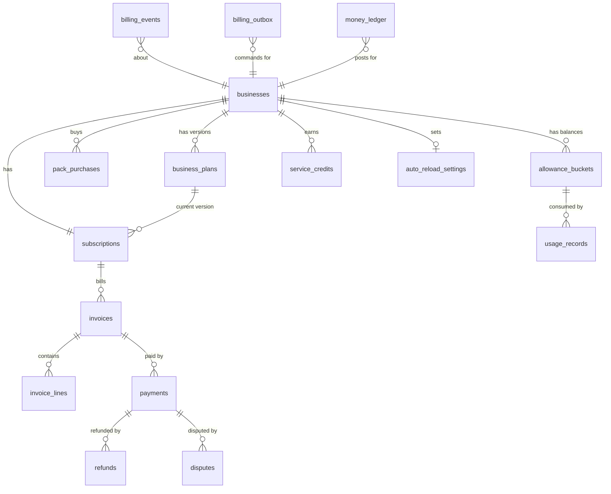

| Table | New or existing | Purpose | Key rules |
|---|---|---|---|
| `business_plans` | new (built, step 2, not applied) | The business's own plan, **versioned**: tier label (Base or Pro), interval, price, setup fee, allowances, languages, caps, trial on/off; every value entered per business, no presets | append a new version per change, never edit; `effective_from`; integer cents |
| `plans` | existing | stays for compatibility; prices move to integer cents (`BIL-7`) | its "anyone can view active plans" policy must not expose per-business prices |
| `subscriptions` | existing | state machine (§7) | one per business (existing unique key); state changes only through functions |
| `invoices`, `invoice_lines` | new | what was charged and why: plan, setup fee, pack, overage, proration, credit, tax | immutable once `issued`; corrections are credit notes |
| `payments` | existing | provider payments; add unique `(provider, external_payment_id)`; amounts in cents | status moves forward only |
| `refunds` | new | requested → approved → sending → processed, failed or uncertain | unique `(provider, external_refund_id)`; **reserved amount** counted while requested, approved, sending or uncertain; sum of reserved and processed ≤ captured; every refund approved by the Zella Voice owner |
| `disputes` | new | chargebacks; suspend while open (`REQ-BIL-37`) | from webhooks only |
| `pack_purchases` | new (built, step 2, not applied) | each pack bought: kind, quantity, price, purchased_at, expires_at (end of the period it was bought in, REQ-BIL-20), rollover_allowed (20% of a minutes pack, 0 for texts and emails), remaining | refundable only if unused and ≤ 14 days |
| `allowance_buckets` | new (built, step 2, not applied) | **current balances** per business and resource: rollover, plan, each pack | one row per bucket; updated in the same transaction as the ledger entry (§11) |
| `billing_periods` | new (built, step 2, not applied) | one row per business per monthly allowance period (yearly plans too, D-46) | every change to a business's balances locks this row, so concurrent usage is serialised |
| `usage_charges` | new (built, step 2, not applied) | every subtraction from, or return to, a balance: quantity, the buckets used, what no balance covered | idempotency key unique (`call:`, `sms:`, `email:`); never edited; serves as the usage key registry until partitioning |
| `billing_pack_catalog` | new (built, step 2, not applied) | the fixed pack prices of §17.3 | platform-owned |
| `usage_records` | existing | append-only usage ledger | idempotency key unique; adjustments, never edits; if partitioned (§11), uniqueness is kept in `usage_keys` |
| `service_credits` | new | outage credits (`REQ-BIL-46`) | capped at one month's fee; applied to next invoices |
| `auto_reload_settings` | new (built, step 2, not applied) | threshold, pack, monthly spend cap, on/off | owner only; changes audited |
| `billing_events` | existing | **webhook inbox**; unique `(provider, external_event_id)` | applied once, in order, never backwards; **never partitioned** (processed events are archived after a retention period, keeping their keys) |
| `provider_accounts` | new | the Razorpay account and environment (live or test) each event and object must match | platform admin only; no secrets stored here |
| `payment_quarantine` | new | events or payments that failed the binding check (§6.0a) or arrived during a secret-compromise window | nothing is granted until a person resolves it; audited |
| `usage_keys` | new, when partitioning | one row per usage idempotency key, **not partitioned** | inserted in the same transaction as the usage entry, so a duplicate is rejected across all months |
| `billing_outbox` | new | **commands to Razorpay** (create order, charge, refund, cancel) | written in the same transaction as the business change (§8) |
| `idempotency_keys` | new | user request keys: unique `(business_id, operation, key)`, request-body hash, stored response | 24 h retention; same key + different body = 409; authorisation re-checked before a stored response is returned |
| `money_ledger` | new | **double-entry** journal: every cent in or out (charge, payment, refund, credit, tax) | each posting balances to zero; the books can be rebuilt from it; each posting has an operation key |
| `ledger_operation_keys` | new, **not partitioned** | one row per ledger operation key (`invoice:`, `payment:`, `refund:`, `credit:` …) | inserted in the same transaction as the postings, so the same operation can never be posted twice in any month |

**Why a double-entry money ledger:** each invoice, payment, refund and credit posts two or more balancing lines,
for example *receivable +$299 / revenue −$299*, then *cash +$299 / receivable −$299*. Any mismatch shows up as a
non-zero balance, which makes reconciliation with Razorpay exact and auditable.

---

## 5. Money rules

| Rule | Detail |
|---|---|
| Amounts | `bigint` cents plus a currency code (`BIL-7`). Never floats. Display in the business's locale. |
| Currency | Customers are charged in USD (`REQ-BIL-28`); Razorpay amounts are in the smallest unit (cents), so no conversion inside our code. **Razorpay settles to Zella Voice in INR** at the exchange rate when the payment is created: each payment stores the USD amount charged and, from the settlement report, the INR amount, rate and fees, so reconciliation (§10) matches both. |
| Rounding | Proration and per-day credits use integer maths, rounding **half up to the cent once, at the line level**; the invoice total is the sum of rounded lines. |
| Proration (upgrade) | `charge = round((new_price − old_price) × remaining_seconds / period_seconds)`; extra allowance for the rest of the cycle is prorated the same way (`REQ-BIL-30`). |
| Service credit | `round(monthly_fee / 30) × affected_days`, capped at `monthly_fee` (`REQ-BIL-46`). |
| Tax | A separate invoice line whose rule is **not built until D-50 is decided**. The design leaves a tax line and a tax ID on the invoice. |
| Prices come from | `business_plans` (plan, setup fee) and a fixed `pack_catalog` (§17.3 prices). Never from the request. |

---

## 6. Flows

### 6.1 Create Business → first payment

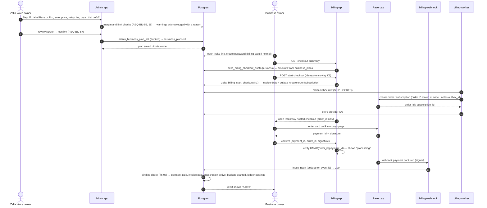

The browser confirmation only shows "processing". **Access is granted only when the verified webhook (or the worker's
fetch from Razorpay) confirms the payment, and the payment passes the binding check below.** A lost browser callback
never loses a payment, and a forged callback never grants anything.

### 6.0a Payment binding (applies to every paid grant)

Before any paid access, allowance, pack or invoice status is granted, one database function checks that the captured
payment belongs to exactly what we expected. **All of these must match a row we created ourselves:**

| Check | Against |
|---|---|
| Provider account and environment (live or test) | the configured Razorpay account; a test-mode event can never grant in live, and the reverse |
| Business | derived from **our own** mapping (the order or subscription we created and stored for that business), never from browser input or provider `notes` alone |
| Order or subscription | an order ID or subscription ID stored by us before checkout |
| Invoice | the open invoice that order was created for |
| Amount and currency | the invoice total in cents, in USD |
| Status | `captured` (a `subscription.activated` event alone is **not** proof that an invoice was paid; for subscriptions the grant needs the captured payment of that invoice, from `subscription.charged` or a server-side fetch) |

Any missing, ambiguous or mismatched field puts the event in **quarantine** (no grant, platform alert, a person
decides). A trial authorisation (§6.2) is a separate, unpaid confirmation and never marks an invoice paid. The grant,
the invoice update and the ledger postings happen in **one transaction**, guarded by unique keys on the provider
payment ID and on the local operation (invoice, pack purchase), so the same money can never be applied twice.

### 6.2 Trial: card at the start, charged at the end (`REQ-BIL-11`, `REQ-BIL-12`)

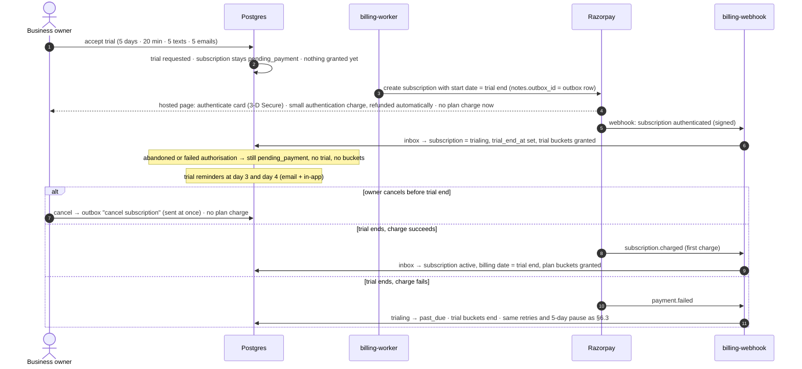

**Trial dates stay aligned.** The subscription is created with Razorpay's start date = creation time + 5 days and a
short authorisation window (the subscription link expires after 24 hours). The local `trial_end_at` is always set to
**Razorpay's stored start date**, never recomputed from the authorisation time, so the trial end and the first charge
are the same moment. If the owner authorises late within the window, the trial is correspondingly shorter (by at most
24 hours) and the trial page shows the exact end date. If the window passes without authorisation, that subscription
expires unused and a new one is created when the owner returns. The exact window behaviour is confirmed in Razorpay
test mode before the trial ships (D-51).

**Razorpay mechanics (§16):** the trial is a subscription with `start_at` = trial end and `expire_by` = the 24-hour
authorisation window. The owner completes an **authentication transaction** (a small amount, ₹5 in Razorpay's docs for rupee plans, the USD amount confirmed in test mode, that is
**charged to the card and then refunded automatically** by Razorpay, so the owner may briefly see it on their
statement; the trial page says so), Razorpay sends `subscription.authenticated`, and the **first plan charge** is made at `start_at`
(`subscription.activated`, then `subscription.charged`). A setup fee passed as the upfront amount (`addons` on create)
is charged **during the authentication**, that is at the start of the trial, and the subscription stays `created` until
it is paid; whether a trial business pays the setup fee at the start or at the end is part of D-54.

Trial abuse guard (D-48, proposed): one trial per business, per phone number and per owner email domain. **No
card-derived identifier is used** (not even a fingerprint), because card details are never collected (`NN-9`). A repeat
is offered a paid plan instead.

### 6.3 Renewal and failed payment (`REQ-BIL-33`)

**Razorpay retries a failed card renewal itself** (§16.3): on the day after the charge day and the two days after
that (T+1, T+2, T+3, matching "days 2, 3 and 4" in `REQ-BIL-33`). Our worker **never** charges a renewal itself; it
only sends the owner our in-app notice and email on each failure event.

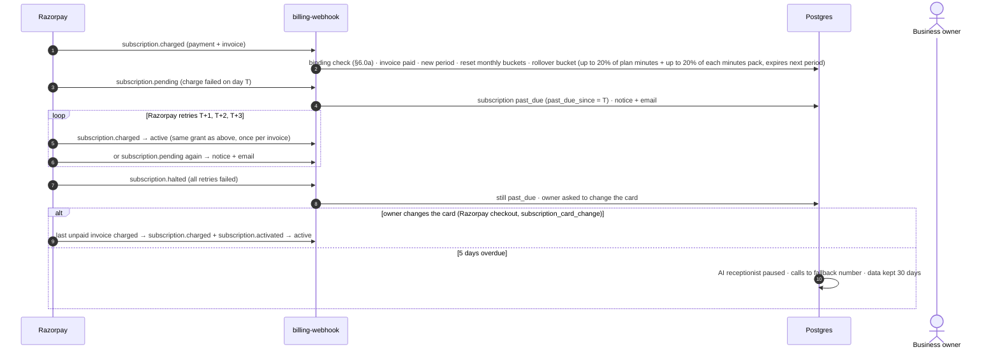

**Watch out (§16.3):** once a subscription is `halted`, Razorpay keeps issuing invoices but charges none of them, and
when it becomes `active` again **older unpaid invoices are not charged** automatically. Changing the card while it is
`pending` charges the last invoice; after `halted`, any older unpaid invoice is charged manually (from the Razorpay
Dashboard; international cards only) or written off by a person, and the ledger records which. Service is restored
only when the invoice for the current period is paid.

### 6.4 Packs and auto-reload, race-free (`REQ-BIL-23`)

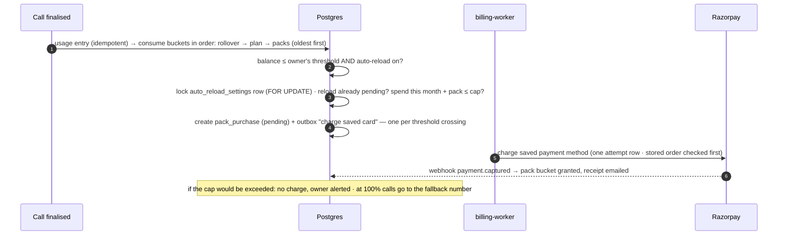

A unique partial index `(business_id) where status = 'pending'` on auto-reload purchases makes a second reload
impossible while one is in flight, however many calls finish at the same moment.

**Blocked on D-54 (§16.3).** "Charge saved payment method" above has no Razorpay route in USD today: subscription
add-ons (charged on the next invoice) are deprecated, and the card-token charge (`POST /v1/payments/create/recurring`)
accepts INR only. Until D-54 is decided, packs are bought **with the owner present**: a Checkout order in USD, card
entered on Razorpay's page with 3-D Secure, granted on `payment.captured` after the binding check (§6.0a). The stored
auto-reload preference stays stored and inactive, as the Billing page already says.

### 6.5 Entitlement check at call time (`REQ-BIL-22`)

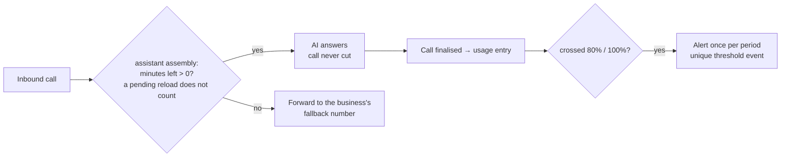

The check reads **one balance row** per business (indexed, no summing), so it costs the same at any scale.

### 6.6 Upgrade and downgrade (`REQ-BIL-30`)

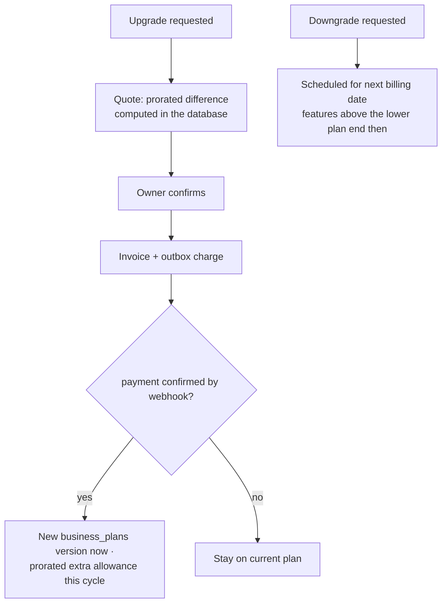

**Razorpay mechanics (§16.4):** a Razorpay plan cannot be edited, so each `business_plans` version that is sold gets
its own Razorpay plan. An upgrade is `PATCH /v1/subscriptions/:id` with the new `plan_id` and
`schedule_change_at: now`: **Razorpay works out the prorated difference by day and charges it itself**; if that charge
fails the subscription is not updated. `subscription.updated` plus the captured payment confirm it (binding check,
§6.0a), and only then is the new version applied. Our quote must use Razorpay's day-based method so the owner sees the
amount that is really charged; this is proven in test mode. A downgrade uses `schedule_change_at: cycle_end`, so no
credit note or refund is created. Limits: only `authenticated` or `active` subscriptions can be updated (not
`pending` or `halted`), the difference must be at least 50 cents, and **plan changes work only for subscriptions on
international cards** (on Indian cards only the offer can change), which fits our US customers.

### 6.7 Refund request with server-side eligibility (`REQ-BIL-38`…`45`)

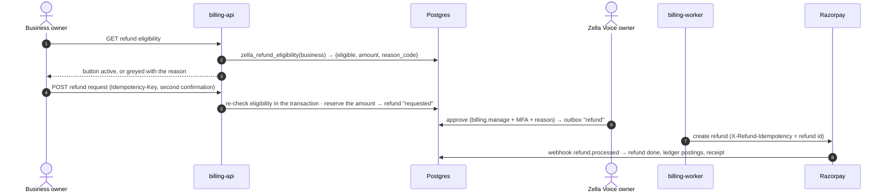

Eligibility is computed again at approval and at sending: a stale screen can never cause a refund that the policy no
longer allows. **Refundable amounts are reserved** when a refund is requested: requested, approved, sending and
uncertain refunds all count against the payment, so concurrent requests can never refund more than was captured.

### 6.9 Pay as you go (D-44), billed after the month ends

When the owner chose pay as you go (D-44), minutes past the allowance are counted at the business's own rate, up to
the monthly spending limit. After the period closes (and its late-usage window has passed), one invoice is made for
those minutes. **How it is collected is D-54**, because Razorpay has no USD off-session charge for a variable amount
(§16.3). The options:

| Option | How | Trade-off |
|---|---|---|
| A · Payment link (recommended until Razorpay offers more) | a USD Razorpay Payment Link or a Checkout order in the Billing page; unpaid after 5 days follows the overdue rules of §6.3 | owner must pay by hand each month; the spending limit caps what can go unpaid |
| B · Prepaid only | no pay as you go; the owner buys packs (with the owner present) instead | no unpaid risk; less convenient |
| C · Ask Razorpay | ask whether add-ons or USD card-token charges can be enabled on the Zella Voice account | automatic if granted; depends on Razorpay |

The pay-as-you-go rate field and the owner's choice are stored already (step 2); nothing is billed until D-54 is decided
and payments are switched on.

### 6.8 Disputes (chargebacks)

`payment.dispute.created` → dispute row, account suspended while open (`REQ-BIL-37`), owner alerted.
`payment.dispute.won` → that dispute is closed; the account is restored **only when no other dispute on the subscription is still open** (§7). `payment.dispute.lost` → ledger postings for the loss; the account stays suspended until settled.
`payment.dispute.action_required` and `payment.dispute.under_review` alert a platform admin (evidence is submitted with
Razorpay's contest API or Dashboard); `payment.dispute.closed` is recorded.

---

## 7. State machines

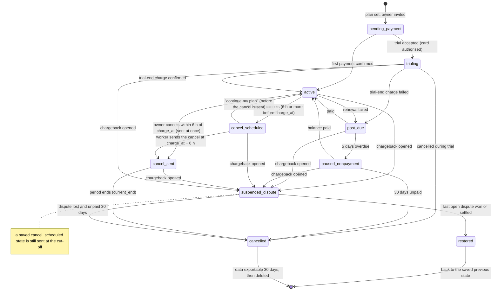

Transitions are allowed only by a table of `(from, to, cause)` checked in one database function. An event that would
move a subscription backwards (an older event arriving late) is recorded and ignored.

**Disputes from any state.** A chargeback can arrive in any state except `cancelled`. The subscription moves to
`suspended_dispute`, and the state it came from is saved **on the subscription** (not on each dispute) when the first
dispute opens.
- **Several disputes:** open disputes are tracked in `disputes`; the subscription stays suspended until **every** one
  is won, settled or lost. A second dispute never overwrites the saved state.
- **Events while suspended:** payment and lifecycle events still apply to the **saved state**, which keeps moving as
  normal; only service stays suspended. For example, a `past_due` subscription whose balance is paid during the dispute
  has its saved state moved to `active`, so it is restored as `active` with no retries or pause; a `cancel_scheduled`
  one passes the cut-off to `cancel_sent` as normal, and a `cancel_sent` one whose period ended moves its saved state to
  `cancelled`.
- **Restore:** when the last dispute closes in the business's favour, the subscription takes the saved state as it is
  then. A lost dispute follows the `dispute lost` path in the diagram.
- A dispute on a `cancelled` subscription is recorded and handled by money only (ledger postings), with no state change.

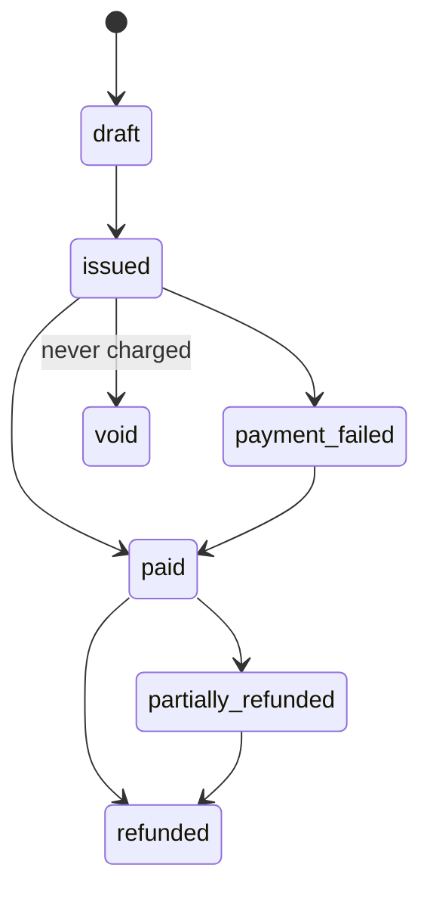

---

## 8. Idempotency and safe retries

Four layers that work **together**; no single layer is relied on alone. Each money operation also has its own
idempotency and recovery rule (table below).

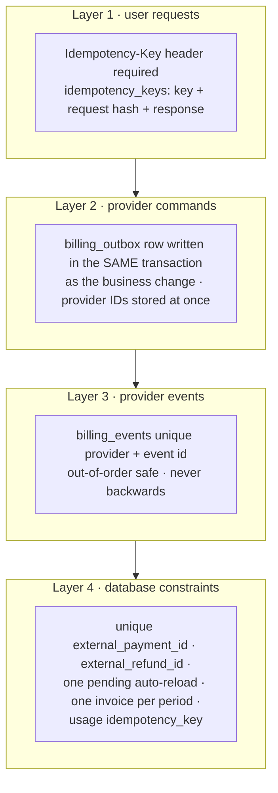

| Situation | What happens |
|---|---|
| Owner double-clicks "Buy pack" | Same `Idempotency-Key` → the stored response is returned; one purchase. Keys are scoped to **(business, operation, key)**, stored with a hash of the request body, and the caller's authorisation is **checked again** before a stored response is returned. |
| Same key, different body | `409 idempotency_key_reused`. |
| Worker crashes after Razorpay accepted the charge but before saving | The outbox row is still `sending`. Our order ID is **stored before the charge call**, so the reconciler fetches that order's payments from Razorpay before any retry and records the real outcome. A receipt is only a label, never relied on as a lookup or a guarantee. Never blind-retry a charge; an outcome that stays uncertain is held and alerted. |
| Worker loses the reply to **create subscription** | Razorpay subscriptions have no receipt lookup. Each create carries `notes.outbox_id`; the reconciler lists the subscriptions created since the attempt (by time window and customer) and matches that note. Found → record it. Not found after the window → a retry is allowed, because an unauthenticated subscription charges nothing; any duplicate found later that was never authenticated is cancelled. **This lookup must be proven in Razorpay test mode before the trial path ships** (D-51); if it cannot be, the trial path waits for another recovery method. |
| Razorpay sends a webhook twice | Razorpay delivers at least once. The event ID (`x-razorpay-event-id` header) is a **delivery de-duplication aid** (it is a header, not part of the signed body), not a replay guarantee. The real protection is semantic: unique keys on the provider payment, refund and dispute IDs and on the local operation, so a repeated event has no second effect. |
| Webhooks arrive out of order | Each event carries the provider's creation time; state only moves forward (§7). An event for an unknown payment is kept and applied when its parent arrives. |
| Our webhook handler times out | Razorpay waits **5 seconds**, then retries with back-off for **24 hours**; after 24 hours of failures it **disables the webhook** and emails the alert address. The handler only inserts, so it answers in milliseconds; a disabled webhook is a platform alert, and the reconciler (§10) fetches what was missed. |
| Two calls cross the threshold at once | The auto-reload row lock and the unique pending index allow one reload. |

**Per-operation rules:**

| Operation | Idempotency | Recovery when the reply is lost |
|---|---|---|
| Create order (checkout, pack, upgrade) | one order per local operation; order ID stored at once | an unpaid order charges nothing: mark it unused and create a new one |
| Renewal and its retries | done by Razorpay, never by us (§6.3) | fetch the subscription's invoices (`GET /v1/invoices?subscription_id=`) and their payments |
| Charge a saved card later (auto-reload, pay as you go) | blocked on D-54 (§16.3) | not built until a route exists |
| Upgrade (update subscription) | one pending update per subscription (Razorpay refuses a second) | fetch the subscription and its pending update (`GET /v1/subscriptions/:id/retrieve_scheduled_changes`) |
| Create subscription | `notes.outbox_id` | §8 table above; proven in test mode before shipping |
| Refund | Razorpay's refund idempotency header (`X-Refund-Idempotency`) set to our refund ID | resend with the same key, or fetch the payment's refunds |
| Cancel subscription | naturally idempotent; sent only when it must take effect (§16.2) | fetch the subscription and record its state |

Each flow is enabled only after its provider behaviour is proven in Razorpay test mode (D-51).

**Outbox sending protocol:** claim with `FOR UPDATE SKIP LOCKED` → mark `sending` with a lease → call Razorpay → store the
provider ID at once → mark `sent`. A lease that expires sends the row to **reconcile**, not to retry.

---

## 9. Security

| Area | Control |
|---|---|
| Card data | Razorpay hosted checkout only. No card fields in our pages, logs, analytics or support tools (`NN-9`). |
| Webhook authenticity | HMAC-SHA256 of the **raw** body (never parsed and re-serialised) with the webhook secret (`X-Razorpay-Signature`), constant-time compare; reject on any mismatch. Retries of events sent before a secret change are signed with the **old** secret, hence the overlap. The event ID only de-duplicates deliveries (it is not part of the signed body); replays have no effect because of unique keys on provider object IDs and local operations (§8). |
| Checkout callback | Verify `HMAC(order_id + "|" + payment_id)` with the key secret, but treat it as a hint only; the webhook or a server-side fetch grants access (§6.1). |
| Amount tampering | The browser never sends an amount. Every amount is computed in the database from `business_plans` and the pack catalog. |
| Authorization | Business billing: **owner role only** (`TEN-9`), checked in the database. Admin billing: `billing.view` / `billing.manage`, MFA, audit. Row security on every billing table; server-only tables have no client policies. |
| Sensitive actions | Refunds, credits, plan overrides, trial extensions: reason, second confirmation, audit (`SEC-18`). **Every provider refund needs the Zella Voice owner's approval** (REQ-BIL-45); there is no automatic or threshold-based refund. |
| Secrets | Razorpay key secret and webhook secret only in edge function secrets; never in tables, code, logs or chat (`NN-2`). Routine rotation: the old and new webhook secrets overlap for a short, planned window. **Suspected compromise is different:** the old secret is revoked at once with no overlap; events received during the exposure window are quarantined and each is re-checked against Razorpay's API (fetch the payment, refund or subscription) before anything is applied. |
| Data minimisation | Store only provider IDs, status and amounts. **No card details of any kind**, not even the last 4 digits or the card brand; the owner manages the card on Razorpay's own page. |
| Rate limits | Checkout start, pack purchase and refund request: per user and per business limits; 429 with retry-after. |
| Fraud | Trial guard (D-48); velocity checks on pack purchases; spend cap on auto-reload; alerts on unusual refund or dispute rates. |
| Logging | Structured logs with business ID and correlation ID; no personal data, no tokens, no full provider payloads. |
| Availability attacks | Webhook body limit 500 KB; JSON bodies limited (`SEC-12`); timeouts on every outbound call (`BE-3`). |

---

## 10. Reconciliation and audit

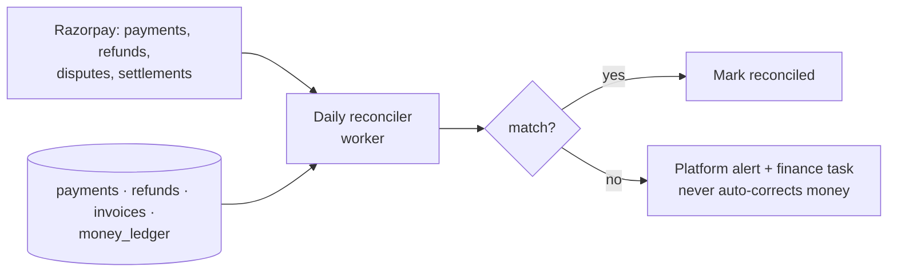

- **Daily:** every Razorpay payment, refund and dispute of the last 7 days is matched to our rows by provider ID and
  amount. A mismatch raises an alert; a person decides.
- **Ledger check:** the money ledger balances to zero overall and per invoice.
- **Usage check:** allowance balances equal the sum of their ledger entries (rebuilt nightly in a read-only check).
- **Audit:** every admin billing action is in the audit log with who, when, why and before/after values.

---

## 11. Scalable architecture: 1 to 10,000 people

The same design serves one owner or 10,000 people at once because every request is stateless, every tenant query is
indexed by `business_id`, hot counters live in one row per business, and slow work goes through queues.

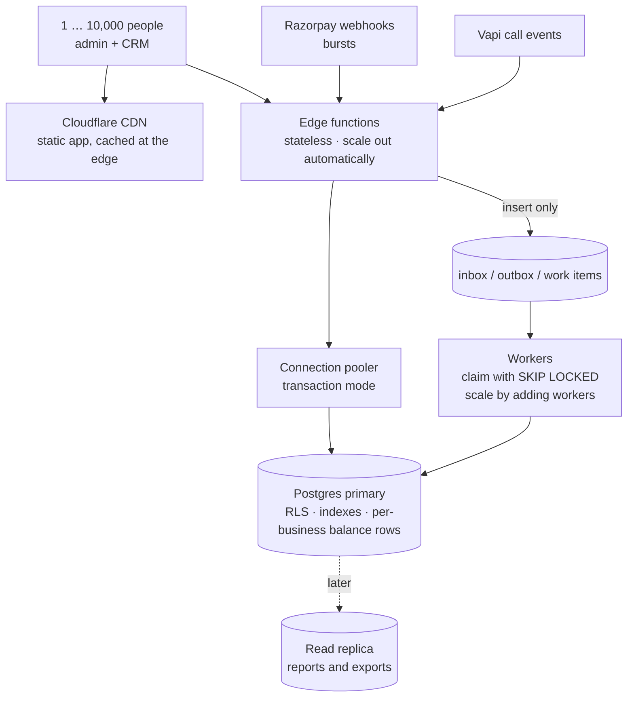

| Concern | Design | Why it scales |
|---|---|---|
| Web app | Static build on Cloudflare's CDN | Pages are served from the edge; no server per user. |
| API | Edge functions are stateless | More traffic → more instances; no session state to share. |
| Database connections | Pooler in transaction mode | Thousands of requests share a small pool of connections. |
| Tenant queries | Every billing and CRM table indexed on `business_id` (plus time) | Each query touches one business's rows, whatever the total size. |
| Hot path at call time | `allowance_buckets`: one balance row per business and resource, updated with the ledger in one transaction | O(1) reads; locks are per business, so businesses never wait for each other. |
| Webhook bursts | Handler only inserts into the inbox; workers apply | Thousands of events a minute are absorbed; processing catches up safely. |
| Background work | Queues with `FOR UPDATE SKIP LOCKED`, leases and back-off | Add workers to go faster; no double processing. |
| Large tables | `usage_records` and `money_ledger` partitioned by month when they pass ~10 M rows. PostgreSQL enforces uniqueness only within a partition, so each gets a small non-partitioned key registry written in the same transaction: `usage_keys` for usage entries, and `ledger_operation_keys` for money-ledger postings (every posting carries an operation key such as `invoice:<id>`, `payment:<id>`, `refund:<id>` or `credit:<id>`, including postings that have no provider ID, like service credits). The webhook inbox `billing_events` is not partitioned. | Old months stay cold; indexes stay small; duplicates are still rejected across months. |
| Reports and exports | Run against a read replica when load requires | Heavy reads never slow down calls or payments. |
| Realtime screens | Subscriptions filtered by row security, only on the pages that need them | No broadcast of other businesses' data, bounded fan-out. |
| Limits | Per-user and per-business rate limits on write endpoints | One noisy business cannot starve others. |

**Capacity plan (to verify with load tests before launch, §13):**

| Stage | People at once | What is needed |
|---|---|---|
| Pilot | 1–50 | Current setup. |
| Launch | 50–1,000 | Pooler on; indexes checked with `EXPLAIN`; workers outside n8n for billing jobs. |
| Growth | 1,000–10,000 | Larger database compute; read replica for reports; partitioned ledgers; more workers; alerting on queue age and p95 latency. |

**One known bottleneck today:** n8n Cloud Starter allows about 2,500 runs a month (`docs/MEMORY.md`). Billing jobs
(outbox sender, renewals, dunning, reconciliation) must therefore run as database-claimed workers in edge functions,
not as n8n runs. n8n stays for messaging workflows, or moves to a larger plan before scale.

**Targets (SLOs, proposed):** checkout start p95 < 500 ms; webhook acknowledgement p95 < 200 ms; entitlement check
p95 < 20 ms; outbox queue age < 60 s; zero unreconciled payments older than 24 h.

---

## 12. Failure modes

| Failure | Effect | Handling |
|---|---|---|
| Razorpay down | Checkout and charges unavailable | Outbox waits with back-off; owners see "payment provider unavailable, we'll retry"; existing access unaffected. |
| Webhook delayed for hours | Payment shown as "processing" | After 15 min the reconciler fetches the payments of the order ID we stored, applies them through the binding check (§6.0a), and alerts if still unclear. |
| Our database down | Nothing can be granted | Razorpay retries webhooks for up to its retry window; inbox applies them when back. |
| Duplicate charge by the provider | Customer charged twice | Daily reconciliation finds it; full refund within 5–10 business days (`REQ-BIL-43`). |
| Worker crash mid-send | Unknown outcome | Lease expiry → reconcile with the per-operation lookup (stored order or subscription ID, refund idempotency key), never blind retry; held and alerted if still unclear (§8). |
| Clock skew | Wrong period boundaries | All periods computed in the database clock, stored in UTC. |
| Secret leaked | Forged webhooks possible | Incident: revoke the old secret immediately (no overlap), set a new one, quarantine events from the exposure window and apply only those confirmed by fetching the object from Razorpay; rotate the API key too if it may be exposed; review grants made in the window. |

---

## 13. Testing

| Level | What is proven | Where |
|---|---|---|
| Unit | proration, rounding, eligibility rules, signature checks, event mapping | Deno tests, Node tests |
| Database | state machine, uniqueness, ledger balance, row security per role, cross-tenant isolation | isolated test database only |
| Idempotency drills | double click, duplicate webhooks, out-of-order webhooks, crash after send, concurrent threshold crossing, concurrent refund requests that would exceed the captured amount | isolated database + mocked provider |
| Binding and abuse | wrong amount, wrong currency, wrong business mapping, test-mode event in live, `subscription.activated` without a captured payment, forged webhook with a leaked secret: each is quarantined, nothing granted | isolated database + mocked provider |
| Provider sandbox | real Razorpay **test mode**: checkout, trial, renewal, failure, refund, dispute | staging, test keys only |
| Load | 10,000 virtual users on CRM reads; 1,000 webhooks/min burst; 500 concurrent call finalisations | staging, synthetic data |
| Reconciliation | seeded mismatches are detected and alerted, never auto-corrected | isolated database |

No real card, real charge or real customer data is used in any test.

---

## 14. Rollout and gates

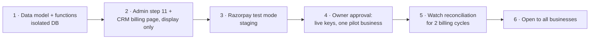

Each step: its own pull request reviewed by CodeRabbit, tests green, the owner's approval for anything that touches
production or real money (`NN-3`, `NN-4`).

---

## 15. Open points

| # | Point | Needed for |
|---|---|---|
| D-51 | Razorpay: recurring USD on international cards is supported per Razorpay's docs (first payment authenticated with 3-D Secure; settled in INR). Still to confirm on the account: international payments activated, the Subscriptions feature on in test and live, cards enabled in Subscriptions settings; then the test-mode proofs in §16.8 | step 3 |
| D-54 | **Variable charges in USD** (auto-reload packs, pay as you go, possibly the trial's setup fee): Razorpay offers no off-session USD charge for a variable amount (§16.3). Choose A payment link, B prepaid packs only, or C ask Razorpay to enable add-ons or USD card-token charges (§6.9) | before auto-reload or pay as you go |
| D-50 | Tax rules (GST on exported services; US state sales tax) | invoices with tax |
| D-45…D-48 | fair-use multiple, annual allowances, founding customers, trial limits | step 1 |
| — | Event names, endpoints and limits: **checked 13 Nov 2026** (§16); check again at build time, as Razorpay changes its docs | step 3 |

---

## 16. Razorpay integration reference

Checked against Razorpay's documentation on **13 Nov 2026** (pages listed in §16.9). Nothing here was tested against
Razorpay yet: every row marked *prove* is confirmed in **test mode** before its flow ships (D-51). Amounts are in cents
(`USD`, exponent 2); Razorpay settles to Zella Voice in INR at the exchange rate when the payment is created.

### 16.1 Which Razorpay product does what

| Need | Razorpay product | Notes |
|---|---|---|
| Monthly or yearly plan charge | **Subscriptions** (a Plan + a Subscription) | Razorpay charges each cycle, retries failures, sends `subscription.*` events |
| Setup fee | Subscription **upfront amount** (`addons` on create) | charged with the authentication transaction |
| Trial | Subscription with a future `start_at` | card authenticated now, first charge at `start_at` |
| Upgrade or downgrade | **Update subscription** | Razorpay charges the prorated difference itself (§6.6) |
| Pack bought by the owner | **Orders** + Standard Checkout | owner present; card on Razorpay's page |
| Pay as you go, auto-reload | none in USD today | D-54 (§6.9) |
| Refunds | **Refunds** API | idempotency header supported |
| Chargebacks | **Disputes** | events + accept/contest |

### 16.2 API calls we make (server side only, Basic auth with the key ID and key secret from edge secrets)

| Call | Endpoint | Key fields | Our rule |
|---|---|---|---|
| Create plan | `POST /v1/plans` | `period` (`monthly`, `yearly`), `interval` 1, `item.name`, `item.amount`, `item.currency: USD`, `notes` | one per sold `business_plans` version; plans **cannot be edited or deleted** |
| Create subscription | `POST /v1/subscriptions` | `plan_id`, `total_count` (required; up to the 100-year limit), `start_at` (trial), `expire_by` (authorisation window), `addons` (setup fee), `customer_notify`, `notes.outbox_id` and `notes.business_id` (labels only, never trusted for binding) | §8 recovery by listing and matching `notes.outbox_id` (*prove*) |
| Fetch subscription | `GET /v1/subscriptions/:id` | `status`, `current_start`, `current_end`, `charge_at`, `paid_count`, `auth_attempts` | reconciler |
| Subscription invoices | `GET /v1/invoices?subscription_id=:id` | invoice `status`, `payment_id`, amounts | renewal recovery and reconciliation |
| Update subscription | `PATCH /v1/subscriptions/:id` | `plan_id`, `schedule_change_at` (`now` / `cycle_end`), `customer_notify` | upgrade `now`, downgrade `cycle_end` (§6.6) |
| Pending update | `GET /v1/subscriptions/:id/retrieve_scheduled_changes`; cancel: `POST /v1/subscriptions/:id/cancel_scheduled_changes` | | owner withdraws a scheduled downgrade |
| Cancel subscription | `POST /v1/subscriptions/:id/cancel` with `cancel_at_cycle_end: false` | | **A cancellation stays local until it must take effect**, because a Razorpay cancellation cannot be undone and a cancelled subscription cannot restart. **Cut-off = `charge_at` − 6 hours.** Before the cut-off the owner's cancel sets `cancel_scheduled` only, and "continue my plan" clears it (nothing was sent). At the cut-off the worker locks the subscription row (`FOR UPDATE`), re-reads it, and only if the cancel intent is still there (state `cancel_scheduled`, **or** `suspended_dispute` with saved state `cancel_scheduled`) moves it (or the saved state, leaving the dispute suspension as it is) to `cancel_sent` in the same transaction as the outbox row, then sends; a subscription without that intent is never sent; "continue my plan" takes the same lock and is refused once the state is `cancel_sent` ("your plan ends on <date>; you can start a new plan then"). **A cancel made after the cut-off** is `cancel_sent` at once and sent immediately. Either way the worker fetches the subscription to confirm `cancelled`; **if Razorpay still charges the renewal** (a late cancel, or a send that failed), a **full refund of that payment is raised automatically as a refund request** and sent only after the Zella Voice owner approves it (`billing.manage` + MFA + reason, `REQ-BIL-45`, §6.7); no new period is granted, and a platform alert fires. *Prove* in test mode how close to `charge_at` a cancel still stops the charge, and test continue before, during and after the send |
| Pause / resume | `POST /v1/subscriptions/:id/pause` · `/resume` | | **not used**: our non-payment pause is our own service pause (D-25 has no owner pause) |
| Create order (pack) | `POST /v1/orders` | `amount`, `currency: USD`, `receipt` = our purchase ID, `notes` | order ID stored before checkout opens |
| Payments of an order | `GET /v1/orders/:id/payments` | `status`, `amount`, `currency` | recovery after a lost reply |
| Refund | `POST /v1/payments/:id/refund` | `amount` (partial allowed, never above what is left), `speed: normal`, `receipt`, `notes`; header `X-Refund-Idempotency` = our refund ID (10+ characters; same body on retry, or `400`/`409`) | §6.7 |
| Refunds of a payment | `GET /v1/payments/:id/refunds` | | recovery and reconciliation |
| Disputes | `GET /v1/disputes/:id`, `POST /v1/disputes/:id/accept`, `PATCH /v1/disputes/:id/contest` | `amount`, `phase`, `status`, `respond_by` | a person decides, with `billing.manage` |

### 16.3 What Razorpay's documentation changed in this design

| Finding (source page) | Impact | Change |
|---|---|---|
| Card renewals that fail are **retried by Razorpay** on T+1, T+2 and T+3, then the subscription is `halted` (Payment Retries) | our own retries would charge twice | §6.3: the worker never charges renewals |
| After `halted`, invoices are issued but not charged; back to `active`, **older unpaid invoices are not charged** (Subscription States) | money can be left unpaid | §6.3: card change, manual charge or written off by a person |
| **Subscription add-ons are deprecated** (Subscriptions FAQ; no add-on endpoint in the API index) | no way to add a variable amount to the next invoice | auto-reload and pay as you go wait for D-54 |
| The card-token charge `POST /v1/payments/create/recurring` takes **INR only** (Create Subsequent Payments) | no off-session USD charge for packs or overage | same; charging US cards in INR is not proposed (`REQ-BIL-28` says USD) |
| Plan changes on a subscription work for **international cards only**; Razorpay prorates by day and charges the difference itself (Update Subscription) | upgrades can be immediate and paid | §6.6 |
| A trial is a future `start_at`; a setup fee as upfront amount is charged at authentication (Create Subscriptions) | setup fee would be paid at trial start | D-54 asks when a trial business pays it |
| Webhooks: answer within **5 s**; retried with back-off for **24 h**, then the webhook is **disabled**; at-least-once; **order not guaranteed** (Webhook best practices, Validate and Test) | missed events possible | §8 alert + reconciler |
| India's card-mandate rules (pre-debit notice, extra authentication above ₹15,000) **do not apply to international cards** (Subscriptions FAQ) | US renewals are charged on the day | none |
| Subscriptions accept USD only with **international payments enabled** on the account, cards only (Subscriptions FAQ, International Payments FAQ) | account step | §16.7 |

### 16.4 Signatures

| What | How |
|---|---|
| Webhook | `X-Razorpay-Signature` = HMAC-SHA256(**raw body**, webhook secret), hex; constant-time compare |
| Checkout result for a subscription | HMAC-SHA256(`razorpay_payment_id` + `\|` + **our stored** `subscription_id`, key secret) = `razorpay_signature` (never use the subscription ID the browser sends back) |
| Checkout result for an order (pack) | HMAC-SHA256(**our stored** `order_id` + `\|` + `razorpay_payment_id`, key secret) |
| De-duplication | `x-razorpay-event-id` header, unique per event |

A valid browser signature only shows "processing" (§6.1); access is granted by the verified webhook or a server fetch.

### 16.5 Webhook events we subscribe to

| Event | We do |
|---|---|
| `subscription.authenticated` | trial starts (§6.2); no invoice marked paid |
| `subscription.activated` | state only; the grant needs the captured payment |
| `subscription.charged` | binding check (§6.0a) → invoice paid, new period, buckets (§6.3) |
| `subscription.pending` | `past_due`, notice + email |
| `subscription.halted` | still `past_due`, ask for a card change; pause at 5 days |
| `subscription.updated` | apply the upgrade or scheduled change after the payment is confirmed (§6.6) |
| `subscription.cancelled` | record that Razorpay confirmed the cancel. A paid subscription stays `cancel_sent` (or, while disputed, keeps that saved state) and **paid service continues until `current_end`**, then `cancelled` (§7). A trial already moved `trialing → cancelled` is left as it is: the event only records Razorpay's result |
| `subscription.completed` | close the subscription at `current_end` |
| `payment.captured`, `payment.failed`, `order.paid` | packs and other orders (§6.4); failure notice |
| `refund.created`, `refund.processed`, `refund.failed` | §6.7 |
| `payment.dispute.created`, `.won`, `.lost`, `.closed`, `.under_review`, `.action_required` | §6.8 |

`subscription.paused` and `subscription.resumed` are recorded only (we do not pause in Razorpay). Unknown events are
acknowledged and ignored. Payloads carry `payload.subscription.entity` and, for charges, `payload.payment.entity` with
`invoice_id`; the exact shapes are checked against real test-mode events before mapping (*prove*).

### 16.6 Settings we choose

| Setting | Value | Why |
|---|---|---|
| `customer_notify` | `true` (proposed) | Razorpay emails the failed-payment notice with its card-change link; our in-app notice and the pause warning are ours. *Prove* that the emails show the Zella Voice name |
| Payment methods for Subscriptions | cards only | UPI and eMandate are INR only |
| Webhook alert email | a monitored Zella Voice address | Razorpay emails it when a webhook is disabled |
| Separate test and live webhooks | yes, test → staging, live → production | a test event can never grant in live (§6.0a) |

### 16.7 The owner's account checklist (needs the owner; nothing here is done by Claude)

1. Razorpay account KYC complete; **international payments** activated (application with purpose code; Razorpay and
   its banking partner approve). Ask Razorpay at the same time about D-54 (add-ons or USD card-token charges).
2. **Subscriptions** feature enabled in **test and live** modes; in Subscriptions settings, **cards** on.
3. Test-mode API keys made in the Dashboard and saved as edge function secrets on **staging only** by the owner
   (never pasted in chat, code or docs, `NN-2`).
4. Test-mode webhook pointing at the staging `billing-webhook` URL, with its own secret, the events in §16.5 and the
   alert email (test mode asks for OTP `754081` when saving).
5. After the test-mode proofs (§16.8) and the owner's approval: live keys, live webhook, one pilot business (§14).

### 16.8 Test-mode proofs before each flow ships

| Flow | Prove in Razorpay test mode |
|---|---|
| First payment | USD subscription on an international test card with 3-D Secure; `subscription.charged` carries the payment and invoice; binding check passes |
| Trial | future `start_at`; authentication amount in USD charged and refunded; `expire_by` window behaviour; first charge at `start_at` |
| Cancel | a cancel sent 6 hours before `charge_at` stops that charge; how close to `charge_at` a cancel still stops it; a renewal charged after a cancel raises a refund request for approval; "continue my plan" before, during and after the send (refused once sent) |
| Lost create reply | listing subscriptions finds the one with our `notes.outbox_id` (§8) |
| Failed renewal | test card failure → `pending` on T, retries T+1..T+3 → `halted`; card change charges the last invoice |
| Upgrade | `schedule_change_at: now` charges Razorpay's prorated amount; our quote matches it |
| Pack | order in USD captured; `payment.captured` grant; double click makes one purchase |
| Refund | partial refund with `X-Refund-Idempotency`; resend returns the same refund |
| Webhooks | forged signature rejected; duplicate and out-of-order events have no second effect |

### 16.9 Pages read (Razorpay documentation, 13 Nov 2026)

Subscriptions: create a plan, create / update / cancel a subscription, subscription states, payment retries, update
subscription, create subscriptions (trial and upfront amount), integration guide (signature), Subscriptions FAQ,
subscription webhook events. Webhooks: overview, best practices, validate and test. Payments: payment webhook events,
orders. Recurring payments (cards): integrate, create authorisation transaction, create subsequent payments, FAQ.
Refunds: create a normal refund, idempotent refunds, refund webhook events. Disputes: dispute webhook events.
International payments: overview and FAQ. All under `razorpay.com/docs`.
